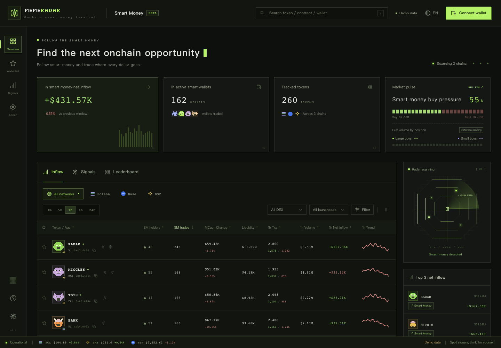
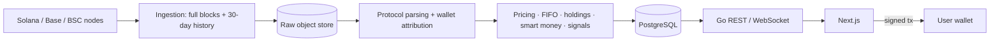

# Meme Radar

**English** | [简体中文](README.zh-CN.md)

A multi-chain meme-token smart-money tracker. It runs its own on-chain indexer for Solana, Base, and BSC and provides smart-money inflows, signals, a leaderboard, token and wallet analytics, wallet tracking, and quick trading.

**Status (2026-10-19):** design docs finalized; backend skeleton and migrations `00001`–`00008` landed; the M1 API contract `api/openapi.yaml` is frozen; **the M1 frontend is done** (pixel-terminal style, currently served by the built-in mock API); backend ingestion/parsing/derivation/API are pending per the [M1 task cards](docs/engineering/16-m1-agent-tasks.md). Doc index: [docs/README.md](docs/README.md) (Chinese is the source of truth).



## Features and milestones

| Milestone | Delivery |
| --- | --- |
| M0 | RPC validation for all three chains: full-block and 30-day history (D73) availability, request volume, cost |
| M1 | Ingestion and parsing on three chains; **Inflow** list; **Token detail** (chart, activity, holders, pools); admin console (smart-money import, run quality); Chinese/English UI switch |
| M2 | **Leaderboard** (7d/30d); **Wallet analysis** (assets, PnL, win rate); automatic smart-money detection |
| M3 | **Signals**; address labels (dev, sniper, bundler, insider, whale, KOL); token info card, dev tokens |
| M4 | Wallet sign-in; **follow / track / collections**, alerts; WebSocket push |
| M5 | **Quick trade** (non-custodial, signed in the user's wallet) |

After M5: limit orders, copy trading/bots, security checks, holder bubble map, AI insights. See [milestones](docs/engineering/11-milestones.md) and the [decision log](docs/DECISIONS.md).

## Initial coverage

| Chain | Protocols |
| --- | --- |
| Solana | Pump.fun, PumpSwap, Raydium LaunchLab and graduated pools, Jupiter route detection |
| Base | Clanker, Uniswap v4 |
| BSC | Four.meme, PancakeSwap |

## Key definitions

- Amounts are aggregated per token and shown in USD, switchable to the native coin (SOL/ETH/BNB).
- Price comes from the latest trade in the main pool (highest 1h average liquidity); curve graduation switches pools immediately.
- PnL uses FIFO. Unknown cost is never treated as zero; such tokens are excluded from win rate and rankings.
- Smart money = admin-imported list + automatic detection based on 30-day PnL and win rate.
- Missing data is shown as "--", never as 0.

Full definitions: [docs index](docs/README.md) (metrics section).

## Architecture



| Layer | Technology |
| --- | --- |
| Backend | Go (net/http, slog, database/sql, pgx, goose) |
| Frontend | Next.js App Router, TypeScript |
| Database | PostgreSQL 17 (BYTEA addresses/hashes; facts partitioned by chain) |
| Charts | TradingView Lightweight Charts |

## Layout

```text
meme-radar/
├── README.md / README.zh-CN.md
├── Makefile
├── docker-compose.yml
├── api/openapi.yaml
├── docs/                  # start at docs/README.md
├── backend/migrations/    # authoritative goose DDL
├── backend/cmd/radar/
├── frontend/
└── scripts/               # demo sample fetch/decode
```

## Development

| Command | Purpose |
| --- | --- |
| `docker compose up -d postgres` | Local DB on port 5433 |
| `make setup` | Install deps and pre-commit hook |
| `make check` | Backend + frontend checks (includes backend smoke) |
| `make -C backend run` | Start API (runs migrations) |
| `npm --prefix frontend run dev` | Start frontend |
| `make smoke` | Smoke tests |

See [backend](backend/AGENTS.md) and [frontend](frontend/AGENTS.md) conventions. Reading order: [docs/README.md](docs/README.md).

## Constraints

- Real API keys live only in backend secret configuration, never in chat, the repository, or the frontend.
- Signing up for or purchasing data services requires explicit approval; validation budget is USD 100/month (pause forward at cap, D104).
- Trading is non-custodial: the server never stores private keys or signs on the user's behalf.
- No third-party private APIs or brand assets are used.

License and public URL are to be decided.
