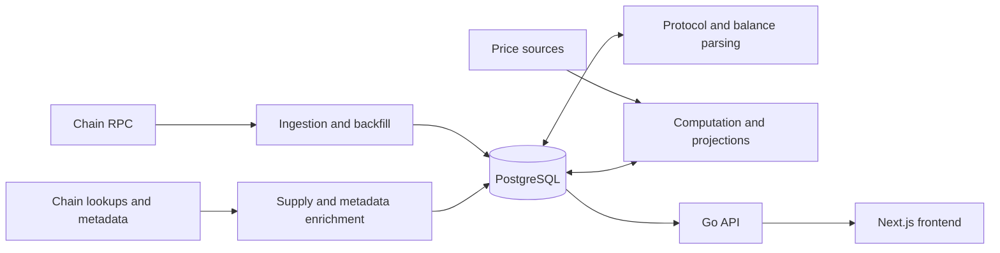

# Meme Radar

**English** | [简体中文](README.zh-CN.md)

An on-chain token and smart-money terminal for Solana, Base and BSC. It collects raw blocks, parses trades and balance changes, derives market data, candles, holdings and inflow projections in PostgreSQL, and serves a Next.js frontend through a Go API.

The current scope is **M1: inflow, token details and administration**. Signals, leaderboards, wallet analytics, wallet login and quick trading belong to later milestones; navigation entries do not imply that those features are implemented.

## Current status

As of 2026-10-25, the PostgreSQL API, list versioning, inflow projections, holdings replay, metadata fetching and operational health/decode retries are connected. The deployed frontend uses the real API, and the mock backend has been stopped.

Deployment acceptance remains incomplete: list queries can time out, derived data can lag, historical holdings are still being replayed, and some external metadata sources are unavailable. A running service and a successful `/healthz` establish process/database readiness; data completeness and freshness require separate verification.

| Connected capability | Current boundary                                                                                 |
| -------------------- | ------------------------------------------------------------------------------------------------ |
| Inflow list          | Three chains, five windows, filtering/sorting, fixed-snapshot pagination and visible-row refresh |
| Token details        | Market data, main-pool candles, activities, holders, liquidity pools and changes                 |
| Smart-money lists    | CSV/JSON validation, asynchronous builds, version activation, exclusion and restoration          |
| Operational health   | Ingestion/parsing progress, gaps, decode failures and a persistent retry queue                   |
| UI and observability | English/Chinese UI, mobile layout, coverage indicators, Prometheus/Grafana/Loki                  |

## How data flows



Ingestion currently uses **HTTP JSON-RPC block polling**. Solana fetches full blocks; EVM fetches full blocks and receipts. Protocol filtering happens during parsing. Yellowstone gRPC ingestion is not implemented.

| Chain  | Currently enabled decoders                             |
| ------ | ------------------------------------------------------ |
| Solana | Pump.fun, PumpSwap                                     |
| Base   | Clanker v4, Doppler, using Uniswap v4 pool information |
| BSC    | Four.meme, PancakeSwap V2/V3, Pancake Infinity CL      |

## Local development

Requirements: Go 1.26.5, Node 24 (see [.node-version](.node-version)) and npm 11. Real-data operation and database integration tests also require PostgreSQL 17 or Docker Compose.

```sh
make setup
make dev
```

Open the [inflow page](http://127.0.0.1:3000/smart-money/inflow). `make dev` uses the frontend's built-in demo data by default.

| Command                        | Purpose                                                                                   |
| ------------------------------ | ----------------------------------------------------------------------------------------- |
| `make dev-connected`           | Develop the frontend against the Go mock API                                              |
| `make up`                      | Start the default Docker demo environment, which still uses the mock API                  |
| `make check`                   | Backend gates, frontend checks/build and browser smoke tests in both modes                |
| `make check-race`              | Run Go race checks; database integration requires a configured test database              |
| `make -C backend test-db`      | Run race tests with isolated temporary databases on a dedicated local PostgreSQL instance |
| `make frontend TASK=api:types` | Regenerate frontend types from OpenAPI                                                    |

The demo admin token is `mock-admin`, for demo mode only.

## Connecting to PostgreSQL

Create a local `.env` using [.env.example](.env.example) and set `RADAR_DATABASE_URL`. Set a separate random `RADAR_ADMIN_TOKEN` if administration is needed. Keep real connection strings and tokens out of version control. The Go binary does not load `.env` automatically; Compose injects it into Docker roles.

To start a standalone real API for the first time, use shell-compatible assignments in `.env`:

```sh
make -C backend build
set -a
. ./.env
set +a
./backend/bin/radar api --store=pg --addr=127.0.0.1:8081
```

API startup applies database migrations, so verify the database target and migration permissions before connecting it to real data. Start the frontend in another terminal:

```sh
cd frontend
RADAR_API_ORIGIN=http://127.0.0.1:8081 npm run dev
```

Production builds must use **the same origin at build time and runtime**: business requests read the runtime proxy configuration, while the `/healthz` rewrite is generated during the build.

```sh
cd frontend
RADAR_API_ORIGIN=http://127.0.0.1:8081 npm run build
RADAR_API_ORIGIN=http://127.0.0.1:8081 npm run start
```

An empty database does not populate itself. Ingestion, parsing, computation and enrichment must also run; the Compose `ingest` profile contains these 12 backend roles. `make ingest-up` starts them but does not switch the default Docker frontend to the real API. See the [technical overview](TECHNICAL_OVERVIEW.md#10-running-and-deploying) for a frontend Compose override. Existing deployments should retain their release overrides and pinned images to avoid replacing their configuration with the demo defaults.

## API and data semantics

- The contract is [api/openapi.yaml](api/openapi.yaml). The frontend generates types and validates responses at runtime; server responses also have contract tests.
- The first inflow query freezes up to 2,000 rows. Pagination uses `query_id`; visible values refresh in batches every 10 seconds without reordering rows.
- Gaps, unfinished historical replay and unknown prices affect complete statistics. Unknown values remain `NULL` and render as `--`; observed parsed counts are presented separately from complete-window statistics.
- List changes build a new version asynchronously. The previous active list remains available during preparation. After activation, value refreshes tied to the old snapshot return `410` and prompt a new query.
- The real API does not return `X-Radar-Mock`. An unavailable upstream produces an error, with no automatic fallback to demo data.
- Administration uses Bearer tokens. The browser stores a token only in the current tab's `sessionStorage`. PG admin routes are disabled when no admin token is configured.

## Repository guide

| Location                                                                                   | Contents                                                                         |
| ------------------------------------------------------------------------------------------ | -------------------------------------------------------------------------------- |
| [TECHNICAL_OVERVIEW.md](TECHNICAL_OVERVIEW.md)                                             | Standalone technical overview, sequences and testing boundaries                  |
| [backend/README.md](backend/README.md)                                                     | Backend roles, commands and configuration                                        |
| [frontend/README.md](frontend/README.md)                                                   | Pages, frontend modes and checks                                                 |
| [api/openapi.yaml](api/openapi.yaml)                                                       | HTTP contract                                                                    |
| [backend/migrations](backend/migrations)                                                   | Ordered database migrations                                                      |
| [backend/internal/config/config.default.yaml](backend/internal/config/config.default.yaml) | Default chains, protocols, price sources, backfill windows and refresh schedules |
| [docker-compose.yml](docker-compose.yml)                                                   | Demo services, real-data roles and observability components                      |
| [ops/observability](ops/observability)                                                     | Metrics, logs, dashboards and alerts                                             |
| [AGENTS.md](AGENTS.md)                                                                     | TDD, commits, isolated worktrees and deployment rules                            |

Database integration tests, browser acceptance against real data and post-deployment raw-data reconciliation each verify different boundaries. Demo smoke tests cannot establish acceptance of the real data path.
