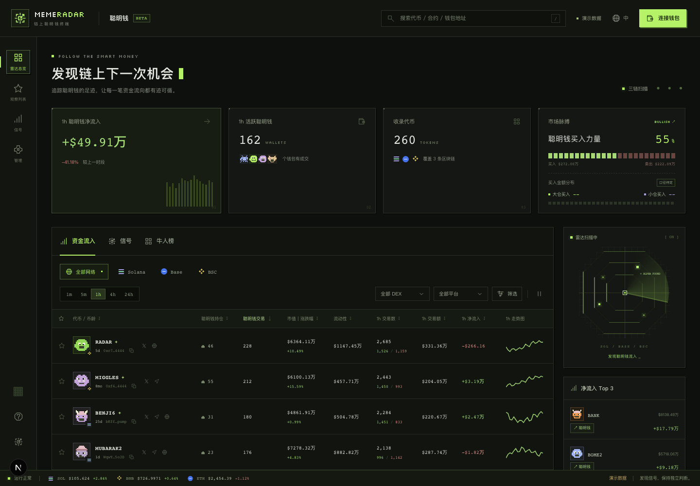
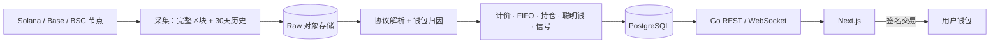

# Meme Radar

**简体中文** | [English](README.en.md)

多链 Meme 代币聪明钱追踪产品：从 Solana、Base、BSC 链上自建索引，展示聪明钱的资金流入、信号、牛人榜、代币与钱包分析，并支持钱包监控与快捷交易。

**当前状态（2026-10-19）**：设计文档已定稿；后端骨架与迁移 `00001`–`00008` 已落地；M1 API 契约 `api/openapi.yaml` 已冻结；**前端 M1 页面已完成**（像素风，当前连内置 mock 接口）；后端采集/解析/派生/接口按 [M1 任务卡](docs/engineering/16-m1-agent-tasks.md) 待开发。文档入口：[docs/README.md](docs/README.md)。



## 功能与里程碑

| 里程碑 | 交付 |
| --- | --- |
| M0 | 三链RPC实测：完整区块与30天历史（D73）的可得性、请求量、费用 |
| M1 | 三链采集与解析；**资金流入**列表；**Token详情**（K线、活动、持有者、流动性池）；管理后台（聪明钱名单导入、运行质量）；界面中英文切换 |
| M2 | **牛人榜**（7天/30天）；**钱包分析**（资产、收益、胜率、盈亏）；聪明钱自动识别 |
| M3 | **信号**；地址标签（开发者、狙击手、捆绑、老鼠仓、鲸鱼、KOL）；代币信息卡、开发者代币 |
| M4 | 钱包签名登录；**关注/监控/合集**、提醒；WebSocket实时推送 |
| M5 | **快捷交易**（非托管，用户钱包签名） |

M5之后：限价单、跟单/Bot、安全检测、持仓气泡图、AI洞察。详见[里程碑](docs/engineering/11-milestones.md)与[决策登记](docs/DECISIONS.md)。

## 首批支持

| 链 | 协议 |
| --- | --- |
| Solana | Pump.fun、PumpSwap、Raydium LaunchLab及毕业池、Jupiter路由识别 |
| Base | Clanker、Uniswap v4 |
| BSC | Four.meme、PancakeSwap |

## 关键口径

- 金额按 Token 汇总、以美元展示，可切换为原生币（SOL/ETH/BNB）。
- 价格取主池最近成交；主池为过去1小时平均流动性最大的池；曲线毕业立即切新池。
- 收益按 FIFO 计算；成本未知时不当作0，该 Token 不进入胜率和榜单。
- 聪明钱 = 管理员导入 + 系统按近30天收益、胜率自动识别。
- 数据缺失显示“--”，不显示为0。

完整定义见[文档导航](docs/README.md)中的「指标口径」。

## 架构



| 层 | 技术 |
| --- | --- |
| 后端 | Go（net/http、slog、database/sql、pgx、goose） |
| 前端 | Next.js App Router、TypeScript |
| 数据库 | PostgreSQL 17（地址/hash 为 BYTEA，事实按链分区） |
| 图表 | TradingView Lightweight Charts |

## 目录

```text
meme-radar/
├── README.md / README.en.md
├── Makefile                 # setup / check / dev / smoke
├── docker-compose.yml       # 本地 Postgres :5433
├── api/openapi.yaml
├── docs/
│   ├── README.md            # 文档导航（从这里读）
│   ├── TECHNICAL_PLAN.md    # 技术方案总纲
│   ├── DECISIONS.md         # 范围与决策（唯一来源）
│   ├── product/             # 页面规格
│   ├── metrics/             # 指标口径
│   ├── engineering/         # 工程实现
│   ├── demos/               # 真实样本演示
├── backend/
│   ├── migrations/          # goose DDL（权威 schema）
│   ├── cmd/radar/           # 单二进制，启动时自动迁移
│   └── AGENTS.md
├── frontend/
│   └── AGENTS.md
└── scripts/                 # demos 样本抓取/解码
```

## 开发

| 命令 | 说明 |
| --- | --- |
| `docker compose up -d postgres` | 本地库（端口 5433） |
| `make setup` | 安装依赖与 pre-commit hook |
| `make check` | 后端 + 前端检查（含后端 smoke） |
| `make -C backend run` | 启动 API（会执行迁移） |
| `npm --prefix frontend run dev` | 启动前端 |
| `make smoke` | 冒烟测试 |

规范见[后端](backend/AGENTS.md)与[前端](frontend/AGENTS.md)。详细读序见[文档导航](docs/README.md)。

## 约束

- 真实 API Key 只放后端秘密配置，不进对话、仓库或前端。
- 申请或购买数据服务需要明确授权；验证阶段数据/RPC预算 USD100/月（到顶暂停前向，D104）。
- 交易非托管：服务端不保存私钥、不代签。
- 不调用任何第三方私有接口，不使用第三方品牌素材。

开源许可证与线上地址待定。
