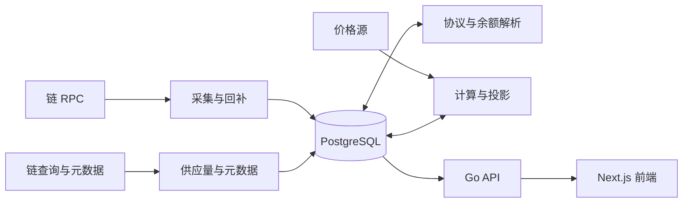

# Meme Radar

[English](README.md) | **简体中文**

面向 Solana、Base、BSC 的链上代币与聪明钱观察终端。项目采集区块原文，解析交易和余额变化，在 PostgreSQL 中生成行情、K 线、持仓和资金流入投影，再通过 Go API 提供给 Next.js 前端。

当前交付范围是 **M1：资金流入、代币详情和管理后台**。信号、牛人榜、钱包分析、钱包登录和快捷交易仍属于后续里程碑，界面入口不代表这些能力已经实现。

## 当前状态

截至 2026-10-25，PostgreSQL API、名单版本管理、资金流入投影、持仓补算、元数据抓取和运行质量/解码重试均已接入；现有部署的前端已连接真实 API，模拟后端已停止。

上线验收仍有未通过项：列表查询可能超时，派生数据有延迟，历史持仓尚在补算，部分外部元数据来源不可用。服务在线和 `/healthz` 成功只表示进程及数据库连接可用，不能代替数据完整性与新鲜度验收。

| 已接入能力   | 当前边界                                              |
| ------------ | ----------------------------------------------------- |
| 资金流入列表 | 三链、五个窗口、筛选排序、固定快照分页、可见行刷新    |
| 代币详情     | 行情、主池 K 线、活动、持有者、流动性池及变化         |
| 聪明钱名单   | CSV/JSON 校验、异步构建、版本激活、排除与恢复         |
| 运行质量     | 采集/解析进度、缺口、解码失败、持久化重试队列         |
| 展示与观测   | 中英文界面、移动端、覆盖提示、Prometheus/Grafana/Loki |

## 数据如何流动



当前采集使用 **HTTP JSON-RPC 区块轮询**。Solana 读取完整区块，EVM 读取完整区块及回执；协议过滤发生在解析阶段。当前没有 Yellowstone gRPC 采集。

| 链     | 当前启用的解码器                                  |
| ------ | ------------------------------------------------- |
| Solana | Pump.fun、PumpSwap                                |
| Base   | Clanker v4、Doppler，使用 Uniswap v4 池信息       |
| BSC    | Four.meme、PancakeSwap V2/V3、Pancake Infinity CL |

## 本地开发

环境：Go 1.26.5、Node 24（版本见 [.node-version](.node-version)）、npm 11；真实数据和数据库集成测试还需要 PostgreSQL 17 或 Docker Compose。

```sh
make setup
make dev
```

打开 [资金流入页](http://127.0.0.1:3000/smart-money/inflow)。`make dev` 默认使用前端内置演示数据。

| 命令                           | 用途                                           |
| ------------------------------ | ---------------------------------------------- |
| `make dev-connected`           | Go 模拟 API 与前端联调                         |
| `make up`                      | 默认 Docker 演示环境；仍使用模拟 API           |
| `make check`                   | 后端门禁、前端检查与构建、两种模式的浏览器冒烟 |
| `make check-race`              | Go 竞态检查；数据库集成部分需测试库配置        |
| `make -C backend test-db`      | 独立本地 PostgreSQL 临时测试库及竞态测试       |
| `make frontend TASK=api:types` | 根据 OpenAPI 重新生成前端类型                  |

演示环境的管理令牌是 `mock-admin`，只用于演示模式。

## 连接真实 PostgreSQL

先按 [.env.example](.env.example) 准备本机 `.env`，配置 `RADAR_DATABASE_URL`；需要后台管理时另设随机的 `RADAR_ADMIN_TOKEN`。不要提交真实连接串或令牌。Go 二进制不会自动读取 `.env`，Docker 角色通过 Compose 注入。

首次启动一个独立的真实 API（`.env` 需使用 shell 兼容的赋值格式）：

```sh
make -C backend build
set -a
. ./.env
set +a
./backend/bin/radar api --store=pg --addr=127.0.0.1:8081
```

API 启动会执行数据库迁移，连接真实数据前应核实数据库目标和迁移权限。另开终端启动前端：

```sh
cd frontend
RADAR_API_ORIGIN=http://127.0.0.1:8081 npm run dev
```

生产构建必须在 **构建和运行时使用同一个 origin**：业务转发读取运行时配置，`/healthz` 转发在构建时生成。

```sh
cd frontend
RADAR_API_ORIGIN=http://127.0.0.1:8081 npm run build
RADAR_API_ORIGIN=http://127.0.0.1:8081 npm run start
```

空数据库不会自动变成完整行情库。还需要启动采集、解析、计算和补全角色；Compose 的 `ingest` profile 包含这 12 个后台角色。`make ingest-up` 会启动它们，但不会把默认 Docker 前端切换到真实 API。真实前端的 Compose 覆盖示例见 [简略技术方案](TECHNICAL_OVERVIEW.zh-CN.md#10-运行与部署)。已有部署应继续使用其发布覆盖文件和固定镜像，避免被默认演示配置覆盖。

## 接口与数据语义

- 接口契约：[api/openapi.yaml](api/openapi.yaml)。前端生成类型并执行运行时校验，服务端响应也有契约测试。
- 资金流入首次查询冻结最多 2,000 行；后续分页使用 `query_id`，可见行每 10 秒批量刷新，刷新不重排。
- 缺口、未完成的历史补算、未知价格会影响完整统计。未知值保留 `NULL`，界面显示 `--`；已解析计数与完整窗口统计分开呈现。
- 名单修改异步生成新版本。准备期间保留旧 active 名单，激活后旧快照的数值刷新返回 `410`，提示重新查询。
- 真实 API 不返回 `X-Radar-Mock`。上游不可达时前端返回错误，不自动回退演示数据。
- 后台采用 Bearer 令牌；浏览器只在当前标签页的 `sessionStorage` 保存令牌。未配置 PG 管理令牌时管理路由关闭。

## 仓库导航

| 位置                                                                                       | 内容                                     |
| ------------------------------------------------------------------------------------------ | ---------------------------------------- |
| [TECHNICAL_OVERVIEW.md](TECHNICAL_OVERVIEW.zh-CN.md)                                       | 独立的简略技术方案、时序与测试边界       |
| [backend/README.md](backend/README.md)                                                     | 后端角色、命令和配置                     |
| [frontend/README.zh-CN.md](frontend/README.zh-CN.md)                                       | 页面、前端运行模式和检查命令             |
| [api/openapi.yaml](api/openapi.yaml)                                                       | HTTP 契约                                |
| [backend/migrations](backend/migrations)                                                   | 有序数据库迁移                           |
| [backend/internal/config/config.default.yaml](backend/internal/config/config.default.yaml) | 默认链、协议、价格源、回补窗口和刷新周期 |
| [docker-compose.yml](docker-compose.yml)                                                   | 演示服务、真实数据角色与监控组件         |
| [ops/observability](ops/observability)                                                     | 指标、日志、看板及告警配置               |
| [AGENTS.md](AGENTS.md)                                                                     | TDD、提交、隔离工作区与部署规则          |

数据库集成测试、真实浏览器验收、部署后的原始数据对账各自承担不同验证责任，不能用演示冒烟代替真实链路验收。
