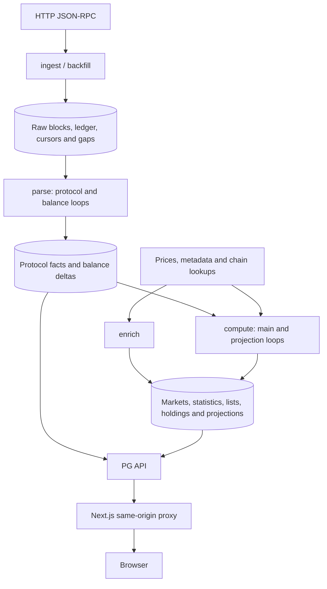
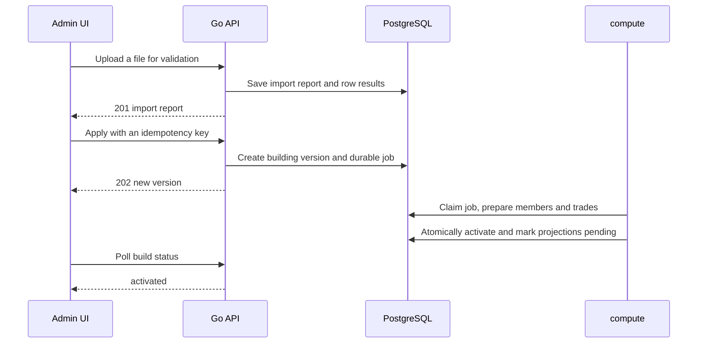
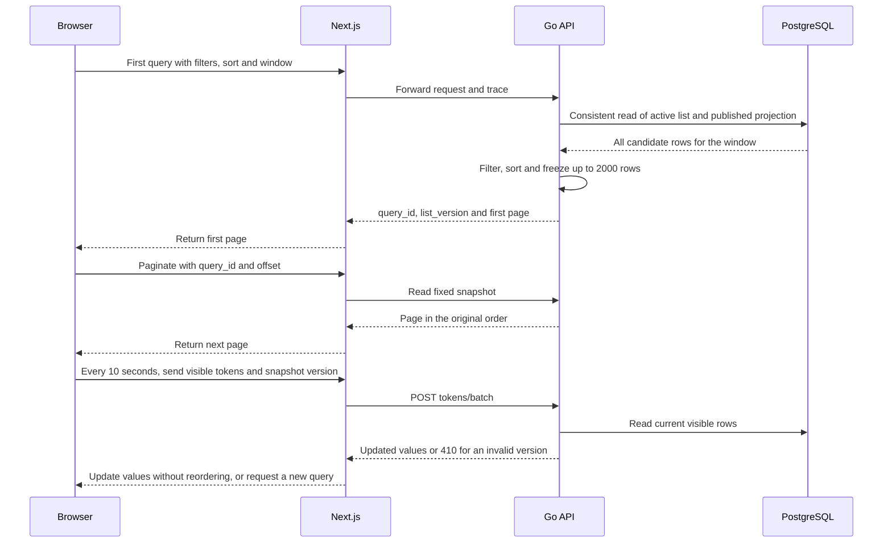

# Meme Radar Technical Overview

**English** | [简体中文](TECHNICAL_OVERVIEW.zh-CN.md)

This standalone overview describes the implemented M1 system at `011d032` (2026-10-25). [OpenAPI](api/openapi.yaml) defines routes and fields; the [default configuration](backend/internal/config/config.default.yaml) defines configuration defaults. Later milestones are outside the current capabilities.

## 1. Scope

The system processes blocks, protocol trades, inflow, token market data and holdings on Solana, Base and BSC. It provides an inflow list, token details and administration. Signals, profit leaderboards, wallet analytics, wallet login, push notifications and trading are not implemented.

The deployed frontend is connected to the real PostgreSQL API. Acceptance still has unresolved query timeouts, derived-data delays and historical replay, so connected functionality does not imply full deployment acceptance.

## 2. Services and storage

A single Go executable, `radar`, runs in distinct roles. Compose defines three ingest, three backfill, three parse, one compute, one enrich and one PG API role, alongside the Next.js frontend and observability services. Roles share PostgreSQL and coordinate through transactions, role locks and persistent watermarks. Kafka and Redis are not used.



PostgreSQL has four layers: raw input and ingestion records, replayable facts, derived state, and published list projections. Business reads do not build market projections in the API; admin operations write list drafts or retry requests.

## 3. Ingestion and backfill

Solana fetches full blocks through `getBlock`. EVM fetches full blocks and `eth_getBlockReceipts`, validating block numbers, receipt counts and block hashes. Compressed input goes to `raw_blocks`; processing state and cursors go to `chain_blocks` and `stream_cursors`; missing ranges go to `stream_gaps`.

Forward ingestion takes priority. Backfill works from the newest gaps toward older history. Default backfill windows are 24 hours for Solana and 168 hours for Base/BSC. The free Solana configuration follows the head and does not establish continuous coverage. Raw blocks and ingestion records default to 30-day retention; configuration and actual cleanup operations determine any additional retention behavior.

## 4. Parsing and replay

One parse process runs per chain, with two concurrent loops. The main loop writes tokens, pools, trades, liquidity and decode failures. The balance loop reads blocks whose main parse has completed and writes `balance_deltas` with an independent balance-parser version. It yields when the main parsing backlog exceeds 1,000 blocks.

Facts have stable chain-position keys. Reprocessing replaces the affected block's data in a transaction, without duplicating trades. The API writes failed-parse replay requests to `parse_retries`; parse resets the affected block state and replays it. The API does not take over the parser's business-fact writes.

Enabled protocols are Pump.fun/PumpSwap on Solana; Clanker v4/Doppler on Base; and Four.meme, PancakeSwap V2/V3 and Infinity CL on BSC. A protocol display name in configuration does not establish decoder support.

## 5. Computation and publication

The main compute loop defaults to a 10-second ticker. Rounds run serially, and a round can take longer than 10 seconds. The order is list jobs → native prices → trade valuation → smart-money trades → pool liquidity/main pool/market data → minute statistics/candles → holdings. Full rounds also perform V3 sampling, ATH, coverage refresh and backlog metrics. See [cycle.go](backend/internal/compute/cycle.go) for the full ordering.

Native prices default to Binance, then Coinbase; Pyth is configurable. Missing quotes or token decimals remain unknown rather than being filled with zero.

A separate projection loop and connection pool write inflow projections. Target checks run every 5 seconds for `1m/5m` and every 15 seconds for `1h/4h/24h`. Publication requires an advancing publishable chain time and ready stats/smtrades watermarks and dirty queues. Scheduling intervals do not guarantee end-to-end freshness.

New `inflow_rows` and the `projection_heads` switch commit in one transaction. Readers use published versions only. Delayed cleanup of old rows prevents partially published lists from becoming visible.

## 6. Smart-money lists

Lists consist of explicitly imported addresses; an automatic profitability model for identifying smart money is not implemented. The API validates CSV/JSON, saves previews and versioned changes, and enqueues `jobs`. Compute prepares immutable member snapshots and their smart-money trades, then atomically switches the unique active version.



Exclusion, restoration and removal also produce new versions. The old active list continues serving reads during preparation; after activation, relevant version checks for old snapshots return `410`. Until projections catch up with the new list, requests return an unavailable error rather than mixing versions.

## 7. API and frontend reads

The frontend forwards `/api/v1/*` to Go through a same-origin proxy. Development without an origin can use demo handlers. Once a real origin is configured, upstream failures remain errors; they do not trigger a fallback to demo data.



Query snapshots live in a process-local LRU: at most 512 snapshots, a 10-minute TTL and up to 2,000 rows each. A process restart invalidates them. Multiple API instances require sticky routing or a shared-snapshot design; cross-instance sharing is not implemented.

Go backend work defaults to a 2-second timeout; the Next.js proxy limit defaults to 10 seconds. The first query still loads all candidate projection rows before filtering and sorting in the HTTP layer, so large windows can time out. SQL amounts use `numeric`, and HTTP transfers decimal strings. HTTP numeric filtering and sorting currently convert to `float64`, so comparisons do not guarantee arbitrary precision.

## 8. Holdings and enrichment

Balances are derived from block deltas, rather than imported as a chain-wide holder snapshot. Compute compares new `balance_deltas` with the applied `balance_journal`, corrects `token_balances` by the difference, and updates holder statistics and coverage. Unknown starting points, gaps and balance-parsing backlog can produce `partial/unknown` coverage.

The API fetches native wallet balances per page and caches them for 60 seconds: Solana uses `getMultipleAccounts`, EVM uses `eth_getBalance`, and failures remain unknown. Some read endpoints therefore depend on external chain RPC.

For each chain, enrich supplements supply and decimals before display metadata such as images, social links and descriptions. All chains share metadata HTTP budgets. Supply goes to `token_supplements`, display information to `token_metadata`; `token_info` merges them without overwriting parser-owned facts.

Sources include existing URIs, Solana Metaplex, Clanker image URIs, Doppler `tokenURI()` and a configurable Four.meme endpoint. Fetching retrieves JSON rather than proxying image downloads. SSRF protections, DNS/redirect validation, response-size limits, rate limits and failure backoff remain enforced.

## 9. Consistency and unknown values

| Boundary           | Current guarantee                                                                                    |
| ------------------ | ---------------------------------------------------------------------------------------------------- |
| Block facts        | Stable chain-position keys, transactional replacement and versioned reprocessing                     |
| Lists              | Unique active version, immutable member snapshots, durable jobs and lease checks                     |
| Projections        | Atomic publication of rows and head; reads do not mix list versions                                  |
| Pagination         | Fixed query snapshots; refreshed values do not reorder loaded rows                                   |
| Holdings           | Delta/journal reconciliation corrects balances without counting replay twice                         |
| Unknown statistics | Contractual NULL values remain unknown; observed parsed values are separate from complete statistics |

Inflow window coverage uses `complete/partial`; holdings coverage uses `full/partial/unknown`. These enums are not interchangeable. `as_of` describes the data cutoff, rather than the response time.

## 10. Running and deploying

See the [README](README.md) for development. `make up` defaults to a mock environment. `make ingest-up` starts real-data backend roles without switching the frontend. Existing environments should retain their release overrides and pinned images; do not regenerate an override to replace a running release.

For a **first deployment in a new environment**, a local, untracked `.local/compose.pg.example.yml` can contain:

```yaml
services:
  frontend:
    build:
      args:
        RADAR_API_ORIGIN: http://api:8081
    environment:
      RADAR_API_ORIGIN: http://api:8081
    depends_on:
      api:
        condition: service_healthy
```

Prepare `.env`, database permissions and RPC access, start the real backend and wait for API readiness, then explicitly start the real frontend. `--no-deps` avoids the inherited demo-backend dependency:

```sh
docker compose -f docker-compose.yml -f .local/compose.pg.example.yml --profile ingest \
  up -d --build --wait api ingest-solana ingest-base ingest-bsc \
  parse-solana parse-base parse-bsc compute enrich backfill-solana backfill-base backfill-bsc
docker compose -f docker-compose.yml -f .local/compose.pg.example.yml --profile ingest \
  up -d --build --no-deps frontend
```

This example builds current source; it does not define immutable-image releases or rollback procedures. Manage existing releases with their corresponding configurations. The fixed Compose project name is `meme-radar-app`; isolated development worktrees must not execute these deployment commands.

## 11. Observability and security

The 12 backend roles expose `/metrics` within the container network. Prometheus collects metrics; Alloy forwards container logs to Loki; Grafana shows both; Alertmanager routes alerts. `make obs-up` starts observability services, with Grafana bound to local port `3301` by default.

`/healthz` checks process/database readiness only. Acceptance also checks projection age, parsing backlog, price availability, list jobs and balance invariants. Computed monitoring timestamps can lag, so compare the current database clock with actual data timestamps.

PG admin routes return `401` when the admin token is unset; with a configured token, missing or incorrect credentials return `403`. Valid tokens are checked with constant-time comparison. The browser stores tokens only in the current tab's `sessionStorage`, and server secrets stay out of client builds. `/api/v1/*` exposes no public pprof endpoint.

## 12. Current limitations

- Free Solana ingestion has real gaps; historical backfill does not establish complete coverage.
- Slow computation and readiness waits delay projections. The 5/15-second schedules do not establish that the refresh target has been met.
- Large-window first queries can return 503; lists can fail intermittently under load.
- Historical balance replay is unfinished, so partial holder rankings cannot represent the whole chain.
- External metadata can return 403, invalid URIs or timeouts. Some protocol transactions still fail to decode, and retries do not guarantee recognition.
- Admin budgets and unknown-method counts include defined placeholders. Signals, leaderboards, push notifications and trading are outside this implementation.

## 13. Testing strategy

Follow the [TDD rules in AGENTS.md](AGENTS.md#tdd用户要求): establish Red on the intended assertion before implementing new behavior or fixing a defect, make the smallest change for Green, and preserve the baseline, test diff, independent expectations, commands and scrubbed evidence. Later regression additions cannot be presented retrospectively as TDD.

| Layer                  | Required boundary                                                                                                                                                                                                                                                                                           |
| ---------------------- | ----------------------------------------------------------------------------------------------------------------------------------------------------------------------------------------------------------------------------------------------------------------------------------------------------------- |
| Protocol decoding      | Cover creation, curve buys/sells, migration/graduation, pool trades, liquidity changes, failed transactions and routed hops for each protocol. Use real raw transactions; derive expectations from explorers, independent protocol interpretation or manual calculations, rather than implementation output |
| Computation            | Windows, main-pool changes, the 5,000 vs. 5,000.000001 large-buy boundary, coverage and list activation; independently calculated amount expectations                                                                                                                                                       |
| PostgreSQL integration | Isolated temporary databases for idempotent block replacement, reorg rollback, skipped-slot coverage continuity, concurrent compute leadership, old-active reads during builds, holdings replay and atomic publication                                                                                      |
| HTTP contract          | Validate each response against OpenAPI; frontend `npm run api:check` prevents generated-type drift                                                                                                                                                                                                          |
| Browser integration    | A production frontend build connected to Go; verify queries, pagination, version changes, details and administration. Record demo mode and real PG fixtures separately                                                                                                                                      |
| Deployment acceptance  | Real RPC → database → API → browser; independently reconcile sampled raw trades, inspect monitoring and actual data age. Long-running stability and historical completeness need additional acceptance                                                                                                      |

`make check` runs the base gates and demo/Go mock integration. Corresponding real PG integration tests run only with `RADAR_TEST_DATABASE_URL` set. `make -C backend test-db` starts a dedicated local database instance; each test creates a temporary database. Never point the test variable at the production business database.

CI runs `make check` and `make check-race` with a PostgreSQL service. It does not deploy the real environment or replace post-deployment data reconciliation. Documentation-only changes need link, diagram and diff checks, without meaningless business tests.
