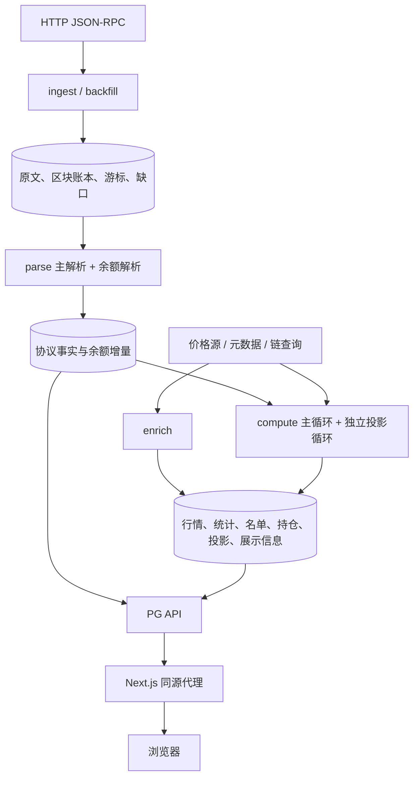
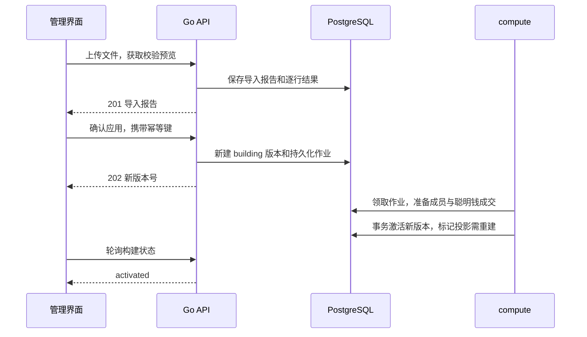
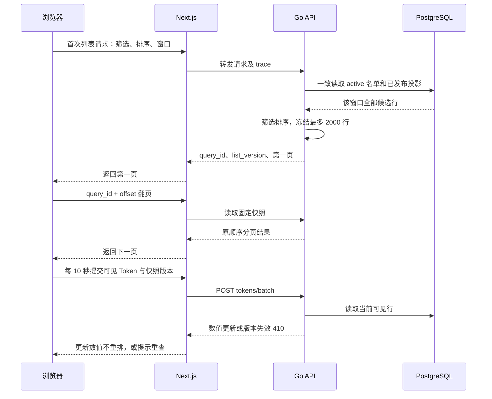

# Meme Radar 简略技术方案

[English](TECHNICAL_OVERVIEW.md) | **简体中文**

本文描述当前已实现的 M1 系统，基线为 `011d032`（2026-10-25），可独立阅读。路由与字段以 [OpenAPI](api/openapi.yaml) 为准，配置以 [默认配置](backend/internal/config/config.default.yaml) 为准。后续里程碑不作为当前能力。

## 1. 范围

系统处理 Solana、Base、BSC 的区块、协议成交、资金流入、代币行情和持仓，提供资金流入列表、代币详情及管理后台。信号、收益排行榜、钱包分析、钱包登录、推送与交易尚未实现。

当前接线已部署到真实 PostgreSQL；部署验收仍有查询超时、派生延迟和历史补算等未完成项，因此“已接入”不等于“完整上线验收通过”。

## 2. 服务与存储

Go 单一可执行文件 `radar` 按角色运行。默认 Compose 组织 3 个 ingest、3 个 backfill、3 个 parse、1 个 compute、1 个 enrich、1 个 PG API，另有 Next.js 前端及监控服务。各角色共享 PostgreSQL，通过事务、角色锁和持久化水位协调；没有 Kafka 或 Redis。



PostgreSQL 分为四层：原文及采集账本、可重放的事实、计算派生状态、面向列表的发布投影。API 的业务读取不生成行情投影；管理操作写入名单草稿或重试队列。

## 3. 采集与回补

Solana 通过 `getBlock` 获取完整区块；EVM 获取完整区块及 `eth_getBlockReceipts`，校验块号、回执数与块哈希。原文压缩写入 `raw_blocks`，处理状态和游标写入 `chain_blocks`、`stream_cursors`，缺失范围进入 `stream_gaps`。

前向采集优先；backfill 从最近缺口向历史补齐。默认 Solana 回补窗口 24 小时，Base/BSC 为 168 小时。免费 Solana 配置采用追最新块的方式，不能据此宣称连续完整覆盖。原文与采集账本默认保留 30 天；额外保留策略以配置和实际清理操作为准。

## 4. 解析与重放

每链一个 parse 进程，包含两个并行循环：主循环写代币、池、成交、流动性和失败事实；余额循环读取主解析完成的原文，写 `balance_deltas` 及独立的余额解析版本。主解析积压超过 1,000 块时，余额循环让出资源。

事实按链上位置定位，重解析在事务中替换对应块的数据，不能叠加重复成交。失败请求由 API 写入 `parse_retries`，由 parse 重置相应块状态后重放，API 不直接替代解析器写业务事实。

启用协议：Solana 的 Pump.fun/PumpSwap；Base 的 Clanker v4/Doppler；BSC 的 Four.meme、PancakeSwap V2/V3、Infinity CL。显示名称配置中出现其他协议，不表示已有对应解码器。

## 5. 计算与发布

compute 主循环默认以 10 秒 ticker 驱动，但一轮串行完成后才进入下一轮，实际耗时可以超过 10 秒。步骤依次为：名单作业 → 原生币价 → 成交定价 → 聪明钱成交 → 池流动性/主池/行情 → 分钟统计/K 线 → 持仓；全量轮次额外运行 V3 采样、ATH、覆盖刷新和积压指标，完整顺序见 [cycle.go](backend/internal/compute/cycle.go)。

原生币价格默认按 Binance、Coinbase 顺序尝试，Pyth 为可配置来源。报价及 Token decimals 不可用时保留未知值，不能按零补齐。

资金流入投影由独立循环及独立连接池写入：`1m/5m` 目标每 5 秒检查，`1h/4h/24h` 每 15 秒检查。只有可发布的链时间推进，且 stats、smtrades 的水位和脏队列就绪，才写新版本。调度间隔不是端到端新鲜度保证。

新 `inflow_rows` 与 `projection_heads` 的切换在同一事务提交；读者只读取已发布版本。旧行延迟清理，避免发布期间看到半份列表。

## 6. 聪明钱名单

名单由明确导入的地址组成；当前没有自动识别“聪明钱”的收益模型。API 验证 CSV/JSON，保存预览和版本化变更，再写 `jobs`。compute 准备不可变成员快照及相应聪明钱成交，最后事务切换唯一 active 版本。



排除、恢复和移除同样生成新版本。构建期间旧 active 名单继续服务；激活后旧快照相关的版本校验返回 `410`。投影尚未追上新名单时返回不可用错误，不拼接新旧版本。

## 7. API 与前端读取

前端 `/api/v1/*` 同源转发至 Go；未配置 origin 的开发模式可以使用演示处理器。设置真实 origin 后上游失败仍返回错误，不自动降级为演示数据。



API 的查询快照为单进程 LRU：最多 512 份、TTL 10 分钟、每份最多 2,000 行，进程重启会失效。多实例部署需要粘性路由或另行设计快照共享，当前没有跨实例共享。

Go Backend 工作默认超时 2 秒；Next.js 转发默认上限 10 秒。当前首查仍先读取全部候选投影，再在 HTTP 层筛选排序，实际大窗口存在超时风险。SQL 金额使用 `numeric`、HTTP 以十进制字符串传输；当前 HTTP 数值筛选排序有 `float64` 转换，不宣称任意精度比较。

## 8. 持仓与展示补全

余额由区块增量推导，不是直接从全链持有人快照导入。compute 对比新的 `balance_deltas` 和已应用的 `balance_journal`，把差额修正到 `token_balances`，再更新持有者统计及覆盖。未知起点、缺口和余额解析积压会使覆盖为 `partial/unknown`。

API 按页查询钱包原生币余额并缓存 60 秒：Solana 使用 `getMultipleAccounts`，EVM 使用 `eth_getBalance`；失败保持未知。链上 RPC 因此也是部分读取接口的外部依赖。

enrich 每链先补供应量和 decimals，再补图片、社交链接和描述；所有链共享元数据 HTTP 预算。供应量写 `token_supplements`，展示信息写 `token_metadata`，通过 `token_info` 合并，不覆盖解析器的事实。

元数据来源包括已有 URI、Solana Metaplex、Clanker 图片 URI、Doppler `tokenURI()` 和可配置 Four.meme 接口。抓取 JSON，不代理下载图片；保留 SSRF、DNS/重定向地址检查、大小限制、速率限制和失败退避。

## 9. 一致性与未知值

| 边界     | 当前保证                                          |
| -------- | ------------------------------------------------- |
| 区块事实 | 稳定链上位置键、事务替换、版本化重解析            |
| 名单     | 唯一 active、不可变成员快照、持久化作业及租约校验 |
| 投影     | 新行与 head 原子发布，一次读取不混用名单版本      |
| 分页     | 固定 query 快照，不因下一次刷新重排已加载行       |
| 持仓     | 增量与 journal 对账后修正，避免重放双计           |
| 未知统计 | 依契约保留 NULL；已解析观察值单列，不冒充完整统计 |

资金流入窗口覆盖使用 `complete/partial`，持仓覆盖使用 `full/partial/unknown`；不同字段的枚举不能互换。`as_of` 表示数据实际截止时间，不等于请求返回时间。

## 10. 运行与部署

开发方式见 [README](README.zh-CN.md)。默认 `make up` 是模拟环境；`make ingest-up` 是真实数据后台，不负责切换前端。已有环境继续沿用发布覆盖文件和固定镜像，不要重新生成覆盖配置替换正在运行的发布。

在**首次部署的新环境**中，可以创建本地 `.local/compose.pg.example.yml`，内容如下；该文件不进入版本库：

```yaml
services:
  frontend:
    build:
      args:
        RADAR_API_ORIGIN: http://api:8081
    environment:
      RADAR_API_ORIGIN: http://api:8081
    depends_on:
      api:
        condition: service_healthy
```

准备 `.env`、数据库权限与所需 RPC 后，先启动真实后台并等 API 就绪，再显式启动真实前端。`--no-deps` 避免继承默认演示后端依赖：

```sh
docker compose -f docker-compose.yml -f .local/compose.pg.example.yml --profile ingest \
  up -d --build --wait api ingest-solana ingest-base ingest-bsc \
  parse-solana parse-base parse-bsc compute enrich backfill-solana backfill-base backfill-bsc
docker compose -f docker-compose.yml -f .local/compose.pg.example.yml --profile ingest \
  up -d --build --no-deps frontend
```

该示例使用当前源码构建，不等于不可变镜像发布或回滚流程；现有版本应使用对应发布配置管理。固定 Compose 项目名为 `meme-radar-app`，隔离开发 worktree 不得执行这些部署命令。

## 11. 监控与安全

12 个后台角色在容器网络提供 `/metrics`，Prometheus 收集指标，Alloy 收集容器日志送 Loki，Grafana 展示两者，Alertmanager 负责告警路由。`make obs-up` 启动监控；Grafana 默认只绑定本机 `3301` 端口。

`/healthz` 只验证进程/数据库就绪；还需检查投影年龄、解析积压、价格可用性、名单作业和余额不变量。监控计算时间可能滞后于现实，验收应核对数据库当前时钟与数据时间。

PG 管理令牌缺失时管理路由返回 `401`；配置后缺失或错误令牌返回 `403`。正确令牌通过常量时间比较。浏览器仅在当前标签页 `sessionStorage` 保存令牌，服务端秘密不进入客户端构建。`/api/v1/*` 不提供公开 pprof 入口。

## 12. 当前限制

- 免费 Solana 采集存在真实缺口；历史回补不等于完整覆盖。
- 慢计算和等待统计就绪会拖延投影；5/15 秒调度不代表这个刷新承诺已经达标。
- 大窗口首查有 503，列表在负载下仍可能间歇失败。
- 历史余额补算尚未完成，不能把局部持仓排名当作全链排名。
- 外部元数据有 403、失效 URI 和超时；部分协议交易还会解码失败，重试并不保证修复协议识别。
- 管理预算和未知方法计数有既定占位；信号、排行榜、推送和交易不在本轮实现内。

## 13. 测试策略

遵循 [AGENTS.md 的 TDD 规则](AGENTS.md#tdd用户要求)：新增行为或缺陷先取得目标断言的 Red，再做最小实现取得 Green，并保留基线、测试差异、独立期望、命令及脱敏证据。存量补测不能事后称为 TDD。

| 层              | 必须验证的边界                                                                                                                                          |
| --------------- | ------------------------------------------------------------------------------------------------------------------------------------------------------- |
| 协议解码        | 每协议覆盖创建、曲线买卖、迁移/毕业、池成交、加减流动性、失败交易和路由多跳；使用真实交易原文，期望来自区块浏览器、独立协议解读或手算，不从实现输出生成 |
| 计算            | 窗口、主池切换、大仓边界 5,000 与 5,000.000001、覆盖判断、名单切换；金额期望独立计算                                                                    |
| PostgreSQL 集成 | 使用隔离临时库验证按块幂等重写、重组回滚、跳过 slot 的覆盖连续性、并发 compute 选主、构建期间旧 active 可读、持仓重放与原子发布                         |
| HTTP 契约       | 逐响应按 OpenAPI 校验；前端 `npm run api:check` 防止生成类型漂移                                                                                        |
| 浏览器联调      | 前端生产构建连接 Go API，验证查询、分页、版本换版、详情和后台；演示模式与真实 PG 夹具分别记录                                                           |
| 部署验收        | 真实 RPC→数据库→API→浏览器；抽样原始成交独立对账、检查监控及实际数据年龄；长时稳定性和历史完整覆盖另行验收                                              |

`make check` 执行基础门禁与演示/Go 模拟联调；只有设置 `RADAR_TEST_DATABASE_URL` 才执行相应真实 PG 集成测试。`make -C backend test-db` 启动专用本地测试库，测试各自建立临时数据库。不得把测试库变量指向生产业务库。

CI 运行 `make check` 和 `make check-race`，并提供 PostgreSQL 服务。它不自动部署真实环境，也不能代替上线后数据核对。纯文档改动检查链接、图表和差异，不增加无意义的业务测试。
