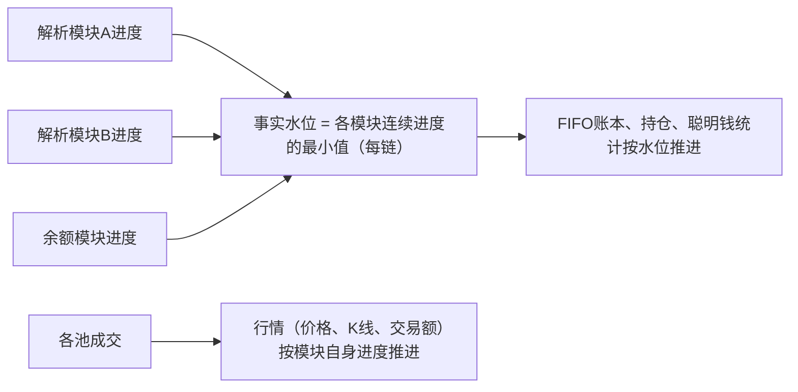
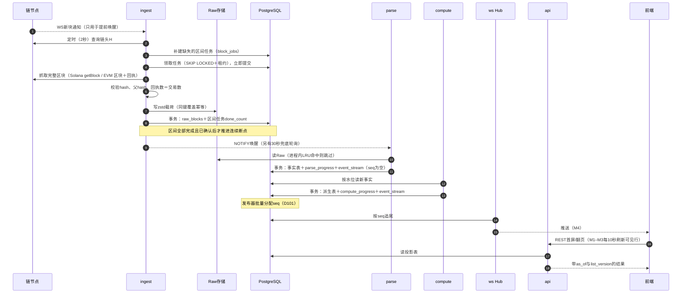

# 技术方案

> 本文是工程实现的总纲：目标、约束、整体设计取舍、容量估算、依赖选型与关键难点。各模块细节见`engineering/`，决策编号见[DECISIONS](DECISIONS.md)，表 DDL 见`backend/migrations/`（说明对照[数据模型](engineering/06-data-model.md)）。读序见[文档导航](README.md)。

## 1. 目标与约束

| 类别 | 内容 | 依据 |
| --- | --- | --- |
| 产品 | 聪明钱追踪：资金流入、信号、牛人榜、Token详情、钱包分析、监控/合集/关注、快捷交易 | D50、D51 |
| 链与协议 | Solana（Pump/PumpSwap、LaunchLab、Jupiter）、Base（Clanker＋Uniswap v4）、BSC（Four.meme＋PancakeSwap） | D2 |
| 数据 | 自建链上索引；完整区块Raw；启动锚点A前向＋A之前30天历史 | D22、D47、D52、D73 |
| 存储 | PostgreSQL存元数据、事实与派生；Raw在对象存储（开发用本地目录）；地址/hash为`BYTEA`；事实按链＋区块号分区 | D66、D75、D77–D83 |
| 计价 | 按Token汇总、美元计价；主池定价 | D53–D56 |
| 规模 | 目标100k+同时在线，需压测证明 | D12 |
| 预算 | 验证阶段数据/RPC USD100/月 | D14 |
| 安全 | 非托管交易；秘密只在后端；不调用第三方私有接口 | D63、D11 |

## 2. 性能目标（初始值，M1/M4压测后修订）

| 指标 | M1–M3（REST轮询） | M4起（WS推送） |
| --- | --- | --- |
| 数据新鲜度：链上出块→API可查，P95 | ≤ 10秒 | ≤ 3秒 |
| 前向采集积压（链头−连续完成位置） | 正常 ≤ 30秒 | 同左 |
| 资金流入列表首页，P95 | ≤ 300ms | 同左 |
| Token详情头部/K线，P95 | ≤ 300ms | 同左 |
| 钱包分析，P95 | ≤ 800ms | 同左 |
| 同时在线 | 先证明单机1万连接 | 给出100k扩展证据 |

时延预算（链上出块→页面可见，M1）：

```mermaid
gantt
    dateFormat X
    axisFormat %s秒
    section 链
    确认（Solana confirmed约1秒；EVM延后12块另计） :0, 1
    section 采集
    通知/定时扫描＋抓取完整区块 :1, 2
    section 解析
    协议解码、归因、写事实 :2, 3
    section 计算
    窗口统计/价格更新 :3, 5
    section 展示
    前端10秒轮询（平均5秒） :5, 10
```

EVM链延后12个区块确认（Base约24秒、BSC约5秒）会超出上述预算。默认方案：**未确认区块先解析并标记`pending`参与展示，12块后转为`confirmed`；重组时按[采集§5](engineering/02-ingestion.md)回滚**。断点只按已确认位置推进。

## 3. 整体架构

模块图见[架构](engineering/01-architecture.md)。核心设计取舍：

### 3.1 单二进制、多角色（D67）

一个Go程序`radar`，按配置启用角色：

| 角色 | 职责 | 实例数 |
| --- | --- | --- |
| `ingest` | 区块调度、抓取、Raw落盘 | 每链1个主实例 |
| `parse` | 协议解析、归因、补证 | 每链1个主实例 |
| `compute` | 价格、K线、窗口统计、FIFO、持仓、聪明钱、标签、信号、榜单 | 1个主实例 |
| `api` | REST、管理接口 | 可多实例，无状态 |
| `ws` | WebSocket Hub（M4） | 可多实例 |

M1全部角色在一个进程里运行。有状态角色（ingest/parse/compute）用PostgreSQL advisory lock选主，同一时间只有一个实例工作，其他实例待命；API与WS只读数据库，可水平扩展。

### 3.2 Raw不进PostgreSQL（D66）

完整区块体积大（见§4），放入PostgreSQL会让备份、VACUUM和磁盘成为瓶颈。默认方案：

- Raw载荷用zstd压缩，**按区块写入对象存储**（S3兼容；开发环境用本地目录），对象键`{chain}/{yyyy-mm-dd}/{position}-{hash}.zst`（position：Solana slot / EVM区块号）。
- PostgreSQL只存`raw_blocks`元数据：位置、hash、父hash、链上时间、交易数、对象键、字节数、确认状态、完整性、所属分支（[数据模型§3](engineering/06-data-model.md)）。
- 先写对象、再写元数据并标记完成；对象写成功但元数据未提交时，重试按同一键覆盖，幂等。
- 解析器按区块读取对象；近期区块在`parse`进程内存保留LRU缓存，前向解析通常不必回读对象存储。

### 3.3 增量计算与水位（D68）

- **行情**只依赖单个池的成交，可以按各模块自己的进度先行更新。
- **钱包账本**需要一个钱包在所有协议上的动作按链序排列，因此只推进到所有模块都完成的位置。某模块失败时账本等待，页面显示“统计延迟”，行情不受影响。
- 历史段（A之前）与前向段分开：历史解析追到A之前，钱包账本以快照基线与未知成本批次起账；历史全部完成后，对涉及的钱包×Token从下界L重放一次，替换旧版本。
- 未确认块（EVM未满12块，D71）的事实直接写入并参与展示（D87）；采集连续断点只按已确认位置推进；重组时按位置删除事实、重新解析，派生结果从共同祖先重算。

### 3.4 列表查询：快照排序＋按需取值

资金流入每10秒刷新但不重排、翻页不能重复或遗漏。默认方案：

1. 首次查询（或改排序/筛选）时，在`token_window_current`上执行筛选与排序，取前2,000个Token ID作为本次结果，存入API进程内存（LRU，TTL 10分钟），返回`query_id`。
2. 后续翻页按`query_id`切片ID列表，再读取这些Token的**当前**数值。
3. 每10秒刷新只按可见行Token ID批量取最新值，不改变顺序。
4. 多API实例时`query_id`缓存无共享，靠负载均衡会话粘滞；缓存丢失则返回`410`，前端自动重新查询。

### 3.5 端到端时序（一个区块从出块到页面）

每一步都可重入：任务有租约，进程崩溃后由其他实例重新领取；所有写入按主键幂等，重复执行不重复计量。

### 3.6 异常兜底总览

| 环节 | 异常 | 兜底 | 用户可见 | 细节 |
| --- | --- | --- | --- | --- |
| 采集 | RPC超时/429/5xx | 退避重试（1s→60s），降并发；8次后记缺口，后台低频补 | 积压超阈值时显示“数据延迟” | [采集§4](engineering/02-ingestion.md) |
| 采集 | 401/403、`-32015`等配置错误 | 该链/供应商暂停并告警，不重试 | 同上 | 同上 |
| 采集 | 历史已清理（`-32001`） | 记`history_unavailable`缺口，换有历史的供应商 | 相关Token成本不完整 | 同上 |
| 采集 | 回执缺失、blockHash不符 | 丢弃重试，3次后换供应商 | 无 | 同上 |
| 采集 | 重组（同位置换hash） | 找共同祖先，旧块标`orphaned`，删除祖先之后的事实并重新解析 | 被撤销的事件推`event.reverted` | [采集§5](engineering/02-ingestion.md) |
| 解析 | 未知判别码/topic | 计数，超过阈值告警，模块继续 | 无 | [解析§5.1](engineering/03-parsing.md) |
| 解析 | 已知指令解码失败 | 该交易进`parse_quarantine` | 无 | 同上 |
| 解析 | 解析器内部错误 | 只阻塞该模块；失败任务持久化，修复后从Raw重放 | 行情继续；钱包统计显示“统计延迟” | 同上 |
| 解析 | 守恒校验不通过 | 交易进`parse_quarantine`，不写事实 | 无 | [数据模型§4.4](engineering/06-data-model.md) |
| 解析 | 钱包归因证据不足 | 池级成交照常计入行情；经济动作等补证 | 钱包统计暂不含该笔 | [解析§4–5](engineering/03-parsing.md) |
| 解析 | 解析器升级 | 写影子分区，校验通过后整段替换（D86） | 无 | [数据模型§4.1](engineering/06-data-model.md) |
| 计价 | 该分钟无报价资产美元价 | 美元值为NULL，价格补齐后重算该分钟（D85） | 显示“--” | [计价§3](engineering/04-pricing.md) |
| 计算 | 输入水位落后/版本变化 | 只推进到最小水位；输入版本不一致的结果丢弃 | “统计延迟” | §3.3 |
| 持仓 | 快照未覆盖地址 | 余额为未知，不当0 | 显示“--”或“部分覆盖” | [持仓](engineering/05-holdings.md) |
| 推送 | 客户端断线/游标过期/epoch变化 | 从ack重放；超出24小时要求resync | 自动重新拉快照 | [实时推送§4](engineering/08-realtime.md) |
| API | `query_id`缓存丢失 | 返回410，前端自动重新查询 | 列表回到顶部 | §3.4 |
| 登录 | 钱包切换地址、本端重新登录 | 撤销本端会话（D98） | 需重新签名 | [登录与交易§1](engineering/15-auth-trading.md) |
| 交易 | 广播后长时间无法判定 | 状态`unknown`，后台继续查询 | 提示“请勿重复提交” | [登录与交易§3.4](engineering/15-auth-trading.md) |
| 运维 | 预算到阈值 | 70美元提醒、80美元停历史与补证、100美元停前向采集与全部新增付费请求，手动恢复（D104） | 管理后台告警；页面显示数据延迟 | [运维§1](engineering/10-operations.md) |
| 运维 | 数据库故障/磁盘将满 | 停写与发布；暂停历史回溯，不自动删Raw | 页面标“过期” | [运维§4](engineering/10-operations.md) |

## 4. 容量估算（2026-10-16公共RPC实测，每链3个样本块；M0扩大到每链1,000块后替换）

实测方法与原始数据见[Demo 01](demos/01-ingestion.md)。计算方法：每链 3 个样本块的zstd-3大小取平均 × 每天区块数（86,400秒 ÷ 出块间隔）× 天数，按十进制单位（1TB＝10¹²字节）。Solana按每个slot都出块计算（实测近5.1万个slot无跳过）。只含Raw，不含PostgreSQL派生数据、索引与副本。“单块大小”为RPC返回的JSON（Solana为`getBlock` full；EVM为区块＋全部回执）。历史窗口已定为30天（D73），120天一列保留作对比。

| 链 | 出块（实测） | 每天区块 | 单块JSON | 单块zstd-3 | 每天zstd-3 | 30天历史（D73） | 前向每月 | 120天（对比） |
| --- | --- | --- | --- | --- | --- | --- | --- | --- |
| Solana | 约0.4秒/slot，近5.1万个slot无跳过 | 约21.6万 | 2.67–5.56MB | 448–701KB（均值589KB） | 约127GB | 约3.8TB | 约3.8TB | 约15.3TB |
| Base | 2秒 | 约4.3万 | 1.30–1.85MB | 114–144KB（均值130KB） | 约5.6GB | 约0.17TB | 约0.17TB | 约0.67TB |
| BSC | **0.45秒**（`milliTimestamp`相邻差450ms） | 约19.2万 | 0.54–1.53MB | 51–78KB（均值65KB） | 约12.5GB | 约0.38TB | 约0.37TB | 约1.5TB |
| 合计 | | | | | 约145GB | **约4.35TB** | **约4.4TB** | 约17.5TB |

推论：

- 存储：Solana占87%。按常见对象存储约$20/TB/月，30天历史约$87/月；Raw保存期限尚未决定（D24），若不删除，前向每月再增约4.4TB（约$88/月），第二个月起即超过USD100验证预算，需要在此之前定下保存期限或预算。zstd-19比zstd-3再省7%–20%（Solana最少），压缩更慢，适合历史数据离线重压。
- 下载流量（未压缩JSON）：Solana每天约845GB、BSC约190GB、Base约70GB。RPC供应商若按流量或按“计算单元”计费，这一项可能比存储更贵，M0要拿到报价。
- 请求量：Solana 30天历史约650万次`getBlock`，前向每月约650万次；Base每块2次，每月约260万次；BSC每块2次，每月约1,150万次。
- 吞吐：前向需要Solana约2.5块/秒、BSC约2.2块/秒、Base约0.5块/秒；30天历史若要7天完成，Solana需约11块/秒。
- 公共RPC实测平均1.1–1.4秒/次，3并发拉Solana完整区块只有0.26块/秒，且出现429与重试失败：**公共端点只能用于样本，生产必须用付费节点**。
- BSC公共端点`eth_getLogs`被禁用（单块也返回`-32005 limit exceeded`）；采集只依赖“区块＋回执”，不受影响。

取舍结论：**已选方案B，历史30天（D73）**。其余方案留作预算变化时的备选：

| 方案 | 效果 | 代价 |
| --- | --- | --- |
| A. Solana Raw剔除投票交易后存储 | 投票交易占交易数56%–70%，但实测只占压缩后体积的19%–26%，Solana 120天约从15.3TB降到约12.1TB | 偏离D22“整块不预筛”；下载流量不变 |
| **B. 历史回溯缩短为30天（已选，D73）** | 历史存储与请求降为1/4 | 30天以前的成本未知，更多Token成本不完整 |
| C. Raw分层保存：近期全量，更早只保留与已支持协议相关的交易 | 长期存储大幅下降 | 规则变更后旧数据无法按新协议重放 |
| D. 维持现方案，提高预算 | 无功能损失 | 费用 |

## 5. 依赖选型

后端（新增依赖须说明必要性，见[后端规范](../backend/AGENTS.md)）：

| 用途 | 选型 | 理由 |
| --- | --- | --- |
| PostgreSQL驱动 | `github.com/jackc/pgx/v5`（经`stdlib`接`database/sql`；批量写用`CopyFrom`） | 维护活跃，支持`NUMERIC`与COPY |
| 迁移 | `github.com/pressly/goose/v3` | SQL文件迁移，可嵌入二进制 |
| Solana解码 | `github.com/gagliardetto/solana-go`、`github.com/mr-tron/base58` | 交易与账户结构、Borsh解码 |
| EVM | `github.com/ethereum/go-ethereum`（`abi`、`common`、`crypto`） | ABI解码、地址、签名校验 |
| 十进制 | `math/big`（原子数量）、`github.com/shopspring/decimal`（美元金额） | 不用浮点计算金额 |
| 压缩 | `github.com/klauspost/compress/zstd` | Raw压缩 |
| 对象存储 | `github.com/aws/aws-sdk-go-v2/service/s3` | S3兼容接口 |
| WebSocket | `github.com/coder/websocket` | 支持context，API简洁 |
| HTTP/日志 | 标准库`net/http`、`log/slog` | 不引入框架 |

前端（见[前端架构](engineering/14-frontend.md)）：Next.js App Router、TypeScript strict、Tailwind CSS、Radix UI Primitives、TanStack Query与TanStack Virtual、next-intl、Lightweight Charts、Solana Wallet Adapter、wagmi＋viem、openapi-typescript、zod。

## 6. 环境与配置

| 环境 | 组成 |
| --- | --- |
| 开发 | Docker Compose运行PostgreSQL；Raw写本地目录；可用录制的区块样本离线解析 |
| 测试/CI | 隔离PostgreSQL库；离线样本；不连真实RPC |
| 验证 | 小规模真实RPC（M0），预算上限生效 |
| 生产 | 单区域：应用服务器＋托管PostgreSQL＋对象存储；前端可走CDN |

配置分两类：普通配置（YAML文件＋环境变量覆盖，进仓库示例`config.example.yaml`），秘密（RPC Key、数据库口令、对象存储凭证；只通过环境变量或秘密管理注入，不进仓库）。启动时校验配置，缺失项明确报错。

## 7. 关键难点与对策

| 难点 | 对策 | 文档 |
| --- | --- | --- |
| 钱包归因（路由、多跳、代付） | 分角色记录，证据不足不计入钱包统计，补证后幂等重算 | [解析](engineering/03-parsing.md) |
| 协议多、版本变化快 | 每模块独立进度与失败任务；解析版本化，可从Raw重放 | [解析](engineering/03-parsing.md) |
| FIFO跨模块链序 | 事实水位取模块最小值（§3.3） | [派生计算](engineering/13-analytics.md) |
| 老Token成本未知 | 快照基线＋未知成本批次；历史补齐后重放 | [持仓](engineering/05-holdings.md) |
| 名单版本变化导致统计跳变 | 按名单版本维护聪明钱分钟统计，新版本构建完再切换 | [派生计算](engineering/13-analytics.md) |
| 列表刷新不重排 | 快照排序＋按需取值（§3.4） | [API](engineering/07-api.md) |
| Raw体积 | 对象存储＋压缩；取舍见§4 | [采集](engineering/02-ingestion.md) |
| 100k在线 | API无状态＋短缓存；WS多实例按订阅过滤；压测证明 | [实时推送](engineering/08-realtime.md) |
| 重组与未确认块 | 事实按链上位置为主键，重组时按位置区间删除后重解析；派生从共同祖先重算（D78、D87） | [采集§5](engineering/02-ingestion.md) |
| 事实表规模（30天1–3亿行成交） | 按链＋区块号分区；余额变化只记跟踪中Token；地址存`BYTEA`（D77–D80） | [数据模型](engineering/06-data-model.md) |
| 全量事件进流的写放大 | 事件与事实同事务写入单表，发布器批量分配seq，按小时分区；M4压测验证（D100–D102） | [实时推送§3](engineering/08-realtime.md) |

## 8. 功能演示

每个功能点都有一份演示，用2026-10-16抓取的真实链上数据说明正常流程、异常兜底和验收用例，见[功能演示](demos/README.md)：

| 功能点 | 演示 |
| --- | --- |
| 区块采集 | [01](demos/01-ingestion.md) |
| 协议解析与归因 | [02](demos/02-parsing.md) |
| 计价与K线 | [03](demos/03-pricing.md) |
| 持仓 | [04](demos/04-holdings.md) |
| FIFO账本 | [05](demos/05-ledger.md) |
| 聪明钱与信号 | [06](demos/06-smart-money-signals.md) |
| 地址标签 | [07](demos/07-labels.md) |
| 资金流入列表 | [08](demos/08-inflow-query.md) |
| 实时推送 | [09](demos/09-realtime.md) |
| 登录与交易 | [10](demos/10-auth-trading.md) |

## 9. 文档索引

| 文档 | 内容 |
| --- | --- |
| [01 架构](engineering/01-architecture.md) | 模块、数据流、代码目录 |
| [02 采集](engineering/02-ingestion.md) | 区块采集、断点、重组 |
| [03 解析](engineering/03-parsing.md) | 协议、归因、补证、元数据 |
| [04 计价](engineering/04-pricing.md) | 美元价、主池、K线 |
| [05 持仓](engineering/05-holdings.md) | 快照基线与增量 |
| [06 数据模型](engineering/06-data-model.md) | 表结构说明（D77–D105）；权威 DDL：`backend/migrations/00001`–`00008` |
| [07 API](engineering/07-api.md) | REST端点 |
| [08 实时推送](engineering/08-realtime.md) | WebSocket |
| [09 数据源](engineering/09-data-sources.md) | 供应商与准备卡 |
| [10 运维](engineering/10-operations.md) | 预算、安全、监控 |
| [11 里程碑](engineering/11-milestones.md) | 任务与验收 |
| [12 测试](engineering/12-testing.md) | 测试与发布 |
| [13 派生计算](engineering/13-analytics.md) | FIFO、聪明钱、标签、信号、榜单、列表查询 |
| [14 前端架构](engineering/14-frontend.md) | 路由、数据获取、国际化、图表、钱包 |
| [15 登录与交易](engineering/15-auth-trading.md) | 钱包签名登录、会话、交易实现 |
