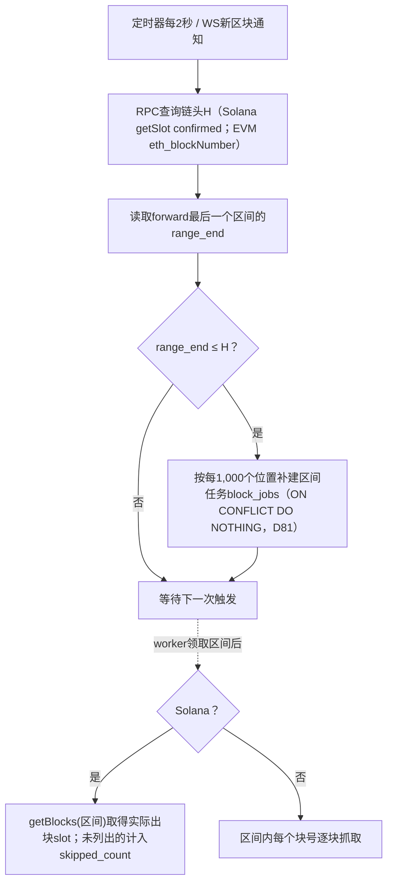
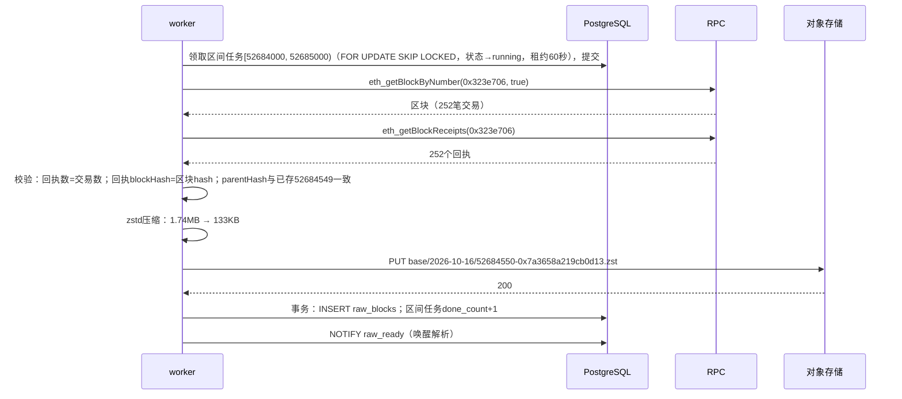
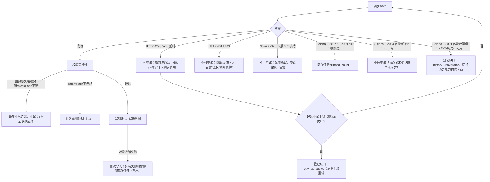
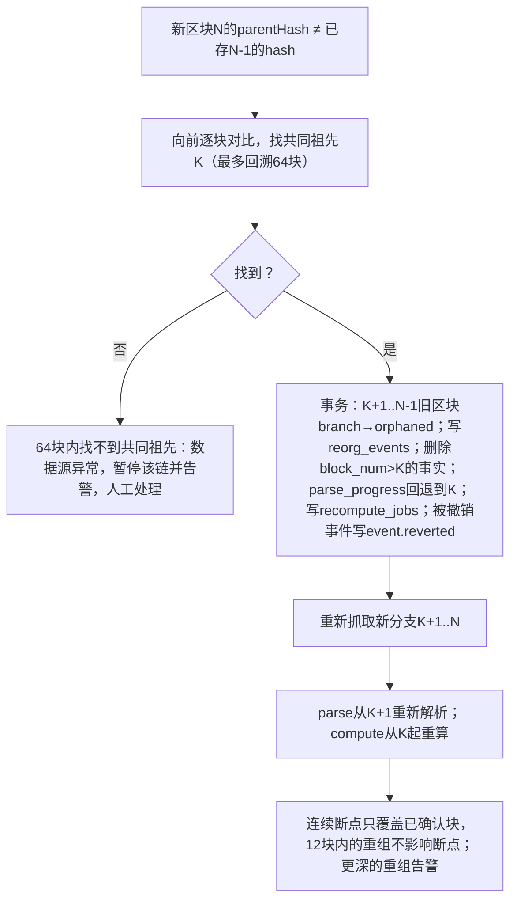

# Demo 01：区块采集

> 设计：[采集](../engineering/02-ingestion.md)、[技术方案§3.2/§4](../TECHNICAL_PLAN.md)。样本：`samples/{chain}/block-header.json`、`block-size.json`。

## 1. 真实样本

### 1.1 Solana slot 457658127

```json
{
  "slot": 457658127,
  "parentSlot": 457658126,
  "blockHeight": 435693945,
  "blockTime": 1792158153,
  "blockhash": "4Lh7SqcktbHFhhWCJg5EVyVHafUQZ26etXkxHbJjrStM",
  "previousBlockhash": "8uYb5KxKsJXDzNLazsMkHaQozty5FTWapUK7yoffj7RH"
}
```

- `blockTime` 1792158153 ＝ 2026-10-16 13:42:33 UTC。
- slot与blockHeight相差约2,196万：历史上被跳过的slot不产生区块，**两者必须分开存**。

请求参数（实测可用）：

```json
{"method": "getBlock", "params": [457658127, {
  "encoding": "json",
  "maxSupportedTransactionVersion": 1,
  "transactionDetails": "full",
  "rewards": false,
  "commitment": "confirmed"
}]}
```

### 1.2 Base 区块 52684550（节选）

```json
{
  "number": "0x323e706",
  "hash": "0x7a3658a219cb0d1378d96af45f26948914232f8da26ff12946a8c1076ea1d3cc",
  "parentHash": "0x43566ac08b989bdd83531da602ba84ab7fcede1e0aabadfb676a15c68507be1a",
  "timestamp": "0x6ad22aef",
  "receiptsRoot": "0x56d02fe3b380e80f4887e69d6f0c77164eac080ab86ba9c00cfcb1e94d442e80",
  "baseFeePerGas": "0x4c4b40"
}
```

EVM一个Raw区块＝`eth_getBlockByNumber(n, true)`＋`eth_getBlockReceipts(n)`两个请求。

### 1.3 BSC 区块 127989026（节选）

```json
{
  "number": "0x7a0f522",
  "hash": "0x6aaedae3a5e9e2875e1511eb06c3832765a3b80e48d3e7f9fb07e8e55261135a",
  "parentHash": "0x492ffdde4a60483e7e38c47e16b94770efc97ba6c8e563c94d426ce01dcf99cc",
  "timestamp": "0x6ad22b0f",
  "milliTimestamp": "0x1a144f832fc"
}
```

| 区块 | timestamp | milliTimestamp | 交易/回执 |
| --- | --- | --- | --- |
| 127988647 | 1792158308 | 1792158308**550** | 121 / 121 |
| 127988648 | 1792158309 | 1792158309**000** | 175 / 175 |
| 127988649 | 1792158309 | 1792158309**450** | 88 / 88 |
| 127989024 | 1792158478 | 1792158478**200** | 75 / 75 |
| 127989025 | 1792158478 | 1792158478**650** | 90 / 90 |
| 127989026 | 1792158479 | 1792158479**100** | 84 / 84 |

- 相邻区块相差450ms：**BSC当前0.45秒出块**，每天约19.2万块。
- 秒级`timestamp`会重复（127988648与127988649都是1792158309）。Solana也一样：slot 457658127与457658128的`blockTime`都是1792158153。**排序一律用块号/slot＋交易序号，不用时间**；BSC存毫秒时间。

### 1.4 实测大小

| 链 | 区块 | 交易数 | 日志数 | JSON | zstd-3 | zstd-19 |
| --- | --- | --- | --- | --- | --- | --- |
| Solana | 457658127 | 938（投票661，失败63） | — | 2.67MB | 448KB | 416KB |
| Solana | 457658128 | 1,485（投票729，失败216） | — | 5.56MB | 701KB | 617KB |
| Solana | 457658129 | 1,184（投票658，失败146） | — | 3.53MB | 618KB | 567KB |
| Base | 52684548 | 274 | 1,366 | 1.85MB | 144KB | 115KB |
| Base | 52684549 | 252 | 931 | 1.30MB | 114KB | 93KB |
| Base | 52684550 | 252 | 1,365 | 1.74MB | 133KB | 107KB |
| BSC | 127989024 | 75 | 477 | 0.54MB | 51KB | 43KB |
| BSC | 127989025 | 90 | 1,756 | 1.53MB | 78KB | 64KB |
| BSC | 127989026 | 84 | 891 | 0.91MB | 66KB | 55KB |

Solana剔除投票交易后zstd-3体积为332KB / 570KB / 500KB，只少19%–26%。

按样本均值外推（每链只有3块，**M0需扩大到每链1,000块**）：

| 链 | 每天区块 | 每天（zstd-3） | 30天历史（D73） | 前向每月 | 120天（对比） |
| --- | --- | --- | --- | --- | --- |
| Solana | 约21.6万 | 约127GB | 约3.8TB | 约3.8TB | 约15.3TB |
| Base | 约4.3万 | 约5.6GB | 约0.17TB | 约0.17TB | 约0.67TB |
| BSC | 约19.2万 | 约12.5GB | 约0.38TB | 约0.37TB | 约1.5TB |
| 合计 | | 约145GB | **约4.35TB** | **约4.4TB** | 约17.5TB |

## 2. 正常流程

### 2.1 调度



### 2.2 单个区块（以Base 52684550为例）



写入后的元数据行：

```json
{
  "chain": "base",
  "block_hash": "0x7a3658a219cb0d1378d96af45f26948914232f8da26ff12946a8c1076ea1d3cc",
  "height": 52684550,
  "parent_hash": "0x43566ac08b989bdd83531da602ba84ab7fcede1e0aabadfb676a15c68507be1a",
  "block_time": "2026-10-16T13:47:27Z",
  "object_key": "base/2026-10-16/52684550-0x7a3658a219cb0d13.zst",
  "compressed_bytes": 132947,
  "tx_count": 252,
  "confirmation": "pending",
  "completeness": "complete",
  "branch": "canonical"
}
```

12个区块后（约24秒）`confirmation`改为`confirmed`，连续断点推进到这里（D71）。

### 2.3 连续断点推进

区间任务内部按块记录结果；下表看区间内的5个slot（Solana 457658125–457658129）：

| 时刻 | 各slot结果 | 连续完成位置 |
| --- | --- | --- |
| t0 | 125写入、126写入、127抓取中、128写入、129抓取中 | 126 |
| t1 | 127超时，退避重试 | 126 |
| t2 | 129写入 | 126（127仍缺） |
| t3 | 127重试成功 | **129** |

若127重试8次仍失败，则写入`collection_gaps`（`retry_exhausted`），连续位置同样推进到129，缺口由后台低频补齐（见[采集§4](../engineering/02-ingestion.md)）。

## 3. 异常兜底

### 3.1 总流程



### 3.2 真实错误原文（2026-10-16复现）

**错误一：Solana交易版本**（请求slot 457658127，参数`maxSupportedTransactionVersion: 0`）

```json
{"jsonrpc":"2.0","error":{"code":-32015,"message":"Transaction version (1) is not supported by the requesting client. Please try the request again with the following configuration parameter: \"maxSupportedTransactionVersion\": 1"},"id":1}
```

- 本项目抓到的Pump买入（`42H9YF9h…wmiT`）就是v1交易。
- 处理：这是配置问题，重试不会成功。立即暂停该链采集并告警；修改配置后从断点继续，不跳过区块。解析器遇到未知版本号同样报警，不静默丢弃。

**错误二：Base公共端点403**（Python默认User-Agent请求`eth_blockNumber`）

```text
HTTP 403 Forbidden
error code: 1010
```

- `1010`是CDN按客户端特征拒绝访问，重试不会成功。
- 处理：403/401归为不可重试，直接熔断并告警，不消耗重试预算。采集客户端统一设置`User-Agent: meme-radar/<版本>`。

**错误三：Solana区块不可用**（请求尚未产生的slot 999999999）

```json
{"jsonrpc":"2.0","error":{"code":-32004,"message":"Block not available for slot 999999999"},"id":1}
```

- 链头附近的slot在节点尚未确认时也会返回这个错误；处理为稍后重试，不计为跳过。

**错误四：BSC公共端点关闭了`eth_getLogs`**（查询TokenManager2事件，范围41个区块，后改为1个区块）

```json
{"code": -32005, "message": "limit exceeded"}
```

- 单个区块也返回同样错误，30个区块×3次重试共90次全部失败。改用`eth_getBlockReceipts`逐块拉回执，16个区块22.5秒完成。
- 结论：采集**不依赖`eth_getLogs`**，统一用“区块＋全部回执”。`eth_getLogs`只作为补查工具，且要按供应商限制切分范围。

**错误五：Solana公共端点限流**

- 3个并发拉取40个完整区块（156秒），其中4个slot（457672925、457672928、457672932、457672937）重试5次后仍失败。
- 随后查询钱包历史时多次返回`HTTP 429 Too Many Requests`。
- 处理：429按可重试处理（指数退避），同时降低该供应商的并发；重试上限后登记缺口，**依赖这些slot的计算（如[07](07-labels.md)的标签窗口）等待补齐**，不能带着缺口出结果。

**观察：跳过的slot**

- `getBlocks(457600000, 457649999)`返回50,000个slot，加上样本附近的1,000个slot，**一个都没有被跳过**。
- 但slot（457658127）与blockHeight（435693945）相差约2,196万，说明历史上存在大量被跳过的slot。历史回溯时每个区间先用`getBlocks`取得实际出块列表，不逐个slot请求。
- 公共节点`getFirstAvailableBlock`返回0，能查到slot 300000000（2024-11-07）的区块：它接了长期存储。付费节点是否提供30天（D73）历史，要在M0逐家确认。

### 3.3 进程崩溃位置

| 崩溃发生在 | 重启后状态 | 恢复动作 |
| --- | --- | --- |
| 领取任务后、请求RPC前 | 任务running，租约未过期 | 租约（60秒）过期后被其他worker重新领取 |
| 写对象之后、写元数据之前 | 对象存在，无元数据行 | 重新抓取并覆盖同一对象键；对象键含hash，内容相同 |
| 元数据事务提交后、NOTIFY之前 | 已完成，解析未被唤醒 | 解析器每30秒复查兜底 |
| 解析中 | 解析进度未推进 | 从解析断点重放；事实主键幂等 |

### 3.4 重组（以EVM为例）



Solana使用`confirmed`时极少发生回滚；仍按同一流程处理（以`previousBlockhash`判断）。

### 3.5 WS通知丢失

- WS只用于提前唤醒。断开或漏推时，定时器仍每2秒查询链头。
- 验证：关闭WS 10分钟，任务表中不出现缺失位置，连续断点与链头差保持在30秒以内。

### 3.6 预算耗尽

预算到70美元提醒；到80美元停止历史任务领取与补证；到100美元前向采集与全部新增付费请求暂停并告警，由你手动恢复（D104）。缺口登记为`budget_paused`，恢复后从断点补齐。

## 4. 验收用例

| 用例 | 期望 |
| --- | --- |
| 用`maxSupportedTransactionVersion: 0`请求含v1交易的slot | 链暂停＋告警，断点不越过该slot |
| 127失败、128与129成功 | 连续完成位置停在126；127补齐（或重试耗尽转入缺口）后跳到129 |
| 对象写完后kill进程 | 重启后该块重新抓取，`raw_blocks`只有一行 |
| 构造parentHash不连续 | 生成reorg_events，旧块orphaned，K之后的事实删除并重新解析，已推送事件收到`event.reverted` |
| 返回403 | 不重试，供应商熔断 |
| 返回429 | 退避重试并降低并发；超过上限登记缺口 |
| `eth_getLogs`被禁用 | 采集不受影响（只用区块＋回执） |
| Solana空slot | 计入区间任务`skipped_count`，不当失败 |
| 回执数少于交易数 | 不写入，重试 |
