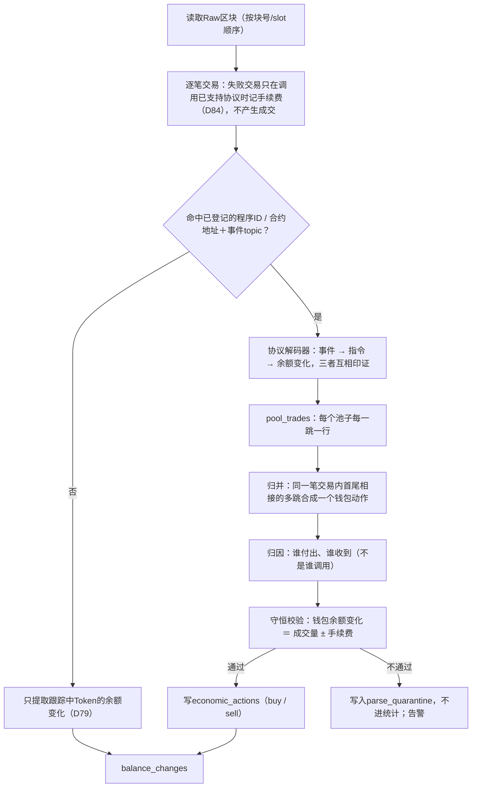
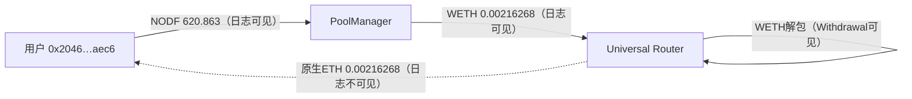
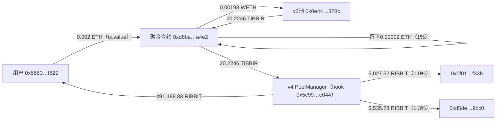
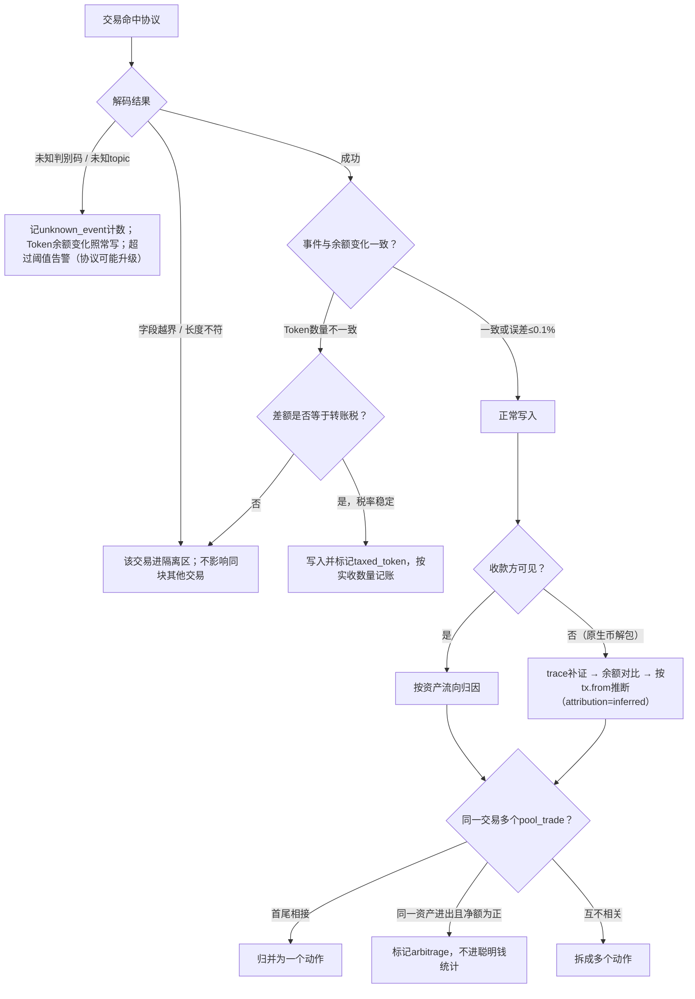

# Demo 02：协议解析与钱包归因

> 设计：[解析](../engineering/03-parsing.md)、[协议适配](../engineering/09-data-sources.md)。样本：`samples/solana/*`、`samples/base/*`、`samples/bsc/*`，解码结果见`samples/decoded.json`。

## 1. 总流程



几个规则在下面的样本中都会用到：

- **方向按Token流向判断**：钱包收到Token＝买入，付出Token＝卖出。不看指令名。
- **归因按资产流向判断**：交易签名者或`tx.from`只是候选，最终以“付出报价资产、收到Token”的地址为准。
- **费用分开记**：协议费、创建者费、聚合器费、网络费分别记录，成本口径见[05](05-ledger.md)。

## 2. 样本A：Pump曲线买入，经第三方路由转调

交易`42H9YF9h2BooitscqX2U6XpebVzJxCsn92ibpyNvTytVibsdbs8adxezMHZDTfun2pwpRLHn1nnSZZr7WiXhwmiT`，slot 457658127，**交易版本v1**。

### 2.1 原始日志（节选）

```text
Program 6Vo3245eszAb5wuqEMw8mGdbfRUdKbHhDHP5LcaGuTAB invoke [1]
Program log: Instruction: BondingCurveV3
Program 6EF8rrecthR5Dkzon8Nwu78hRvfCKubJ14M5uBEwF6P invoke [2]
Program log: Instruction: BuyExactQuoteInV2
Program pfeeUxB6jkeY1Hxd7CsFCAjcbHA9rWtchMGdZ6VojVZ invoke [3]
Program log: Instruction: GetFeesWithQuoteMint
Program return: pfeeUxB6jkeY1Hxd7CsFCAjcbHA9rWtchMGdZ6VojVZ AAAAAAAAAABfAAAAAAAAAB4AAAAAAAAA
Program TokenzQdBNbLqP5VEhdkAS6EPFLC1PHnBqCXEpPxuEb invoke [3]
Program log: Instruction: TransferChecked
Program data: vdt/007mYe7mjxCfs7OmDSmE+4XbpJFHA6AhHoOhw441BS6FZzym71c0bx0AAAAAztrgYXkBAAAB…
Program MemoSq4gqABAXKb96qnH8TysNcWxMyWCqXgDLGmfcHr invoke [1]
```

- 顶层指令是路由程序`6Vo3245e…`，Pump（`6EF8rrec…`）在第2层被调用。**只扫顶层指令会漏掉这笔**。
- 指令名为新版`BuyExactQuoteInV2`，Token使用Token-2022程序（`TokenzQdB…`）。
- 费率程序返回值解码为三个u64：`0 / 95 / 30`，即LP费0、协议费95bps、创建者费30bps。费率可逐笔从链上读取，不需要写死。

### 2.2 解码TradeEvent（判别码`bddb7fd34ee661ee`）

| 字段 | 原始值 | 换算 |
| --- | --- | --- |
| mint | `GX1JGwFmrzgkv6MBjwZZdZt3qBcWi1d5ZuAUS3KFpump` | |
| is_buy | true | |
| user | `7LMk5tKCGXgvweApmksAvfoAVAAXQWGnJdSKTn1bGLqg` | ＝交易签名者 |
| sol_amount | 493,827,159 | 0.493827159 SOL |
| token_amount | 1,620,844,796,622 | 1,620,844.796622（6位小数） |
| virtual_sol / virtual_token | 99,279,611,809 / 324,235,762,323,533 | 成交后现价3.0620×10⁻⁷ SOL |
| real_token_reserves | 44,335,762,323,533 | 曲线剩余44,335,762个，进度约94.4% |
| fee（95bps） | 4,691,359 | 收款方`G5UZ…69dP` |
| creator_fee（30bps） | 1,481,482 | 创建者`4v9uPGeH…vBuu6` |

### 2.3 用余额变化印证

| 账户 | SOL变化（lamports） | 角色 |
| --- | --- | --- |
| `7LMk…bGLqg` | −500,024,000 | 用户 |
| `HFnm…ytXRC` | +493,827,159 | 曲线账户（＝sol_amount） |
| `5YxQ…xvxeD` | +2,345,679 | 协议费账户之一 |
| `G5UZ…69dP` | +2,345,680 | 协议费账户之二（fee_recipient） |
| `C6Cu…rjHmj` | +1,481,482 | 创建者费账户（＝creator_fee） |
| `DttW…2KRL` | +10,000 | 路由收费或小费（角色待确认） |
| — | 14,000 | 网络费 |

守恒校验：

- 成交＋协议费＋创建者费＝493,827,159＋4,691,359＋1,481,482＝**500,000,000**，正好0.5 SOL：这是“指定花费0.5 SOL”的买入。
- 两个协议费账户合计2,345,679＋2,345,680＝4,691,359＝事件中的fee。
- 用户总支出＝500,000,000＋10,000＋14,000＝500,024,000。✓
- Token：曲线账户−1,620,844.796622，用户＋1,620,844.796622。✓

### 2.4 写入结果

```json
{
  "pool_trade": {
    "chain": "solana", "tx": "42H9YF9h…wmiT", "slot": 457658127, "ix_path": "2.0",
    "protocol": "pump_curve", "pool": "HFnmyKGX59cwyaEeJAD7UNUHMU3zJ6tproPowfrytXRC",
    "token": "GX1JGwFmrzgkv6MBjwZZdZt3qBcWi1d5ZuAUS3KFpump",
    "quote_asset": "SOL", "token_amount": "1620844.796622", "quote_amount": "0.493827159",
    "protocol_fee": "0.004691359", "creator_fee": "0.001481482"
  },
  "economic_action": {
    "wallet": "7LMk5tKCGXgvweApmksAvfoAVAAXQWGnJdSKTn1bGLqg", "side": "buy",
    "token_amount": "1620844.796622", "quote_spent": "0.5", "other_cost_sol": "0.000024",
    "usd_value": "52.6235", "route": ["6Vo3245e…(router)", "pump_curve"]
  }
}
```

`usd_value` 52.6235＝0.5 SOL × 105.247，不含网络费与路由小费（这两项记在`chain_txs`）。示例中的美元值是派生计算的结果，用于说明；事实表本身只存原子数量（D85）。

## 3. 样本B：PumpSwap——指令名与方向相反

交易`PdkLZn9oANPB2WZybToyhaXmHxc8pWEBNxxaTTrRbXdspNAwWoThqk9F3yTCaJKcqLSBgBWfbdc4Ggmg8Ea38Um`，slot 457658127。

```text
Program pAMMBay6oceH9fJKBRHGP5D4bD4sWpmSwMn52FMfXEA invoke [1]
Program log: Instruction: Sell
Program return: pfeeUxB6jkeY1Hxd7CsFCAjcbHA9rWtchMGdZ6VojVZ GQAAAAAAAAAFAAAAAAAAAAAAAAAAAAAA     ← 25 / 5 / 0 bps
Program data: Pi83CqUD3CrJKdJqAAAAAJbNz5UAAAAAJQdevpoNAACWzc+V…                              ← 判别码 3e2f370aa503dc2a
```

这个池子的**base是WSOL，quote是Token**（与常见方向相反）。`Sell`卖出的是WSOL，从Token角度看是**买入**。

| SellEvent字段 | 值 |
| --- | --- |
| base_amount_in | 2.513423766 WSOL |
| pool_base / pool_quote（成交前） | 115.459817834 WSOL / 741,277,222.883642 Token |
| quote_amount_out | 15,792,926.102441 |
| lp_fee（25bps，留在池内） | 39,482.315257 |
| protocol_fee（5bps） | 7,896.463052 |
| user_quote_amount_out | 15,745,547.324132 |

印证：

- 恒定乘积：741,277,222.88 × 2.513423766 ÷ (115.459817834＋2.513423766)＝15,792,935.45，与事件差9.35个（0.00006%，取整与费用计算顺序造成）。差异在千分之一以内视为通过。
- 余额变化：池子＋2.513423766 WSOL、−15,753,443.787184 Token；用户＋15,745,547.324132；`62qc…NgV`与`A7hA…piqW`各＋3,948.231526。15,745,547.324132＋3,948.231526×2＝15,753,443.787184。✓

```json
{
  "economic_action": {
    "wallet": "HpzVbfyDohem6b5hwSqViVVnjWTPQ7Exa1LvPuV9w9TU", "side": "buy",
    "token": "EvJBc8govNsZ4fi5SSKp3BPXg9AVyssipm16c2GPbg4e",
    "token_amount": "15745547.324132", "quote_spent": "2.513423766", "usd_value": "264.5302",
    "note": "pool base=WSOL; instruction 'Sell' means token BUY"
  }
}
```

## 4. 样本C：Four.meme用USDT买入，手续费拆两份

交易`0xcff838fda51d4b74354dd77b775d5e80bd965e80bebc316dd455ddfdd252197b`，BSC区块127989001。`tx.to`是TokenManager2（`0x5c95…762b`），`value`为0。

### 4.1 原始日志：TokenPurchase（所有字段非indexed，全在data里）

```text
address: 0x5c952063c7fc8610ffdb798152d69f0b9550762b
topic0 : 0x7db52723a3b2cdd6164364b3b766e65e540d7be48ffa89582956d8eaebe62942
data   : 000000000000000000000000f657490f3c5563895ee06833cc54d43f13ce4444   token
         00000000000000000000000005d072ff4fc64df106e4ebe30601d39f407b4b57   account
         00000000000000000000000000000000000000000000000000001e8d7a6f1ea2   price
         00000000000000000000000000000000000000000000962a2688509c47642a00   amount
         00000000000000000000000000000000000000000000000149e357c56e9555b7   cost
         000000000000000000000000000000000000000000000000034c83700de7e4b2   fee
         0000000000000000000000000000000000000000002f1445df80b0fd69d1f000   offers
         0000000000000000000000000000000000000000000001a0ec10e917211c3d99   funds
```

| 字段 | 换算 |
| --- | --- |
| token | “飞行汽车” `0xf657…4444`，总量10亿 |
| price | 0.000033592993 **USDT**/个 |
| amount | 709,132.512239 |
| cost / fee | 23.770940 / 0.237709 USDT（1%） |
| offers | 曲线剩余56,915,249.78个 |
| funds | 曲线已募集7,690.86 USDT |

### 4.2 Transfer印证

| logIndex | Token | from → to | 数量 |
| --- | --- | --- | --- |
| 453 | USDT | 用户 → TokenManager2 | 24.008649 |
| 455 | USDT | TokenManager2 → `0x821c…40aa` | 0.225824（fee的95%） |
| 456 | USDT | TokenManager2 → `0x2b6e…3b28` | 0.011885（fee的5%） |
| 457 | 飞行汽车 | TokenManager2 → 用户 | 709,132.512239 |

24.008649＝23.770940＋0.237709。✓

要点：**Four.meme曲线不一定用BNB报价**。报价资产从用户付出的Token识别（这里是USDT `0x55d3…7955`），美元价直接按1:1计算。

## 5. 样本D：Four.meme创建＋开发者首买

交易`0x5e75a5d4772bf4b4112bbd7212365f4406c421f4fe637f7ca250108aad7e81e9`，区块127988960，2026-10-16 13:47:29 UTC。同一笔交易内先`TokenCreate`再`TokenPurchase`：

| 事件 | 关键字段 |
| --- | --- |
| TokenCreate | creator `0x47a3…7647`；token “sanctuary” `0x0e67…ffff`；totalSupply 10亿；requestId 103258278；launchTime 0；launchFee 0 |
| TokenPurchase | account＝creator；amount 349.959306；cost 0.00000154 BNB；fee 0.0000000154 BNB；price 4.4005×10⁻⁹ BNB；offers 799,999,650.04；funds＝cost |

- `tx.value`为0.0000015862 BNB，大于cost＋fee＝0.0000015554 BNB；差额0.0000000308 BNB不在事件中，需要用trace或余额变化确认去向（可能是退款或额外费用）。
- 曲线可售量为8亿（offers＋已售≈800,000,000）。
- 这笔是开发者标签的直接证据，见[07](07-labels.md)。

## 6. 样本E：Base Uniswap v4经Universal Router卖出

交易`0xba312a55b8d9fa15fd546e3c4c90dfbf49270fe9e8b0e433996c3dbe2218462b`，区块52684550。`tx.from`＝`0x2046…aec6`，`tx.to`＝Universal Router `0x6ff5…9b43`，函数选择器`0x3593564c`（execute）。

### 6.1 原始日志（5条）

| logIndex | 地址 | 事件 |
| --- | --- | --- |
| 0x12b | PoolManager `0x4985…2b2b` | Swap（topic `0x40e9cecb…`） |
| 0x12c | Hook `0xbdf9…6544` | 自定义事件`0x1d9f7b5e…`（未知，忽略） |
| 0x12d | NODF | Transfer 用户 → PoolManager，620.863089 |
| 0x12e | WETH | Transfer PoolManager → Router，0.00216268 |
| 0x12f | WETH | Withdrawal（Router把WETH解包为ETH） |

Swap事件原文：

```text
topics: 0x40e9cecb9f5f1f1c5b9c97dec2917b7ee92e57ba5563708daca94dd84ad7112f
        0x1c934aa126722d618d4130054c150b92c8b12ccff6eb80a39f0a2f7ff705ddca     poolId
        0x0000000000000000000000006ff5693b99212da76ad316178a184ab56d299b43     sender = Router
data:   amount0      =  2,162,680,000,000,000        (+0.00216268 WETH，交换方收到)
        amount1      = -620,863,089,260,929,294,569  (−620.863 NODF，交换方付出)
        sqrtPriceX96 =  42424071358710935514104619280125
        liquidity    =  655317491415253560218
        tick         =  125669
        fee          =  3000
```

### 6.2 归因难点：用户收到的ETH在日志里不可见



- Swap的sender是Router，不是用户。只凭日志能确认“用户付出了NODF”，但不能确认“谁收到了ETH”。
- 兜底顺序：①`debug_traceTransaction`（callTracer）找Router对外的ETH转账；②trace不可用时，比较用户前后两个区块的余额（需要归档节点，且同块内无其他交易）；③都不可用，按`tx.from`归因并记`attribution=inferred`：计入钱包账本，但不进入聪明钱识别样本（[解析§4](../engineering/03-parsing.md)）。
- 网络费：L2执行费0.0000010208 ETH＋L1数据费0.0000000045 ETH≈$0.0025。

价格：0.00216268 ÷ 620.863＝3.4833×10⁻⁶ ETH ≈ **$0.0085484**；与tick 125669推出的价格一致（1.0001^−125669 ≈ 3.48×10⁻⁶）。

## 7. 样本F：Base聚合器两跳买入＋三层费用

交易`0x271788fbf642353989e4a1550c1493c66be3742fbe24b15db5096dbbdb815020`，区块52684550，13条日志，gas 460,611。



| 层 | 写入 |
| --- | --- |
| pool_trades | 2行：WETH→TIBBIR（v3）、TIBBIR→RIBBIT（v4） |
| economic_actions | 1行：用户**买入**RIBBIT 491,188.83，花费0.002 ETH（$4.908），用户实际单价$0.00000999 |
| 中间Token TIBBIR | 聚合合约先收后付，净变化0：**不算用户买卖，也不算持仓** |
| 费用 | 聚合器费0.00002 ETH；Token端分成1.0%与1.3%（推测为hook或前端分成），写入费用明细 |

这笔最初被抓取脚本当成“套利”，人工核对资金流向后确认是普通买入。判断套利的条件应为：**同一地址付出与收到的是同一种资产，且净额为正**；本例付出ETH、收到RIBBIT，不是套利。

## 8. 样本G：BSC Pancake两跳USDT→WBNB→ACC

交易`0x674ae7939b20c2ab45bd5ed6860ff7b4a38778ba7c04c7d5d9ef6a2b22eeff21`，区块127988969，`tx.to`＝Pancake Router V2 `0x10ed…024e`。

| logIndex | Token | from → to | 数量 |
| --- | --- | --- | --- |
| 621 | USDT | 用户`0x6f0e…e03a` → WBNB/USDT对`0x16b9…0dae` | 0.795709 |
| 623 | WBNB | `0x16b9…0dae` → WBNB/ACC对`0x81d5…2e2a` | 0.00109091 |
| 626 | ACC | `0x81d5…2e2a` → 用户 | 104.464380 |

- 归并：第1跳的输出（WBNB）等于第2跳的输入，且中间不经过用户，合成一个动作：用户用0.795709 USDT买入104.464 ACC，单价$0.0076170。
- 第一跳同时是一条WBNB/USDT成交：推出BNB＝$729.40（见[03](03-pricing.md)）。

## 9. 异常兜底

### 9.1 流程



### 9.2 处理规则

| 情况 | 真实例子 | 处理 |
| --- | --- | --- |
| 协议被第三方程序转调 | 样本A：路由`6Vo3245e…`调用Pump | 扫描全部内部指令和事件，不只看顶层 |
| 新指令名 | `BuyExactQuoteInV2`、`BondingCurveV3` | 以事件判别码为准；指令名只用于日志与排查 |
| 池子base/quote反向 | 样本B | 方向按Token流向判断 |
| 报价资产不是原生币 | 样本C：USDT | 报价资产从付出方Token识别 |
| 原生币收款不可见 | 样本E | trace补证，最终降级 |
| 中间Token | 样本F：TIBBIR | 净变化为0的地址不产生动作 |
| 多方分成 | 样本C、F | 每一笔分成写费用明细；未知收款方标`fee_unknown` |
| 交易失败 | slot 457658127中63笔失败 | 调用了已支持协议的才写`chain_txs`（`success=false`）记网络费，不产生成交（D84） |
| 税币 | 未采到 | Transfer实收少于事件数量，按实收记账并标记 |
| 未知事件 | 样本E：hook事件`0x1d9f7b5e…` | 忽略，不影响Swap解码 |
| 解码器版本升级 | — | 新版本写影子分区，与旧结果校验通过后按区间整段替换（D86） |

## 10. 验收用例

| 用例 | 期望 |
| --- | --- |
| 样本A | buy，1,620,844.796622个，quote_spent 0.5 SOL，协议费与创建者费分开 |
| 样本B | buy（不是sell），15,745,547.324132个 |
| 样本C | 报价资产USDT，cost＋fee＝用户付出 |
| 样本E | sell 620.863 NODF；无trace时`attribution=inferred` |
| 样本F | 1个buy动作；TIBBIR不产生动作；2个pool_trade |
| 样本G | 1个buy动作；同时产生WBNB/USDT价格点 |
| 删掉样本A的Program data日志 | 进隔离区，不写成交 |
| 同一区块重复解析两次 | 结果行数不变（幂等） |
