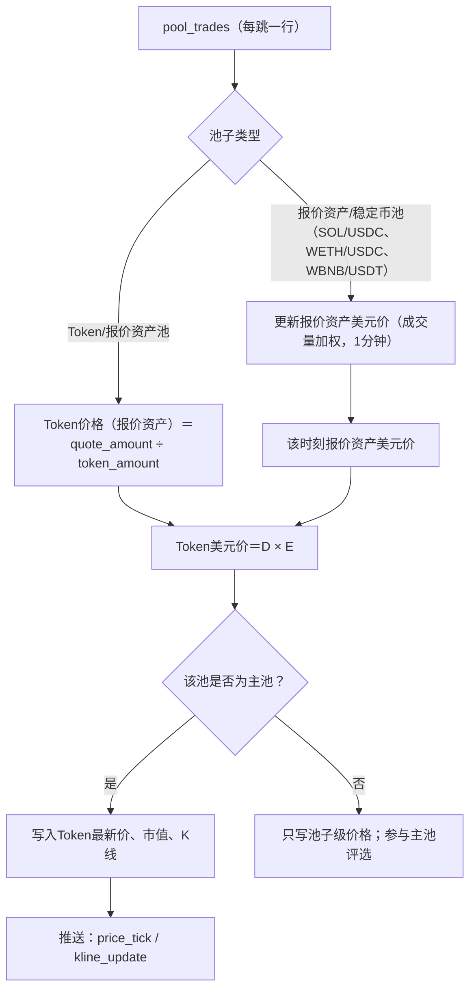
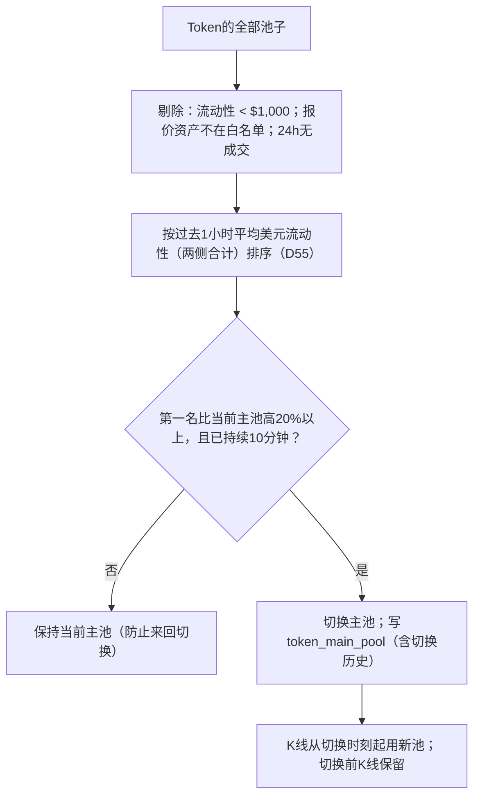
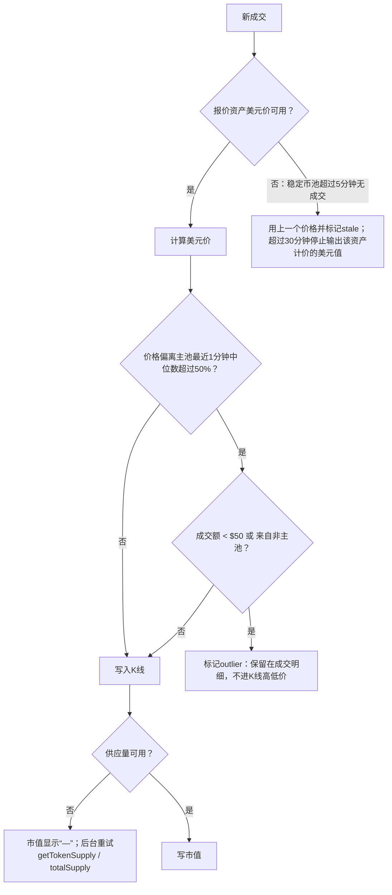

# Demo 03：计价、市值与K线

> 设计：[计价](../engineering/04-pricing.md)。样本价格全部来自`samples/decoded.json`。

## 1. 正常流程

## 2. 报价资产美元价（真实）

| 资产 | 成交 | 计算 | 美元价 |
| --- | --- | --- | --- |
| SOL | `4sewivDn…KE2v`：付248 USDC，得2.356362194 SOL | 248 ÷ 2.356362194 | **105.247** |
| ETH | `0x8ee180bb…477e`：池子付出0.610924739 WETH，收1,499.25 USDC | 1,499.25 ÷ 0.610924739 | **2,454.07** |
| BNB | `0x674ae793…ff21`第一跳：0.795709 USDT换0.00109091 WBNB | 0.795709 ÷ 0.00109091 | **729.40** |

生产中每分钟用该资产在白名单稳定币池的全部成交做成交量加权平均；单笔只用于演示。

## 3. Token价格与市值（真实）

| Token | 链 | 价格来源 | 价格（报价资产） | 美元价 | 供应量 | 市值 |
| --- | --- | --- | --- | --- | --- | --- |
| `GX1J…pump` | Solana | Pump曲线成交后虚拟储备 | 3.0620×10⁻⁷ SOL | $0.000032226 | 955,336,024.27 | **$30,786.83** |
| `EvJB…bg4e` | Solana | PumpSwap池储备（成交前） | 1.5576×10⁻⁷ SOL | $0.000016393 | 1,000,000,000 | $16,393.05 |
| 同上 | Solana | PumpSwap池储备（成交后） | 1.6260×10⁻⁷ SOL | $0.000017114 | 1,000,000,000 | $17,113.60 |
| 飞行汽车 `0xf657…4444` | BSC | Four.meme事件price | 0.000033593 USDT | $0.000033593 | 1,000,000,000 | **$33,592.99** |
| sanctuary `0x0e67…ffff` | BSC | 开发者首买price | 4.4005×10⁻⁹ BNB | $0.0000032097 | 1,000,000,000 | $3,209.74 |
| NODF `0x5b7c…38d3` | Base | v4成交 | 3.4833×10⁻⁶ ETH | $0.0085484 | 10,000,000,000 | $85.48M |
| ACC `0xc513…c493` | BSC | 两跳成交 | 1.0443×10⁻⁵ BNB | $0.0076170 | 500,000,000 | $3.81M |

三个要点：

1. **市值用链上实时供应量**：`GX1J…pump`的供应量是955,336,024.27，不是Pump默认的10亿；若用10亿，市值会高估4.7%。
2. **成交均价≠成交后现价**：样本A的成交均价为$0.000032066（0.493827159 SOL ÷ 1,620,844.80个），成交后现价为$0.000032226，相差0.5%。K线收盘价用成交均价；Token详情页的“当前价格”用池子现价。
3. **单笔大额会拉动价格**：PumpSwap这笔2.5 SOL的买单让价格从$0.000016393升到$0.000017114（+4.4%）。

流动性（定义：两侧储备美元值之和；曲线用报价资产实际储备×2）：Pump曲线成交后69.279611809 SOL×2×$105.247＝**$14,582.94**；PumpSwap池成交前115.46 SOL×2×$105.247＝**$24,303.59**，成交后$24,832.65。

## 4. 主池选择

毕业场景：`GX1J…pump`曲线进度94.4%（剩余44,335,762个，按初始可售7.931亿计算）。毕业后曲线关闭，Token迁移到PumpSwap：

| 时刻 | 主池 | 规则 |
| --- | --- | --- |
| 毕业前 | Pump曲线`HFnm…ytXRC` | 曲线是唯一池 |
| 毕业交易所在区块 | 曲线停止；PumpSwap新池出现 | 曲线`complete=true`后**立即切换**，不等10分钟 |
| 之后 | PumpSwap池 | 正常评选 |

## 5. K线

以样本A为第一笔成交，构造同一分钟内后续两笔（构造数据已标注）：

| 时间（UTC） | 来源 | 成交均价 | 成交额 |
| --- | --- | --- | --- |
| 13:42:33 | 真实：`42H9YF9h…wmiT` | $0.000032066 | $51.97 |
| 13:42:41 | 构造 | $0.000032410 | $120.00 |
| 13:42:58 | 构造 | $0.000031980 | $35.00 |

1分钟K线（13:42）：开$0.000032066、高$0.000032410、低$0.000031980、收$0.000031980、成交额$206.97、笔数3。

成交额按“报价资产实际成交量×美元价”计算：0.493827159 SOL×105.247＝$51.97，不含手续费。

## 6. 异常兜底

| 情况 | 例子 | 处理 |
| --- | --- | --- |
| 报价资产不是原生币 | 飞行汽车用USDT | 稳定币按1:1，不经过BNB价格 |
| 稳定币脱锚 | 构造：USDT 0.97 | 首版仍按1美元（D54），美元值会偏高约3%；脱锚监测与按实际价格计价后续评估 |
| 价格依赖循环 | 样本G：BNB价与ACC价来自同一交易 | 报价资产只用白名单稳定币池定价，Token池不反推报价资产 |
| 供应量变化 | `GX1J…pump`为9.55亿 | 每小时刷新；Transfer到零地址时立即刷新 |
| 粉尘交易操纵 | 构造：$0.5买单把价格打到3倍 | outlier规则，不进K线高低价 |
| 历史回溯时缺报价资产价 | 回溯初期稳定币池数据未齐 | 事实表不存美元（D85）；派生作业遇到缺价分钟先写NULL，价格补齐后重算该分钟 |
| 重组 | 见[01](01-ingestion.md) | 受影响的K线分钟重算并推送更正 |

## 7. 验收用例

| 用例 | 期望 |
| --- | --- |
| 用样本A计算市值 | $30,786.83（供应量955,336,024.27） |
| 用10亿代替链上供应量 | 测试失败（防止回归） |
| 样本C（USDT报价） | 美元价＝事件price，不乘BNB价 |
| 主池第一名领先25%持续5分钟 | 不切换 |
| 曲线complete | 立即切换主池 |
| 稳定币池停止成交31分钟 | 依赖该资产的美元值显示为不可用 |
