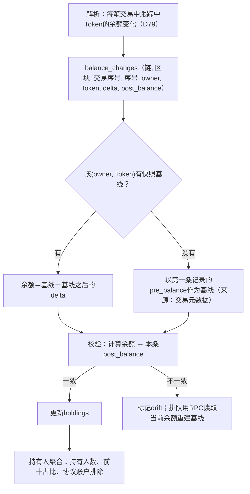
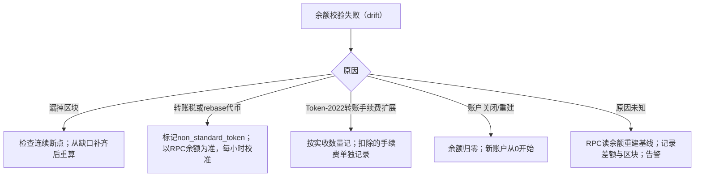

# Demo 04：持仓与持有人

> 设计：[持仓](../engineering/05-holdings.md)。样本：`samples/solana/pump-trade.json`、`pumpswap-trade.json`中的`preTokenBalances`/`postTokenBalances`。

## 1. 真实样本：交易前后余额

### 1.1 PumpSwap买家已有持仓

交易`PdkLZn9o…Ea38Um`，Token `EvJBc8govNsZ4fi5SSKp3BPXg9AVyssipm16c2GPbg4e`（6位小数）：

| 账户（owner） | 角色 | 交易前 | 交易后 | 变化 |
| --- | --- | --- | --- | --- |
| `HpzVbfyD…w9TU` | 买家 | 9,032,766.397190 | 24,778,313.721322 | **+15,745,547.324132** |
| `88SUbRzc…6K1g` | 池子 | 741,277,222.883642 | 725,523,779.096458 | −15,753,443.787184 |
| `62qc2CNX…NgV` | 协议费 | 2,138,879.470344 | 2,142,827.701870 | +3,948.231526 |
| `A7hAgCzF…piqW` | 协议费 | 2,138,879.585801 | 2,142,827.817327 | +3,948.231526 |
| `8N3GDa…` | 未知（余额始终为0） | 0 | 0 | 0 |

- 事件字段`user_quote_token_reserves`＝9,032,766.397190，正好等于买家交易前余额：事件与余额两路数据可以互相校验。
- 变化合计：+15,745,547.324132 − 15,753,443.787184 + 3,948.231526×2 ＝ 0。✓ 这笔交易没有增发或销毁。
- 买家在本次之前已持有903万个。如果30天回溯窗口（D73）内找不到这部分的买入记录，就是**未知成本持仓**（见[05](05-ledger.md)）。

### 1.2 Pump曲线账户：持有量≠可售量

交易`42H9YF9h…wmiT`，Token `GX1J…pump`：

| 账户 | 交易前 | 交易后 |
| --- | --- | --- |
| 曲线`HFnmyKGX…ytXRC` | 252,856,607.120155 | 251,235,762.323533 |
| 买家`7LMk…bGLqg` | 0（本交易新建账户） | 1,620,844.796622 |

事件`real_token_reserves`＝44,335,762.323533，曲线账户实际持有2.512亿。差额206,900,000是**毕业迁移预留量**，不可售。持有人列表里这个账户标为“曲线（协议）”，不计入前十持仓集中度。

## 2. 正常流程

Solana可以直接用交易元数据中的`pre/postTokenBalances`；EVM没有逐笔余额，要靠Transfer累加，因此EVM更需要基线：

| 链 | 基线来源 | 每笔变化来源 |
| --- | --- | --- |
| Solana | 首次出现时的`preTokenBalances` | `post − pre` |
| EVM | 回溯起点的`balanceOf`（归档节点，按区块号查询） | Transfer事件累加 |

## 3. 持有人聚合（以`EvJB…bg4e`为例，构造其余持有人）

| 排名 | 地址 | 持有量 | 占比 | 类型 |
| --- | --- | --- | --- | --- |
| — | `88SU…6K1g` | 725,523,779.10 | 72.55% | 池子（排除） |
| 1 | `HpzV…w9TU` | 24,778,313.72 | 2.48% | 真实样本 |
| 2 | `62qc…NgV` | 2,142,827.70 | 0.21% | 协议费账户（排除） |
| 3 | 构造 | 18,000,000.00 | 1.80% | |

前十占比的分母用流通供应量（总供应量减去销毁地址余额；本例无销毁，为10亿）。排名时排除池子、曲线、协议费账户与销毁地址，与[标签定义](../metrics/labels.md)一致。

## 4. 异常兜底

| 情况 | 例子 | 处理 |
| --- | --- | --- |
| 交易中新建账户 | `7LMk…`的Token账户 | 交易前余额视为0 |
| 余额为0的账户 | `8N3GDa…` | 不进持有人列表 |
| 同一owner多个Token账户 | — | 按owner汇总 |
| 失败交易 | 63笔失败交易 | 失败交易没有余额变化，跳过 |
| EVM回溯起点无归档节点 | — | 从起点之后的Transfer累加，余额标`partial`，不参与集中度 |
| 重组 | — | 共同祖先之后的`balance_changes`按位置删除并重新解析（D78），持仓从共同祖先重放 |

## 5. 验收用例

| 用例 | 期望 |
| --- | --- |
| PumpSwap样本 | 买家余额24,778,313.721322；变化合计为0 |
| Pump样本 | 曲线账户标为协议，不进前十 |
| 首次出现即有903万余额 | 基线来自preTokenBalances，未知成本部分在账本中单独标出 |
| 人为删除一条delta | 下一笔校验失败，触发重建 |
