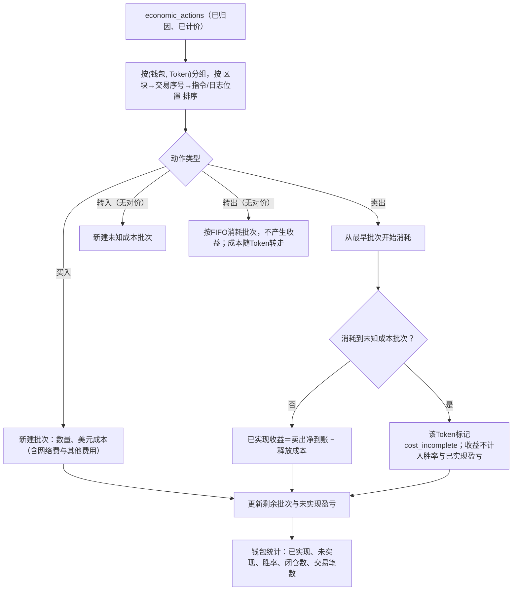
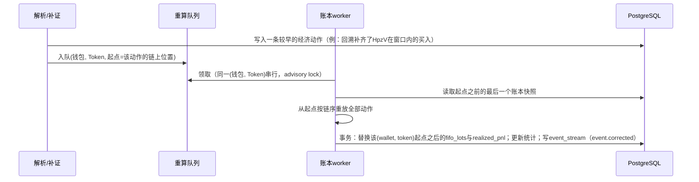

# Demo 05：FIFO账本与钱包统计

> 设计：[钱包指标与FIFO](../metrics/wallet-metrics.md)、[计算](../engineering/13-analytics.md)。第一笔买入为真实成交，后续动作为**构造**，已逐行标注。

## 1. 正常流程



## 2. 例一：成本完整（钱包`7LMk…bGLqg`，Token `GX1J…pump`）

| # | 时间（UTC） | 来源 | 动作 | 数量 | 金额 | 美元 |
| --- | --- | --- | --- | --- | --- | --- |
| 1 | 13:42:33 | **真实** `42H9YF9h…wmiT` | 买入 | 1,620,844.796622 | 0.500024 SOL（含网络费0.000014与路由费0.00001） | $52.6260（SOL $105.247） |
| 2 | 13:50:00 | 构造 | 买入 | 1,000,000 | 0.4 SOL | $42.0000（SOL $105.00） |
| 3 | 14:05:00 | 构造 | 卖出 | 2,000,000 | 净到账0.85 SOL（已扣费） | $90.1000（SOL $106.00） |

卖出处理：

| 批次 | 消耗数量 | 释放成本 |
| --- | --- | --- |
| 批次1（$0.0000324683/个） | 1,620,844.796622（全部） | $52.6260 |
| 批次2（$0.000042/个） | 379,155.203378 | $15.9245 |
| 合计 | 2,000,000 | **$68.5505** |

- 已实现收益＝$90.1000 − $68.5505＝**$21.5495**。
- 剩余批次2：620,844.796622个，成本$26.0755。
- 未实现盈亏＝620,844.796622 × 当前价 − $26.0755。

钱包×Token状态：

```json
{
  "wallet": "7LMk5tKCGXgvweApmksAvfoAVAAXQWGnJdSKTn1bGLqg",
  "token": "GX1JGwFmrzgkv6MBjwZZdZt3qBcWi1d5ZuAUS3KFpump",
  "cost_complete": true,
  "lots": [{"qty": "620844.796622", "cost_usd": "26.0755", "opened_by": "constructed#2"}],
  "realized_usd": "21.5495",
  "buy_count": 2, "sell_count": 1,
  "closed_cycles": 0,
  "input_version": 3
}
```

`closed_cycles`为0：持仓未归零，不算“完整闭仓”，暂不计入聪明钱识别的闭仓数。

## 3. 例二：期初已有余额（钱包`HpzV…w9TU`，Token `EvJB…bg4e`）

[04](04-holdings.md)中看到这个钱包在PumpSwap买入前已持有9,032,766.397190个。设30天回溯窗口（D73）内找不到它的买入记录：

| # | 来源 | 动作 | 数量 | 美元 |
| --- | --- | --- | --- | --- |
| 0 | **真实**（preTokenBalances） | 期初余额 → 未知成本批次 | 9,032,766.397190 | 未知 |
| 1 | **真实** `PdkLZn9o…Ea38Um` | 买入 | 15,745,547.324132 | $264.5309（2.513429367 SOL，含网络费5,601 lamports） |
| 2 | 构造 | 卖出 | 12,000,000 | 净到账$300.00 |

卖出处理：

| 批次 | 消耗数量 | 释放成本 |
| --- | --- | --- |
| 未知成本批次 | 9,032,766.397190（全部） | 未知 |
| 批次1 | 2,967,233.602810 | $49.8506 |

- 释放成本中有未知部分，因此**该Token标记为成本不完整**：已实现收益显示“--”，不计入胜率、榜单盈亏、聪明钱识别。
- 剩余12,778,313.721322个，成本$214.6803。之后这部分的未实现盈亏可以计算，但Token整体仍为成本不完整。
- 页面提示：“部分持仓来自统计起点前或转入，成本未知”。

## 4. 重算



例：回溯补齐后发现期初903万个其实是窗口内用0.9 SOL买的，未知成本批次被替换为正常批次，该Token变为成本完整，收益与胜率随之更新；结果整体替换，不叠加。

## 5. 异常兜底

| 情况 | 处理 |
| --- | --- |
| 卖出数量大于已知批次合计 | 差额视为未知来源，生成未知成本批次后再消耗；标记成本不完整并记录差额 |
| 成交时刻报价资产无美元价 | 该动作美元值为null，所在Token标记成本不完整，价格补齐后重算 |
| 归因为推断（`attribution=inferred`） | 照常记账，但该钱包×Token不进入聪明钱识别 |
| 交易被重组撤销 | 共同祖先之后的动作按位置删除并重新解析（D78），账本从该位置重放；已推送事件发`event.reverted` |
| 同一笔交易里先买后卖 | 按指令/日志顺序处理，是一次完整闭仓 |
| 空投或转入 | 未知成本批次，不算买入笔数 |
| 转给自己的其他钱包 | 第一版不识别关联钱包，按转出处理（成本随Token转走，不产生收益） |
| 灰尘余额（价值<$0.01） | 视为已清仓，用于判断闭仓；余额本身保留 |

## 6. 验收用例

| 用例 | 期望 |
| --- | --- |
| 例一 | 释放成本$68.5505，已实现收益$21.5495，剩余620,844.796622个，成本$26.0755 |
| 例二 | Token成本不完整；已实现收益不计入统计 |
| [指标文档](../metrics/wallet-metrics.md)算例一、二 | 利润18.6、107.6 |
| 补入更早买入 | 版本号加1，统计替换而非叠加 |
| 同一输入重放两次 | 结果完全一致 |
