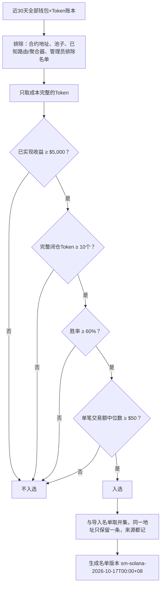
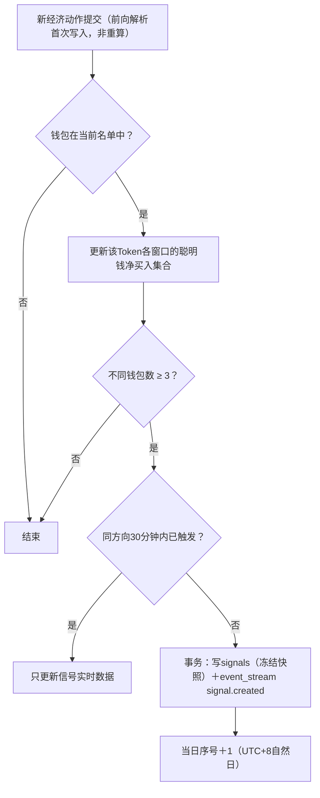
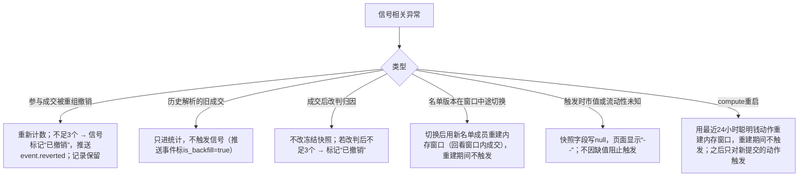

# Demo 06：聪明钱识别与信号

> 设计：[聪明钱名单](../metrics/smart-money.md)、[信号](../product/02-signals.md)、[计算](../engineering/13-analytics.md)。钱包统计为**构造数据**；信号演示中的第一笔买入使用真实成交。

## 1. 自动识别

### 1.1 流程（每天UTC+8 00:00，单链独立）



### 1.2 构造样例

| 钱包 | 已实现 | 闭仓Token | 胜率 | 中位交易额 | 其他 | 结果 |
| --- | --- | --- | --- | --- | --- | --- |
| W1 | $12,400 | 18 | 72% | $310 | | ✅ 入选 |
| W2 | $5,000 | 10 | 60% | $50 | 全部恰好等于阈值 | ✅ 入选（阈值含等号） |
| W3 | $48,000 | 9 | 89% | $2,100 | | ❌ 闭仓不足 |
| W4 | $9,800 | 25 | 64% | $18 | | ❌ 疑似刷量小号 |
| W5 | $31,000 | 40 | 70% | $900 | 地址是聚合合约`0xd8ba…a4e2`（[02](02-parsing.md)样本F） | ❌ 已知聚合器 |
| W6 | $6,200 | 12 | 67% | $120 | 另有一个Token成本不完整、亏损$20,000 | ✅ 入选；成本不完整的Token不参与计算 |
| `7LMk…bGLqg` | 见[05](05-ledger.md)例一 | 0 | — | — | 只有一个Token且未闭仓 | ❌ |

W6说明了“成本不完整不参与”的副作用：真实亏损可能被隐藏。页面在钱包详情显示“N个Token成本不完整”，让用户自行判断。

### 1.3 名单版本切换

| 时刻 | 事件 | 当前版本 | 已打开的列表 |
| --- | --- | --- | --- |
| 10-16 23:50 | 用户打开资金流入，`query_id=q_1`绑定 | v41 | v41 |
| 10-17 00:00 | 自动重算：W3移出，W2加入 | v42 | 仍为v41，翻页不变 |
| 10-17 00:03 | 用户点刷新 | v42 | 新`query_id=q_2`绑定v42 |

## 2. 信号触发

规则（D60）：同一Token在窗口内≥3个不同聪明钱净买入即触发；同方向冷却30分钟；只看链上时间在触发前的事实；历史补采不触发。

### 2.1 时间线（窗口5m，Token `GX1J…pump`）

设`7LMk…bGLqg`在当前名单中（构造假设），其余为构造钱包：

| 链上时间（UTC） | 钱包 | 动作 | 金额 | 当时市值 | 窗口内净买入钱包数 | 结果 |
| --- | --- | --- | --- | --- | --- | --- |
| 13:42:33 | `7LMk…`（**真实成交**） | 买入 | $52.62 | $30,787 | 1 | |
| 13:43:10 | SM-A | 买入 | $800 | $31,500 | 2 | |
| 13:43:40 | SM-B | 买入 | $300 | $32,050 | 2 | SM-B同时卖出$400，净卖出，不计 |
| 13:44:05 | SM-C | 买入 | $1,200 | $33,900 | **3** | **触发买入信号#1** |
| 13:46:30 | SM-D | 买入 | $500 | $35,000 | 4 | 冷却中，只更新实时数据 |
| 14:15:00 | SM-E、SM-F、SM-G | 买入 | 各$200 | $41,000 | 3（窗口14:10–14:15） | 冷却已过（>30分钟）→ **今日第2次推送** |

### 2.2 冻结快照

```json
{
  "signal_id": "sig_solana_GX1J_20261016_1",
  "token": "GX1JGwFmrzgkv6MBjwZZdZt3qBcWi1d5ZuAUS3KFpump",
  "side": "buy",
  "window": "5m",
  "rule_version": "D60-v1",
  "list_version": "sm-solana-2026-10-16T00:00+08",
  "triggered_at": "2026-10-16T13:44:05Z",
    "daily_seq": 1,
  "snapshot": {
    "market_cap_usd": "33900.00",
    "liquidity_usd": "15900.00",
    "avg_buy_market_cap_usd": "32884.81",
    "holders": 412,
    "wallets": ["7LMk…bGLqg", "SM-A", "SM-C"],
    "net_inflow_usd": "2052.62"
  }
}
```

快照中流动性与持有人数为构造值（真实成交后曲线流动性为$14,582.94，见[03](03-pricing.md)）。平均买入市值按买入金额加权：(52.62×30,787＋800×31,500＋1,200×33,900) ÷ (52.62＋800＋1,200)＝**$32,884.81**。SM-B净卖出，不参与。

“距首次推送涨幅”＝当前市值 ÷ 当日首次推送时市值（$33,900）：14:15市值$41,000时为1.21，向下取整显示1X；市值到$67,800才显示2X。

### 2.3 正常流程



## 3. 异常兜底



| 情况 | 处理 |
| --- | --- |
| 同一地址既是导入又是自动识别 | 只算1个钱包 |
| 一个钱包在窗口内多次买入 | 只算1个钱包，金额累加 |
| 一个钱包同一笔交易里多跳 | 一个动作（[02](02-parsing.md)） |
| 归因降级的动作 | 不参与触发 |
| 机器人在同一slot内买卖 | 净额为0或负，不计 |

## 4. 验收用例

| 用例 | 期望 |
| --- | --- |
| W1–W7 | 入选结果与表格一致 |
| 2.1时间线 | 13:44:05触发；13:46:30不重复；14:15:00为第2次推送 |
| 删除SM-C的成交（模拟重组） | 信号#1变为“已撤销”，推送reverted |
| 13:44:05的成交以回填方式写入 | 不触发 |
| 平均买入市值 | $32,884.81 |
