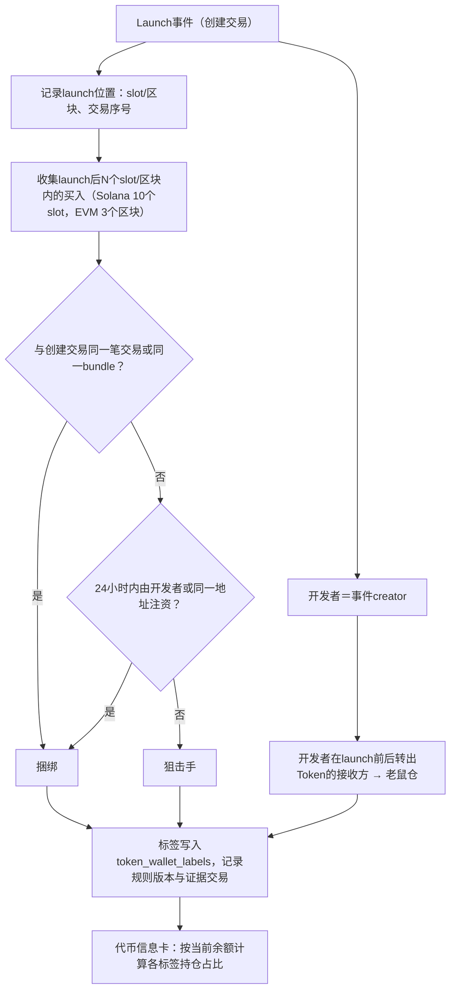

# Demo 07：地址标签（开发者、狙击手、捆绑、老鼠仓）

> 设计：[地址标签](../metrics/labels.md)。样本：`samples/bsc/fourmeme-create.json`、`samples/solana/pump-launch-early-trades.json`（2026-10-16扫描slot 457672911–457672950得到）。

## 1. 真实样本一：Pump新币`HWgMx9sQqk5zHBtjJcfGRskKkwfx927Q2XHvtxg9pump`

扫描的40个slot中有4个Pump新币，这个在创建后5个slot内的独立买家最多（19个，含开发者）。前22笔成交（创建slot记为+0；份额按总量10亿计算）：

| slot | 交易序号 | 方向 | 钱包 | SOL | Token | 占总量 | 规则判定 |
| --- | --- | --- | --- | --- | --- | --- | --- |
| +0 | 108 | 买 | `EtaXR3CM…wh7X` | 1.8568 | 62,540,381 | 6.25% | **开发者**（创建交易内买入） |
| +0 | 438 | 买 | `t9bNZ4Kr…JUQ` | 4.9383 | 135,613,960 | 13.56% | 同slot → 捆绑？ |
| +0 | 457 | 买 | `4yFAz7dp…QrG3` | 1.4321 | 32,774,220 | 3.28% | 同slot → 捆绑？ |
| +0 | 463 | 买 | `DsGJkPzF…tRSA` | 1.4525 | 30,823,960 | 3.08% | 同slot → 捆绑？ |
| +1 | 54 | 买 | `D12RJL1s…MPBd` | 0.0921 | 1,878,976 | 0.19% | 狙击手 |
| +2 | 231 | 卖 | `t9bNZ4Kr…JUQ` | 4.1751 | 94,929,772 | | |
| +2 | 267 | 卖 | `t9bNZ4Kr…JUQ` | 1.5325 | 40,684,188 | | 已全部卖出 |
| +2 | 285 | 买 | `DGvMiAcF…rzXLo` | 0.6914 | 18,797,645 | | 狙击手 |
| +3 | 99、951、1009 | 买 | 3个钱包 | 0.09–0.44 | | | 狙击手 |
| +4 | 89 | 卖 | `DGvMiAcF…rzXLo` | 0.7228 | 18,797,645 | | 已全部卖出 |
| +4 | 626–1009 | 买 | 6个钱包 | 0.09–1.78 | | | 狙击手 |
| +5 | 35–663 | 买 | 4个钱包 | 0.20–1.25 | | | 狙击手 |

观察：

- `t9bNZ4Kr`在创建同slot买入13.56%，2个slot（约0.8秒）后分两笔全部卖出，收回5.7076 SOL，比投入多0.7693 SOL（+15.6%，未计手续费）。
- `DGvMiAcF`在+2买入、+4卖出，同样是秒级进出。

### 1.1 资金来源核查

查每个同slot买家在买入前的最近3笔交易（`getSignaturesForAddress`＋`getTransaction`）：

| 钱包 | 最近一次收到SOL | 最近交易的签名者 | 结论 |
| --- | --- | --- | --- |
| 开发者`EtaXR3CM…` | 约20.8小时前（2026-10-15 17:53 UTC）从`BmFdpraQ…ymy6`收到2.473542 SOL | `BmFdpraQ…` | 资金来源可追溯 |
| `t9bNZ4Kr…` | 近3笔无转入 | 自己（买入前约9分钟仍在交易） | 独立的活跃交易钱包 |
| `4yFAz7dp…` | 近3笔无转入 | 自己 | 独立的活跃交易钱包 |
| `DsGJkPzF…` | 近3笔无转入 | 自己 | 独立的活跃交易钱包 |

**结论：旧规则“与Launch同slot买入即为捆绑交易”会把这3个狙击机器人误判为捆绑。** 这3个钱包与开发者之间没有资金关联，它们在开发者交易之后、同一slot内跟进买入。在Solana上，同slot跟单靠监听待处理交易或高优先费即可做到，不需要和开发者串通。

### 1.2 规则修改（D72，2026-10-17已确认）

| 标签 | 旧规则（D59） | 新规则（D72） |
| --- | --- | --- |
| 捆绑交易 | 同slot买入；**或**同一资金来源24小时内注资的多个买入钱包 | 需要关联证据：①与创建交易在**同一笔交易**内买入；②与创建交易**同一bundle**（同slot、交易序号连续、该组含Jito小费转账）；③买入钱包在24小时内由开发者或同一地址注资 |
| 狙击手 | Launch后前10个slot内买入 | 前10个slot内买入，且不属于捆绑与开发者（同slot无资金关联的也算狙击手） |

按新规则，本例的判定为：开发者1个；狙击手18个（含同slot的3个）；捆绑0个。同slot的3笔交易序号是438、457、463，与创建交易（108）不连续，也不满足bundle条件。

区块数据里没有“bundle”标记，条件②是近似判断：Jito bundle内的交易在区块中连续排列，并且其中一笔向Jito小费账户转账。

## 2. 真实样本二：Four.meme创建＋开发者首买

交易`0x5e75a5d4…81e9`，BSC区块127988960。Token “sanctuary” `0x0e67…ffff`：

| logIndex顺序 | 事件 | 内容 |
| --- | --- | --- |
| 1 | Transfer | 零地址 → `0x6e0c…3ef1`，1,000,000,000（铸造） |
| 2 | Transfer | `0x6e0c…3ef1` → TokenManager2，1,000,000,000 |
| 3 | TokenCreate | creator `0x47a3…7647` |
| 4 | TokenPurchase | account `0x47a3…7647`，349.959306个 |
| 5 | Transfer | TokenManager2 → `0x47a3…7647`，349.959306 |

之后16个区块（约7秒）没有任何买卖；再扫描最近200个BSC区块（约90秒），共6个Four.meme新币、15笔成交，前3个区块内都没有非开发者买入。说明**Four.meme当前活跃度远低于Pump**，标签样本以Solana为主，BSC样本在M0扩大扫描后补充。

开发者的判定依据：

- 首选：协议事件中的`creator`字段（Four.meme的TokenCreate、Pump的CreateEvent）。
- 不使用“铸造接收方”：本例中铸造先转给`0x6e0c…3ef1`（协议辅助合约），这个地址不是开发者。

## 3. 正常流程

注资关系依赖资金流向数据：采集侧需要保留SOL/原生币的系统转账，这部分已在完整区块里，解析时写入`native_transfers`。

## 4. 异常兜底

| 情况 | 例子 | 处理 |
| --- | --- | --- |
| launch窗口内有slot采集失败 | 本次扫描4个slot重试后仍失败（公共节点限流） | 标签计算等待窗口内所有slot完整后才执行；超时24小时仍不完整则标记`labels_partial` |
| 开发者经路由创建 | — | 以事件creator为准，不用tx签名者 |
| 注资来源超出回溯窗口 | 开发者资金来自20.8小时前 | 只在采集范围内追溯；超出范围的不判定 |
| 交易所热钱包注资 | 多个钱包都从同一交易所提现 | 已知交易所热钱包列表排除，不作为“同一资金来源” |
| 狙击手已清仓 | `t9bNZ4Kr`、`DGvMiAcF` | 标签保留（历史行为）；持仓占比按当前余额，为0 |
| 规则修改 | 1.2的D72 | 规则带版本号；修改后对全部Token重算标签 |

## 5. 验收用例

| 用例 | 期望 |
| --- | --- |
| `HWgMx…pump`（新规则D72） | 开发者`EtaXR3CM…`；狙击手18个；捆绑0个 |
| `HWgMx…pump`（旧规则D59） | 捆绑3个、狙击手15个——仅用于说明规则差异 |
| sanctuary | 开发者`0x47a3…7647`，不是`0x6e0c…3ef1` |
| 窗口内缺slot | 不输出标签，状态为等待 |
