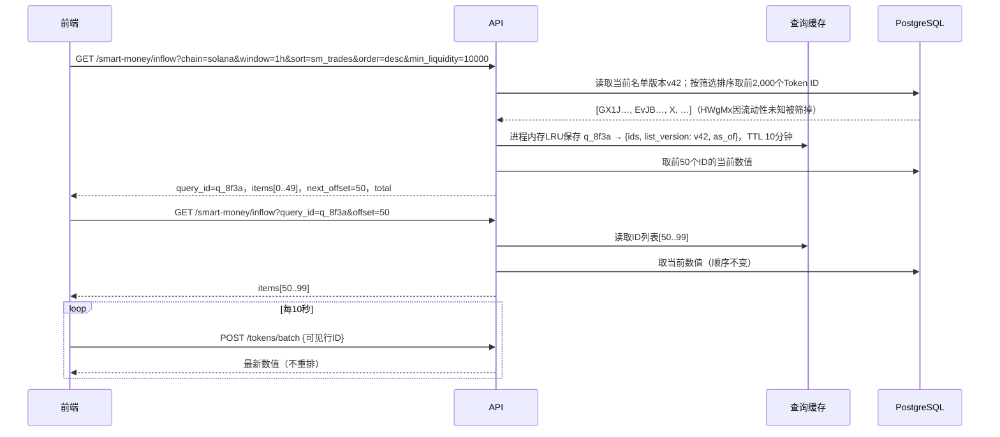
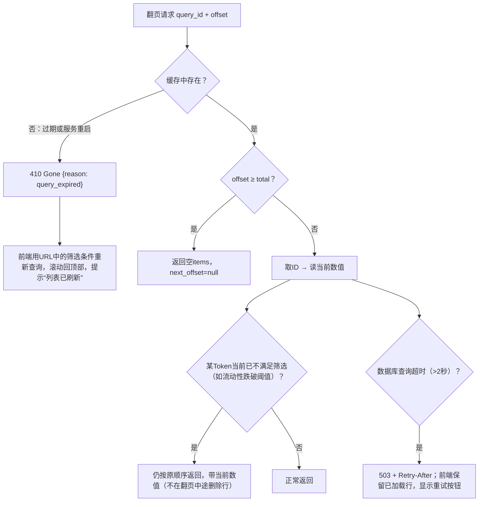

# Demo 08：资金流入列表查询

> 设计：[资金流入](../product/01-inflow.md)、[API](../engineering/07-api.md)、[技术方案§3.4](../TECHNICAL_PLAN.md)。Token、市值来自真实样本；聪明钱持仓/交易/净流入为**构造**。

## 1. 演示数据

Solana，窗口1h，按“聪明钱交易”降序：

| Token | 市值（真实） | 流动性（真实） | 聪明钱持仓 | 聪明钱交易 | 1h净流入 |
| --- | --- | --- | --- | --- | --- |
| `GX1J…pump` | $30,786.83 | $14,582.94 | 7 | 23 | $2,052.62 |
| `HWgMx…pump` | 未计算 | 未计算 | 3 | 23 | −$410.00 |
| `EvJB…bg4e` | $17,113.60 | $24,832.65 | 4 | 9 | $264.53 |
| 构造Token X | $1,200,000 | $310,000 | 12 | 9 | $18,000.00 |

`GX1J`与`HWgMx`的聪明钱交易都是23：排序值相同按Token ID升序，保证每次结果顺序一致。`EvJB`与X同理。

## 2. 正常流程



响应（节选，完整字段见 `api/openapi.yaml` 的 `InflowPage`）：

```json
{
  "query_id": "q_8f3a",
  "list_version": "42",
  "as_of": "2026-10-16T13:45:00Z",
  "items": [
    {
      "token": {"chain": "solana", "address": "GX1JGwFmrzgkv6MBjwZZdZt3qBcWi1d5ZuAUS3KFpump"},
      "currency": "USD",
      "price": "0.0000322262",
      "market_cap": "30786.83",
      "liquidity": "14582.94",
      "sm_holders": 7,
      "sm_trades": 23,
      "net_inflow": "2052.62"
    }
  ],
  "next_offset": 50,
  "total": 3
}
```

## 3. 筛选条件与未知值

| 条件 | 未知值的处理 |
| --- | --- |
| 设置了`min_liquidity` | 流动性未知的Token**不满足**（被排除） |
| 未设置流动性条件 | 未知值的Token保留，显示“--” |
| 按流动性排序 | 未知值始终排在最后（升序、降序都一样） |

`HWgMx…pump`的价格在采集到足够数据前为未知：设了最小流动性时被排除，未设时排在流动性排序的末尾。

## 4. 异常兜底



| 情况 | 处理 |
| --- | --- |
| 参数不合法（窗口不存在、min>max） | 400，返回出错字段；前端在抽屉中标红 |
| 名单版本已更新 | 翻页继续用v42；刷新得到v43 |
| 查询结果超过2,000个 | 只缓存前2,000个；页面底部显示“仅显示前2,000个，请缩小筛选” |
| 同一用户频繁切换排序 | 每次生成新query_id；旧的到期自动清理；单IP每分钟最多60次新查询 |
| 多个API实例 | 缓存在API进程内存（技术方案§3.4），负载均衡按会话粘滞；落到其他实例或实例重启时返回410，前端重查。若410比例超过1%，再考虑改为PostgreSQL存储 |
| 重组导致数值回退 | 数值为当前值，顺序不变；下一次刷新重新排序 |

## 5. 验收用例

| 用例 | 期望 |
| --- | --- |
| 两个Token排序值相同 | 按Token ID升序，多次查询顺序一致 |
| 翻页期间数据变化 | 不重复、不遗漏 |
| 11分钟后翻页 | 410，前端自动重查 |
| `min_liquidity=10000` | `HWgMx…pump`被排除 |
| 后台SQL独立计算 | 与API结果一致 |
