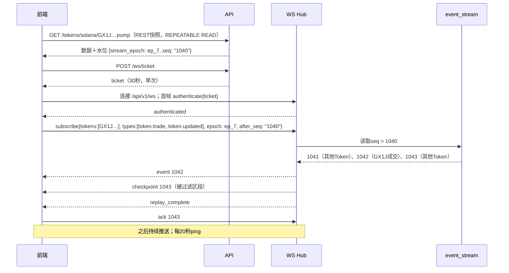
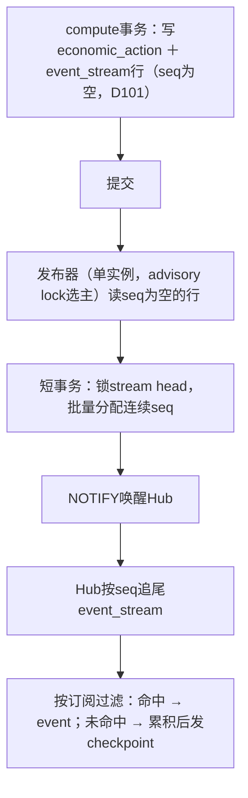
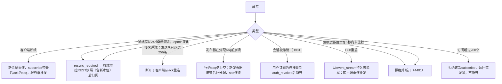

# Demo 09：实时推送

> 设计：[实时推送](../engineering/08-realtime.md)。事件内容来自真实成交，`seq`、`event_id`等为演示值。

## 1. 一次完整会话



## 2. 事件帧

### 2.1 新成交（样本A，Pump曲线买入）

```json
{
  "schema_version": "1",
  "event_id": "evt_sol_42H9YF9h_2.0",
  "type": "token.trade",
  "stream_epoch": "ep_7",
  "seq": "1042",
  "chain": "solana",
  "entity_id": "GX1JGwFmrzgkv6MBjwZZdZt3qBcWi1d5ZuAUS3KFpump",
  "entity_revision": "1",
  "occurred_at": "2026-10-16T13:42:33Z",
  "is_backfill": false,
  "payload": {
    "tx": "42H9YF9h2BooitscqX2U6XpebVzJxCsn92ibpyNvTytVibsdbs8adxezMHZDTfun2pwpRLHn1nnSZZr7WiXhwmiT",
    "wallet": "7LMk5tKCGXgvweApmksAvfoAVAAXQWGnJdSKTn1bGLqg",
    "side": "buy",
    "token_amount": "1620844.796622",
    "amount_usd": "52.6235",
    "price_usd": "0.0000320659",
    "confirmation": "confirmed"
  }
}
```

`event_id`由“链＋交易＋指令位置”生成：同一笔成交无论重放多少次，id都相同，前端据此去重。

### 2.2 改判（样本E，Base v4卖出补证后）

[02](02-parsing.md)样本E中，用户收到的ETH在日志里不可见，首次推送时归因为推断值。trace补证完成后：

```json
{
  "event_id": "evt_base_0xba312a55_0x12b",
  "type": "event.corrected",
  "seq": "1188",
  "chain": "base",
  "entity_revision": "2",
  "is_backfill": false,
  "payload": {
    "replaces_revision": "1",
    "wallet": "0x2046d4ee2268e5583be790fde46095bdaf4eaec6",
    "side": "sell",
    "attribution": "confirmed",
    "evidence": "debug_traceTransaction: router → 0x2046…aec6 value 0.00216268 ETH"
  }
}
```

前端按`event_id`替换原条目，不重复弹提醒。

### 2.3 Base区块先pending后确认（D71）

| 时刻 | 事件 | `confirmation` |
| --- | --- | --- |
| 13:47:27 | `token.trade`（区块52684550） | pending |
| 13:47:51（12个区块后） | `token.updated` | confirmed |
| 若期间发生重组 | `event.reverted` | — |

## 3. 正常发布流程



## 4. 异常兜底



| 情况 | 例子 | 处理 |
| --- | --- | --- |
| 历史回溯产生的成交 | 30天回溯中的样本A | `is_backfill=true`，进事件流供页面刷新，不触发提醒与信号 |
| 同一事件既在快照中又被补发 | 快照水位1040之后的1042 | 前端按`event_id`＋`entity_revision`去重 |
| 改判 | 2.2 | 替换，不重复提醒 |
| 重组撤销 | Base pending期间重组 | `event.reverted`，前端删除条目；提醒已发出则补发“已撤销” |
| 高频Token | 每秒多笔成交 | `token.updated`合并节流，每Token每秒最多1次；`token.trade`不合并 |

## 5. 验收用例

| 用例 | 期望 |
| --- | --- |
| 快照水位1040，期间写入1041–1043 | 前端收到1042一次，checkpoint到1043 |
| 业务事务已提交（event_stream行seq为空）后发布器kill | 重启后补分配seq，seq无空洞 |
| 断线5分钟后重连 | 补发断线期间事件，不重不漏 |
| 2.2改判 | 列表中只有一条，revision为2 |
| 慢客户端 | 断开，服务端内存不增长 |
