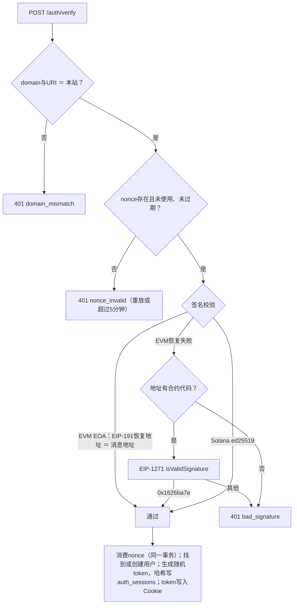
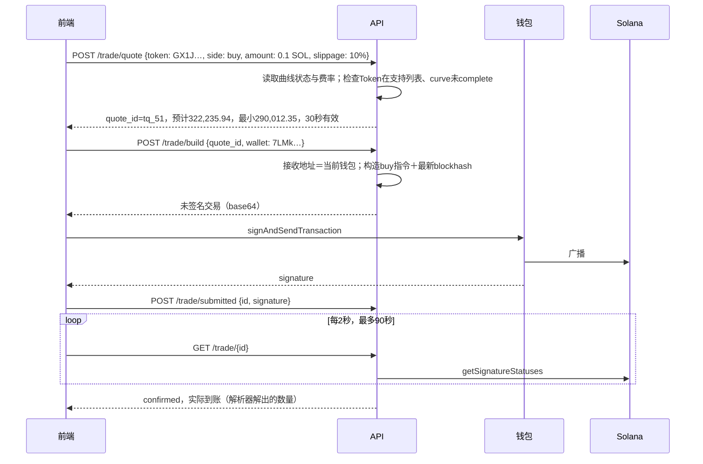
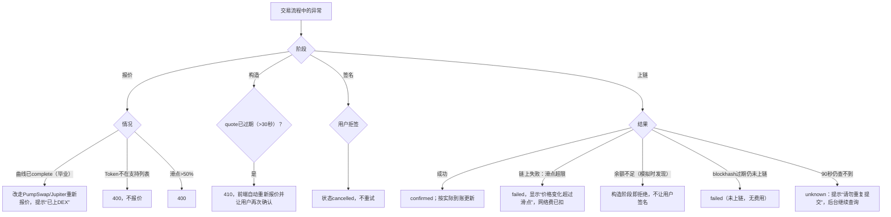

# Demo 10：钱包登录与快捷交易

> 设计：[登录与交易](../engineering/15-auth-trading.md)、[快捷交易](../product/07-trading.md)。报价以样本A成交后的Pump曲线真实状态计算；nonce、会话等为演示值。**后端不接触私钥，不代签。**

## 1. 登录

### 1.1 EVM（SIWE，EIP-4361）

```text
meme-radar.example wants you to sign in with your Ethereum account:
0x2046d4ee2268e5583be790fde46095bdaf4eaec6

Sign in to Meme Radar.

URI: https://meme-radar.example
Version: 1
Chain ID: 8453
Nonce: 7f3c9a1e5b2d4f60
Issued At: 2026-10-16T13:50:00Z
Expiration Time: 2026-10-16T13:55:00Z
```

### 1.2 Solana（SIWS）

```text
meme-radar.example wants you to sign in with your Solana account:
7LMk5tKCGXgvweApmksAvfoAVAAXQWGnJdSKTn1bGLqg

Sign in to Meme Radar.

URI: https://meme-radar.example
Version: 1
Chain ID: mainnet
Nonce: 2b8e41d07c9a3f55
Issued At: 2026-10-16T13:50:00Z
Expiration Time: 2026-10-16T13:55:00Z
```

### 1.3 校验与异常



| 用例 | 期望 |
| --- | --- |
| 同一签名提交两次 | 第二次`nonce_invalid` |
| 修改消息中一个字符 | `bad_signature` |
| 6分钟后提交 | `nonce_invalid` |
| 钓鱼站转发消息（domain不同） | `domain_mismatch` |

## 2. 快捷交易：在Pump曲线买入0.1 SOL的`GX1J…pump`

### 2.1 报价

曲线状态（样本A成交后，真实）：虚拟SOL 99.279611809，虚拟Token 324,235,762.323533；费率95＋30bps，从链上费率程序读取。

| 项 | 计算 | 值 |
| --- | --- | --- |
| 支付 | 用户输入 | 0.1 SOL（$10.52） |
| 费用 | 0.1 − 0.1÷1.0125 | 0.0012346 SOL |
| 进入曲线 | 0.1÷1.0125 | 0.0987654 SOL |
| 预计到账 | 324,235,762.32 × 0.0987654 ÷ (99.279612＋0.0987654) | **322,235.94个** |
| 最小到账（滑点10%） | ×0.9 | 290,012.35个 |
| 价格影响 | 成交价 ÷ 现价 − 1 | 0.10% |
| 网络费 | 基础费＋P2优先费（演示） | 约0.000105 SOL |

曲线剩余可售44,335,762个，按当前状态大约再买入15.7 SOL就会耗尽并毕业。报价时如果买入额超过剩余，提示“超过曲线剩余，部分将无法成交”。

### 2.2 正常流程



### 2.3 异常兜底



| 情况 | 处理 |
| --- | --- |
| 钱包只能签名不能发送 | 前端把已签名交易提交到`/trade/{id}/broadcast`，后端只转发 |
| 用户连点两次 | 同一quote_id只能build一次；第二次返回已有交易 |
| BSC Four.meme卖出前需授权 | 先构造approve交易，确认后再构造卖出 |
| Base的Token走v4 hook池 | 报价由聚合器给出；hook额外收费（如[02](02-parsing.md)样本F的1.3%）计入预计到账 |
| 本应用发起的交易也被采集到 | 通过签名关联，统计只计一次 |

## 3. 验收用例

| 用例 | 期望 |
| --- | --- |
| 0.1 SOL报价 | 预计322,235.94个，最小290,012.35个（同一曲线状态） |
| 报价后31秒构造 | 410，重新报价 |
| 拒签 | cancelled |
| 构造用其他接收地址 | 400 |
| 90秒未确认 | unknown，不提示重试 |
