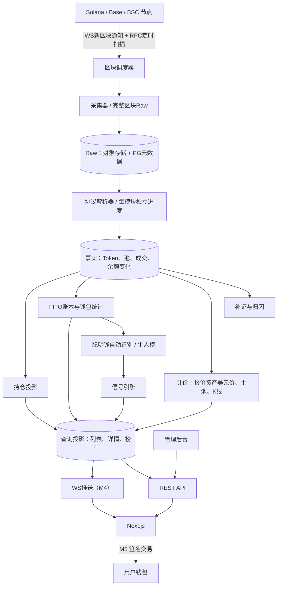

# 系统架构

## 1. 技术栈

| 层 | 选型 |
| --- | --- |
| 后端 | Go，单module；标准库`net/http`、`log/slog`、`database/sql`；有界worker |
| 前端 | Next.js App Router、TypeScript strict；默认Server Components，交互区Client Components |
| 数据库 | PostgreSQL（D8）；goose版本化SQL迁移；美元金额用`NUMERIC`，原子数量`NUMERIC(78,0)`；地址/hash用`BYTEA`；事实表按链＋区块号分区（D77–D83） |
| Raw存储 | S3兼容对象存储，zstd压缩，按区块一个对象（D66）；开发环境用本地目录 |
| 接口 | REST（OpenAPI 3.0描述）；M4起WebSocket推送 |
| 图表 | TradingView Lightweight Charts |
| 钱包 | Solana Wallet Adapter；EVM用wagmi/viem（M4起） |

不预先引入Redis、Kafka、ORM或微服务；有容量证据再评估。具体依赖库、进程角色与容量估算见[技术方案](../TECHNICAL_PLAN.md)。工程规范见[backend/AGENTS.md](../../backend/AGENTS.md)、[frontend/AGENTS.md](../../frontend/AGENTS.md)。

## 2. 模块与数据流



| 模块 | 职责 | 文档 |
| --- | --- | --- |
| 采集 | 完整区块抓取、断点、补缺、重组 | [02](02-ingestion.md) |
| 解析与补证 | 协议解码、经济动作、钱包归因、补证重算 | [03](03-parsing.md) |
| 计价 | 美元价格、主池、K线、窗口指标 | [04](04-pricing.md) |
| 持仓 | 快照基线、余额增量、持有人 | [05](05-holdings.md) |
| 派生计算 | FIFO、钱包统计、聪明钱、标签、信号、榜单、列表投影 | [13](13-analytics.md) |
| 数据模型 | 表说明；权威 DDL 在 `backend/migrations/` | [06](06-data-model.md) |
| API | REST契约 | [07](07-api.md) |
| 实时推送 | WebSocket | [08](08-realtime.md) |
| 登录与交易 | 钱包签名登录、关注与提醒、交易 | [15](15-auth-trading.md) |
| 前端 | 路由、数据获取、国际化、图表、钱包 | [14](14-frontend.md) |

## 3. 代码目录

已有：`cmd/radar`、`store`、`httpapi`、`config`、`migrations/00001`–`00008`；前端 M1 已完成（目录见[前端架构§2](14-frontend.md)）。后端其余包为规划目标，归属见[16 M1任务卡](16-m1-agent-tasks.md)：

```text
meme-radar/
├── api/openapi.yaml
├── Makefile                 # 根编排：make -C backend / npm --prefix frontend
├── docker-compose.yml
├── .githooks/pre-commit
├── docs/                    # 见 docs/README.md
├── scripts/                 # demos 样本抓取
├── backend/
│   ├── cmd/radar/           # 服务入口（启动时 goose up）
│   ├── internal/
│   │   ├── chain/           # Solana/EVM RPC与区块采集（待实现）
│   │   ├── protocol/        # 各协议解码（待实现）
│   │   ├── ingest/          # 调度、任务、断点（待实现）
│   │   ├── parse/           # 解析进度、归因、补证（待实现）
│   │   ├── pricing/         # 美元价、主池、K线（待实现）
│   │   ├── rawstore/        # Raw对象读写（待实现）
│   │   ├── ledger/          # FIFO、钱包统计（待实现）
│   │   ├── smartmoney/      # 名单、自动识别、标签、信号（待实现）
│   │   ├── holding/         # 持仓（待实现）
│   │   ├── auth/            # 签名登录、会话（待实现）
│   │   ├── trade/           # 报价、构造交易（待实现）
│   │   ├── store/           # PostgreSQL访问与迁移 ✓
│   │   ├── config/          # ✓
│   │   └── httpapi/         # REST 骨架 ✓
│   ├── migrations/          # 权威 DDL ✓
│   └── testdata/
└── frontend/                # Next.js，M1 页面 ✓（见 14-frontend）
```

## 4. 关键原则

1. **Raw先落盘，解析后做**：业务筛选不丢原始数据，规则修改可重放。
2. **并发抓取、链序计算**：抓取与无状态解码可并发；FIFO与余额按区块→交易→指令顺序应用。
3. **幂等**：重复通知、重试、重放都不重复计量；结果按版本替换而非累加。
4. **未知≠0**：缺数据显式为`null`，不进入统计。
5. **短事务**：任务领取用`FOR UPDATE SKIP LOCKED`后立即提交，网络请求在事务外。
6. **事件与数据同事务**：写事实或派生结果的事务同时写`event_stream`，提交前不推送（D101）。

## 5. 主要风险

| 风险 | 应对 |
| --- | --- |
| 全块采集费用与存储超验证预算：Solana每天约21.6万slot；已缩短为30天历史（D73），回溯约650万次`getBlock`，Raw三链30天约4.35TB，前向每月再增约4.4TB（每链3个样本块外推，见[技术方案§4](../TECHNICAL_PLAN.md)） | M0扩大样本实测；Raw保存期限（D24）尽早决定；不丢前向数据 |
| 自动识别与标签规则误判 | 规则版本化、可调，管理员可排除；页面注明为规则推断 |
| 协议升级导致解码失败 | 解析模块独立进度与失败任务，修复后重放 |
| 交易资金风险 | 非托管、逐笔签名、未知状态先查链 |
