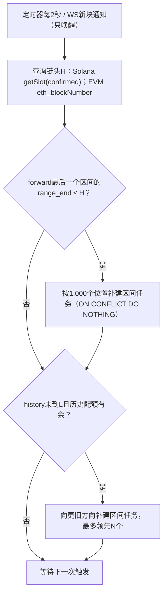
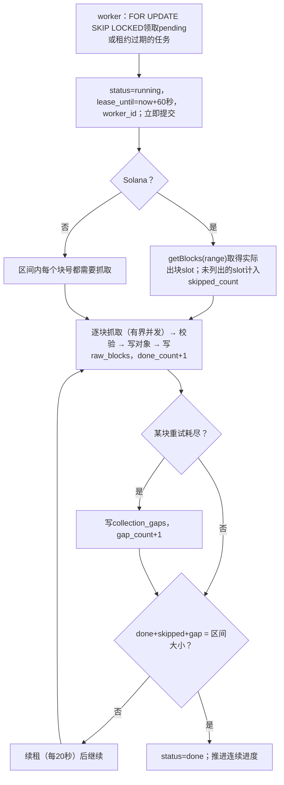
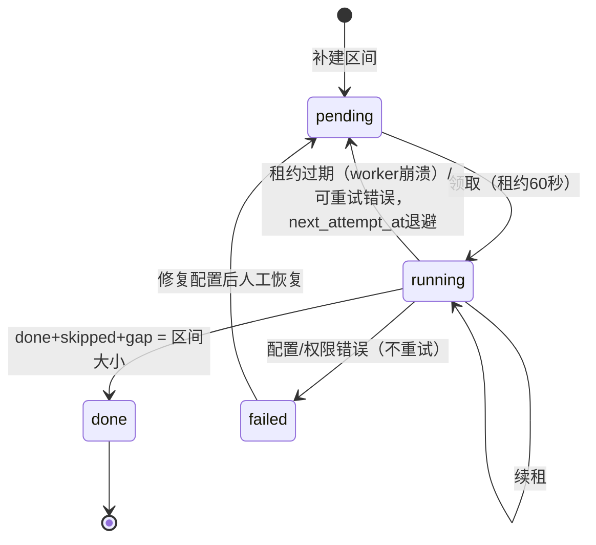
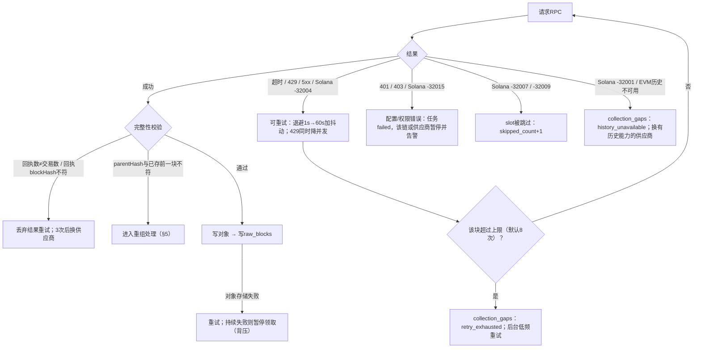
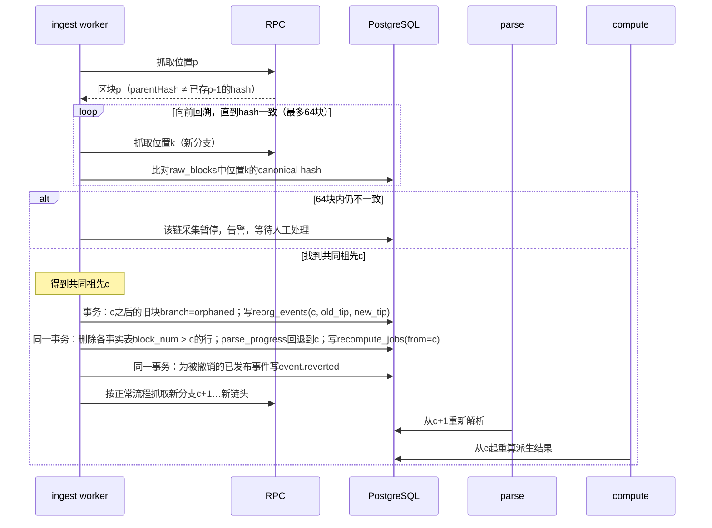

# 区块采集与断点恢复

> 决策D21、D22、D47、D66、D71、D73、D81、D83、D87。表结构见[数据模型§3](06-data-model.md)。
>
> 演示（真实链上样本＋异常兜底）：[Demo 01 区块采集](../demos/01-ingestion.md)。

## 1. 采集单位

| 链 | 一个Raw区块包含 |
| --- | --- |
| Solana | slot、blockHeight（与slot分开存，可缺失）、blockhash、parentSlot、blockTime、全部交易及meta（指令、内部指令、日志、前后余额、费用、错误） |
| Base / BSC | blockNumber、blockHash、parentHash、timestamp、全部完整交易对象、每笔交易的receipt（全部日志、status、gas与费用字段） |

EVM需另取receipt组成完整数据包；任一receipt缺失不算完整。Solana被跳过的slot（没有出块）只计数，不写`raw_blocks`；请求失败不能当作跳过。

## 2. 两条采集任务

| 任务 | 范围 | 采集方向 |
| --- | --- | --- |
| forward | 启动锚点A及之后，追随链头 | 旧→新 |
| history | A之前30天（D73；按链上时间定位下界L并记录实际位置） | 新→旧 |

- A在首次启动时为每链选定并持久保存到`chain_anchors`（位置、hash、链上时间、L），重启不重选（D74）。
- 两任务共用采集器、Raw存储和区块去重，各自记录进度；历史任务有独立资源配额，不挤占前向。
- 30天是采集目标，不是保存期限（D24）。
- 采集方向与解析方向无关：解析始终按旧→新（D49），历史解析从L起等待所需Raw，见[解析§3](03-parsing.md)。

## 3. 调度：区间任务（D81）

每1,000个位置建一条`block_jobs`（Solana 30天历史约6,500条，而不是650万条）。区间内每个块的结果看`raw_blocks`，重试耗尽的块记`collection_gaps`。

领取与执行：

- forward追链头时，链头所在区间在到达`range_end`前保持running并按租约续期。
- Solana `getBlocks`只对≤确认链头的范围调用，避免把“尚未出块”误计为跳过；单块返回`-32007`/`-32009`时同样计入`skipped_count`。
- 每个块的写入顺序：先写zstd对象（键`{chain}/{yyyy-mm-dd}/{position}-{hash}.zst`），再在一个事务里写`raw_blocks`并更新任务计数（D66）。对象已写、元数据未提交时，重试覆盖同一键，幂等。

任务状态：

## 4. 单块抓取的异常分类

实测例子见[Demo 01 §3](../demos/01-ingestion.md)。

| 类别 | 例子 | 处理 | `last_error_class` |
| --- | --- | --- | --- |
| 可重试 | 超时、HTTP 429/5xx、Solana `-32004` | 指数退避，429降并发；8次后记缺口 | `retryable` |
| 配置/权限 | Solana `-32015`、HTTP 401/403 | 不重试；暂停并告警，修复后从断点继续 | `config` |
| 数据不存在 | Solana `-32007`/`-32009` | 计入跳过数 | `not_found` |
| 历史不可用 | Solana `-32001`、EVM历史缺失 | 记缺口，换供应商 | `history_unavailable` |
| 结果不完整 | 回执缺失或blockHash不符 | 丢弃重试，3次后换供应商 | `incomplete` |

重试计数：单块的重试次数记在worker内存里（区间行的`attempts`只记整个区间被领取的次数）；worker崩溃后由新worker从0重新计数，最多多试一轮，不影响正确性。

缺口的后续：

- 缺口块不阻塞采集区间完成，也不阻塞连续进度；后台按低频重试，补齐后写`collection_gaps.resolved_at`。
- 解析遇到未解决的缺口块时不无限等待：跳过该块并记录覆盖缺口；依赖缺口区间的计算（如标签的Launch窗口）等待补齐；补齐后该块按“迟到事实”处理，派生结果从该位置重算。
- 管理后台展示未解决缺口数与最老缺口；M1验收要求24小时内无未解释缺口。

## 5. 确认与重组

- 确认等级：Solana `confirmed`；Base/BSC延后12个区块（D71）。
- EVM未确认块照常抓取、解析，事实直接写正式表（D87），`raw_blocks.confirmation=pending`；满12块后改为`confirmed`。连续进度只按已确认位置推进。
- 区块身份为(chain, position, block_hash)；同一位置只有一个`branch=canonical`。

- 旧分支Raw保留（对象不删），便于排查。
- 重组深度超过确认深度（已confirmed的块被替换）属于异常：照常处理，同时告警。
- 回溯最多64块；64块内找不到共同祖先说明数据源异常，暂停该链并告警，人工处理。

## 6. 进度表

`collection_progress`按(chain, task_kind, run_id)一行：固定范围、连续完成位置与该位置hash、generation（防止过期worker覆盖）、状态、最近错误。

- forward的连续完成位置：从A起，所有区间都done且最高位置已确认的最大位置。
- history的连续完成位置：从A-1向L方向连续done的最小位置。
- 示例：区间[100,101,102,103]中102重试中、103已完成，连续位置停在101；102成功或转入缺口后推进到103。

## 7. 验收要点

- 关闭WS后RPC仍能补齐；重复通知不重复落盘。
- 102失败、103成功时连续位置停在101，102补齐（或转入缺口）后推进到103。
- 写对象、写元数据、更新任务三步之间任意时刻崩溃，重启后状态一致、不重复。
- worker崩溃后租约过期，任务被其他worker重新领取。
- Solana区间的done+skipped+gap与区间大小一致；“尚未出块”不被计为跳过。
- 同位置换hash按重组处理：旧分支标orphaned，c之后的事实删除并重新解析，被撤销事件推送`event.reverted`。
- 历史任务失败不影响前向进度。
