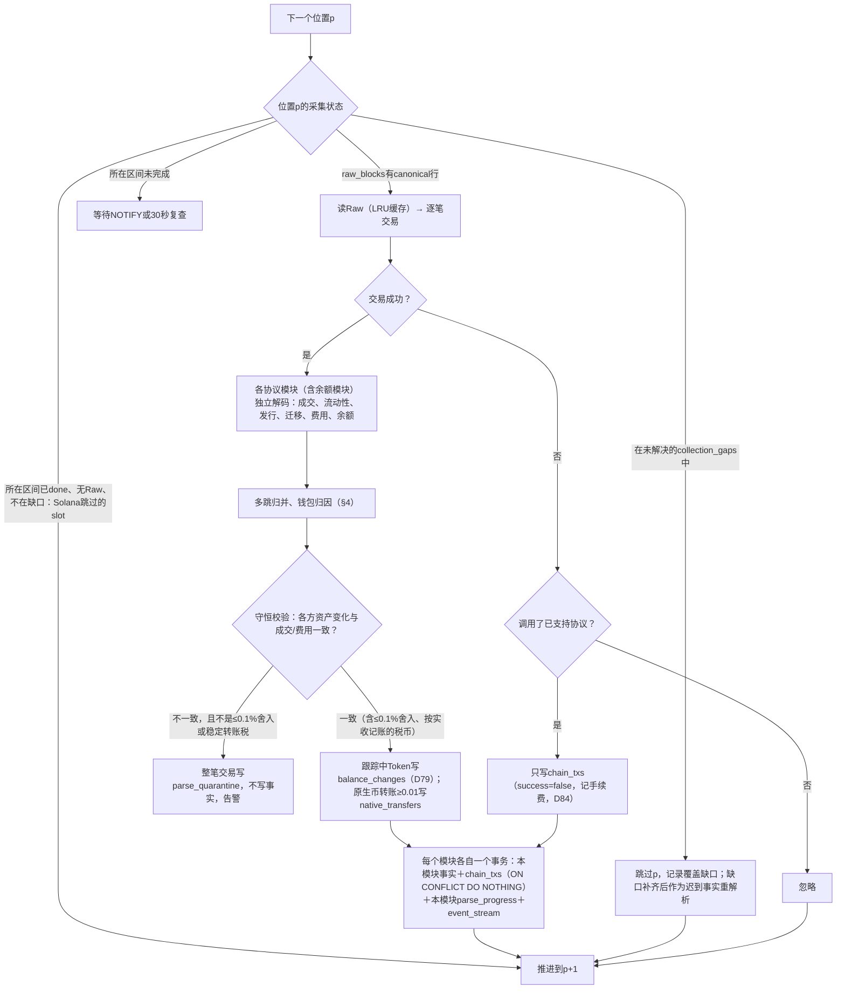
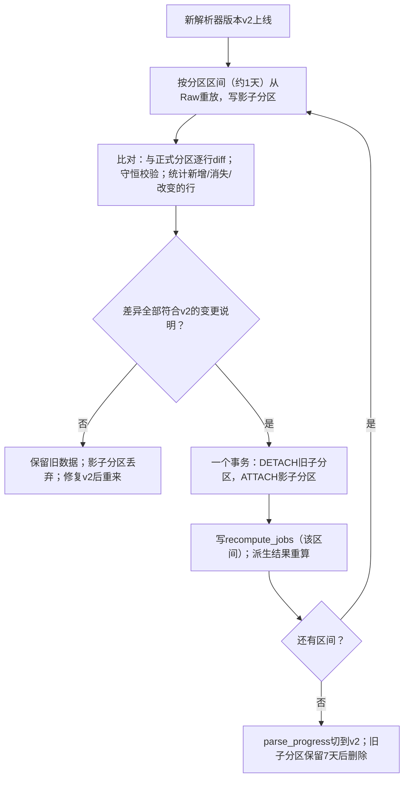
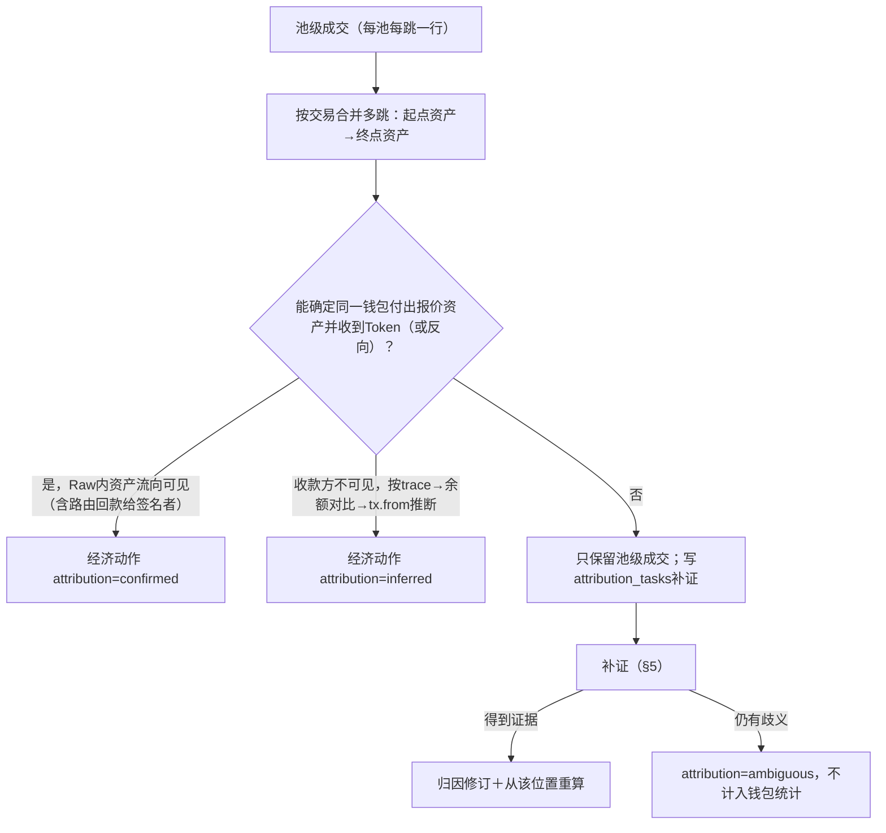

# 协议解析、归因与补证

> 决策D20、D23、D25–D27、D48、D49、D78、D79、D84、D86。
>
> 演示（真实链上样本＋异常兜底）：[Demo 02 协议解析与归因](../demos/02-parsing.md)。

## 1. 首批协议

| 链 | 发行 | 交易场所 | 关注点 |
| --- | --- | --- | --- |
| Solana | Pump.fun、Raydium LaunchLab | PumpSwap、Raydium毕业池；Jupiter路由识别 | 曲线完成≠迁移成功；Jupiter多跳归为一笔经济动作 |
| Base | Clanker v4 | Uniswap v4（poolId＋hooks） | Swap.sender不是买家，结合结算与转账判断 |
| BSC | Four.meme Classic V2 | PancakeSwap V2/V3 | 税费币、TradeStop≠迁移完成，目标池需交叉核验 |

官方合约候选（需按部署区间与ABI核验后使用）：

| 名称 | 地址 | 依据 |
| --- | --- | --- |
| BSC Four.meme TokenManager2 | `0x5c952063c7fc8610FFDB798152D69F0B9550762b` | [Four.meme](https://github.com/four-meme-community/fourmeme-docs/blob/main/docs/integration-guide.md) |
| BSC OpenFour Registry（后续） | `0x912CEf0C3aE9Ab6eB3Ec87cab69371cFb317Ab94` | [OpenFour](https://github.com/four-meme-community/openfour-docs/blob/main/docs/integration-guide.md) |
| Base Clanker v4.0 | `0xE85A59c628F7d27878ACeB4bf3b35733630083a9` | [Clanker](https://github.com/clanker-devco/v4-contracts#deployed-contracts) |
| Base Flaunch V1_3（后续） | `0x475a09618bfd00fa4cb03b8504e95b62075e6f7d` | [Flaunch SDK](https://github.com/flayerlabs/flaunch-sdk/blob/master/src/addresses.ts) |

解码资料：[Pump IDL](https://github.com/pump-fun/pump-public-docs/blob/main/idl/pump.json)、[PumpSwap](https://github.com/pump-fun/pump-public-docs/blob/main/docs/PUMP_SWAP_README.md)、[LaunchLab](https://docs.raydium.io/products/launchlab/instructions)、[Clanker源码](https://github.com/clanker-devco/v4-contracts/blob/main/src/Clanker.sol)、[Uniswap v4 PoolManager](https://github.com/Uniswap/v4-core/blob/main/src/interfaces/IPoolManager.sol)、[Four.meme接口](https://github.com/four-meme-community/fourmeme-docs/blob/main/contracts/interfaces/ITokenManager2.sol)、[Pancake Pair](https://github.com/pancakeswap/pancake-swap-core/blob/master/contracts/interfaces/IPancakePair.sol)。

## 2. 解析输出

| 事实 | 说明 |
| --- | --- |
| Token / Launch | 身份chain＋address（D20）；Launch时间与证据；首次发现时间独立（D27） |
| Pool | 池/曲线身份、两侧资产、DEX与版本、创建时间、迁移关系 |
| 池级成交 | 池、数量、报价资产、方向、交易位置；不要求钱包已归因 |
| 经济动作 | 钱包×Token的一次买或卖，可由多跳成交归并 |
| 流动性事件 | 添加/移除、两侧数量 |
| 余额变化 | 转账、铸造、销毁（供持仓模块） |
| 原生币转账 | ≥0.01 SOL/ETH/BNB、接收方非程序/合约的转账，保存30天，供标签判断注资关系（见[派生计算§7](13-analytics.md)） |

## 3. 解析进度

- `parse_progress`按(chain, 协议模块, 解析版本, 范围forward/history)独立推进；一个模块失败只阻塞自己（D23）。
- 前向从A起、历史从下界L起，都按旧→新解析；下一块Raw未就绪就等待，不跳过（D49）。历史采集是新→旧，所以历史解析要等采集回溯到L附近才开始推进。
- 追平后进入等待，由新Raw提交唤醒，并每30秒复查一次防止丢唤醒。
- 失败任务持久保存（模块、区块、错误、重试次数），修复后从Raw重放。
- 老Token在A之后出现交易时，先登记最小身份并保存成交，资料未知；历史解析到创建事件后补关联，不重复建币（D48）。

### 3.1 单块解析流程

- 同一Raw、同一解析器版本，输出完全相同（`item_index`确定性生成），重放按主键幂等。
- 解码异常按§5.1分三种：未知判别码/topic只计数告警；已知指令解码失败只隔离该交易；只有解析器内部错误才让该模块写`parse_failures`并停在p，其他模块继续。

### 3.2 解析器升级（D86）

前向新数据在升级期间继续由v1写入正式分区；最后一个区间追平链头时切换为v2写入。

## 4. 钱包归因（D25）

分别记录交易发起方、手续费付款方、资产付款方、资产接收方、路由合约。只有确认或可按规则推断“同一钱包付出报价资产并收到Token”（或反向）才生成经济动作；否则池级成交照常保存并计入行情，但不进入钱包、聪明钱与FIFO统计，生成补证任务。

| attribution | 含义 | 钱包账本/统计 | 聪明钱自动识别样本 |
| --- | --- | --- | --- |
| `confirmed` | Raw内资产流向直接可见 | 计入 | 计入 |
| `inferred` | 收款方不可见（如Base路由解包原生ETH），按trace→余额对比→`tx.from`依次推断 | 计入 | 不计入 |
| `ambiguous` | 补证后仍无法判断 | 不计入 | 不计入 |

## 5. 补证与重算（D26）

1. 先用本地Raw与已有证据判断；不足才受控请求上游（历史交易、账户状态、trace），请求前预留预算。
2. 失败分类：网络/限流→退避重试；依赖未就绪→等待；解析器不支持→等待版本升级；证据充分但仍歧义→标记ambiguous。
3. 取得有效响应但无新证据时，不重复请求，直到相关证据或能力变化。
4. 归因结论改变时，在同一事务里写归因修订与重算任务；重算从受影响点按链序重放，生效前校验输入版本，过期结果不覆盖新结果。
5. 例：池成交100 USDC原本钱包未知，补证确认为A，则A记一笔100 USDC买入、池成交额仍是100；之后改判为B时，A的贡献撤销、B新增。
6. 改判已推送的钱包动作时写`event.corrected`，前端按原事件id替换，不重复提醒。

### 5.1 异常兜底

| 异常 | 处理 | 影响范围 |
| --- | --- | --- |
| 已支持程序的未知判别码/未知topic | 记`unknown_event`计数，余额变化照常写；超过阈值告警（协议可能升级） | 无，模块继续 |
| 已知指令/事件解码失败（字段越界、长度不符） | 整笔进`parse_quarantine`，不影响同块其他交易 | 该交易 |
| 解析器内部错误（程序缺陷） | 该模块写`parse_failures`并停在当前位置，告警；修复后重放 | 只该协议；行情中该协议成交暂缺 |
| 交易版本不支持 | 整链暂停并告警（同采集`-32015`） | 该链 |
| 守恒校验：差额≤0.1% | 视为舍入，正常写入 | 无 |
| 守恒校验：差额等于稳定的转账税 | 按实收记账并标记`taxed_token` | 该Token |
| 守恒校验：其他不一致 | 整笔进`parse_quarantine`，不写事实 | 该交易 |
| 缺口块 | 跳过并记录，补齐后作为迟到事实重解析，派生重算 | 依赖该区间的计算等待 |
| 失败交易 | 只记手续费（D84） | 无 |
| 补证上游限流/超预算 | 退避；预算不足时排队，不丢任务 | 钱包统计暂缺该笔 |
| 元数据URI失败 | 最多5次退避；最终失败时名称等字段为空 | 页面显示地址缩写 |

## 6. Token元数据

| 字段 | 来源 |
| --- | --- |
| 名称、符号（清洗：去控制字符，符号≤32、名称≤128字符，原始值存`raw_metadata`，D103）、decimals、总供应量 | 链上：Solana Mint与Metaplex/Token-2022元数据；EVM调用`name/symbol/decimals/totalSupply` |
| 图标、简介、社交链接 | 链上元数据URI指向的JSON（常见为IPFS/Arweave）；缺失时用DEX Screener公开接口补充 |

- 拉取URI是异步任务：Token首次出现时入队，失败指数退避，最多重试5次。
- 防SSRF：只允许`https`与IPFS/Arweave网关；拒绝内网与回环地址；响应≤1MB、超时5秒；不跟随跳转到不允许的地址。
- 图标下载后校验类型与尺寸，转存为对象存储中的缩略图，前端只从本站加载。
- 社交链接只接受`http(s)`，前端作为外链显示，不渲染外部HTML。

## 7. 验收要点

- 每协议至少一条真实样本：发行→曲线成交→迁移→DEX成交。
- 协议A在102失败时，协议B与采集照常推进；A修复后补齐不重复。
- 多跳只算一笔、同tx独立动作分别计；补证、重放、重组不双算。
- A之前创建的老Token：成交先入库、Launch未知，历史补齐后关联原记录、币龄不改。
