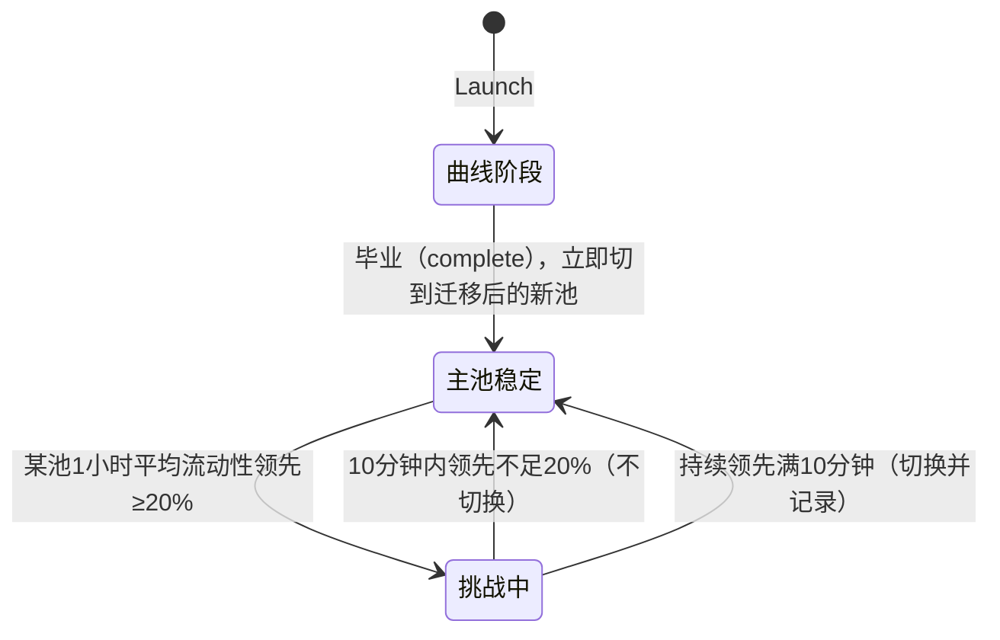
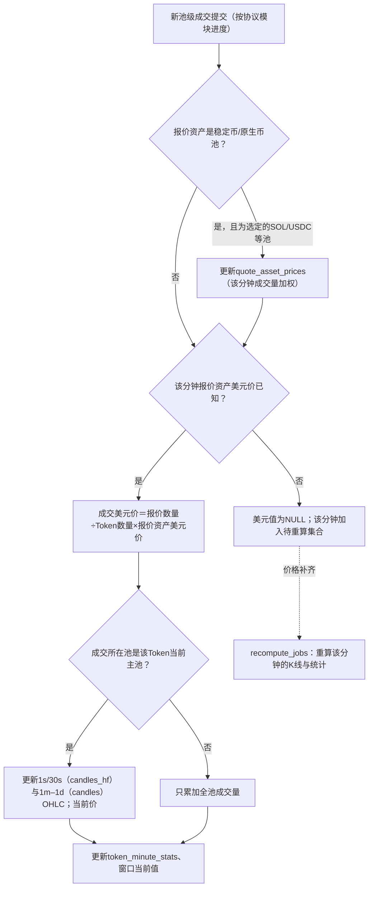

# 计价、主池与K线

> 决策D31、D53–D56、D85、D89、D90。字段口径见[Token指标](../metrics/token-metrics.md)。
>
> 演示（真实链上样本＋异常兜底）：[Demo 03 计价与K线](../demos/03-pricing.md)。

## 1. 报价资产美元价（D54）

| 链 | 资产 | 美元价来源 |
| --- | --- | --- |
| Solana | USDC `EPjFWdd5AufqSSqeM2qN1xzybapC8G4wEGGkZwyTDt1v`、USDT | 固定1美元 |
| Solana | SOL（WSOL） | 选定SOL/USDC池每分钟成交量加权价 |
| Base | USDC `0x833589fCD6eDb6E08f4c7C32D4f71b54bdA02913` | 固定1美元 |
| Base | ETH（WETH） | 选定WETH/USDC池每分钟成交量加权价 |
| BSC | USDT `0x55d398326f99059ff775485246999027b3197955`、USDC | 固定1美元 |
| BSC | BNB（WBNB） | 选定WBNB/USDT池每分钟成交量加权价 |

地址来源：[Circle USDC地址](https://developers.circle.com/stablecoins/usdc-contract-addresses)；接入前核验合约与decimals。稳定币脱锚监测后续评估。报价资产不在上表时，该池成交不计美元额，只保留原币记录。

## 2. 主池（D55）

- 候选：该Token所有已支持池/曲线；剔除流动性<$1,000、报价资产不在白名单、24小时无成交的池（[Demo 03](../demos/03-pricing.md)）。
- 主池＝过去1小时平均美元流动性（两侧合计；曲线为报价资产储备×2，见[Token指标](../metrics/token-metrics.md)）最大的池；新池领先当前主池≥20%并持续10分钟才切换。
- 曲线阶段只有曲线一个候选；曲线毕业（complete）时立即切到迁移后的新池，不等10分钟（D55）。
- 每次切换记录时间、新旧池与原因，K线按切换时间拼接。

## 3. 价格与K线

- 每笔成交价＝报价资产数量 ÷ Token数量（按decimals），乘以发生时（同一分钟）报价资产美元价。成交记录只存原子数量，美元价在派生计算时关联`quote_asset_prices`得到（D85、D90）。
- Token当前价＝主池最近一笔有效成交价；排除失败、被重组撤销的成交。
- K线桶：1s、30s、1m、5m、1h、1d（首版只做这六个，D105）；基于主池成交生成OHLCV（另存全部池合计成交量）；空桶不补成交，前端沿用上一收盘价绘制。
- 保存：1m/5m/1h/1d存`candles`长期保存；1s/30s存`candles_hf`只留24小时，更早的请求从`pool_trades`现算（D89）。
- 迟到成交、重组修订只重算受影响的桶。

美元价缺失的兜底：

| 情况 | 处理 | 页面 |
| --- | --- | --- |
| 选定的SOL/USDC等池无成交 | 沿用上一个价格；超过5分钟标记stale；超过30分钟停止输出该资产计价的美元值（NULL） | stale时灰色提示；停止后显示“--” |
| 单笔成交价偏离主池最近1分钟中位数>50%，且成交额<$50或来自非主池 | 标记outlier：保留在成交明细，不进K线高低价 | 无 |
| 供应量不可用 | 市值为NULL，后台重试读取供应量 | 市值“--” |
| 报价资产不在白名单 | 不计美元额，只保留原币记录 | 美元列“--”，原币列正常 |
| 稳定币脱锚 | 首版按1美元（D54）；脱锚监测后续评估 | 无 |
| 历史回溯时价格还没算出 | 先写NULL，价格作业补齐后重算 | 回溯期间部分值“--” |

## 4. 窗口指标

1m/5m/1h/4h/24h的交易数、交易额、净流入、涨跌幅按分钟级预聚合表滚动求和；列表查询读预聚合结果，不实时扫成交表。

## 5. 第三方校验

可选用DEX Screener、Birdeye等对比价格，偏差>5%时记日志供排查，不覆盖本地值（D31）。

## 6. 验收要点

- 独立核对SOL/USDC换算后某笔Pump成交的美元价。
- 构造两池流动性交替领先的样例，切换满足20%＋10分钟条件。
- 跨池交易额合计正确，单池K线不被其他池成交污染。
