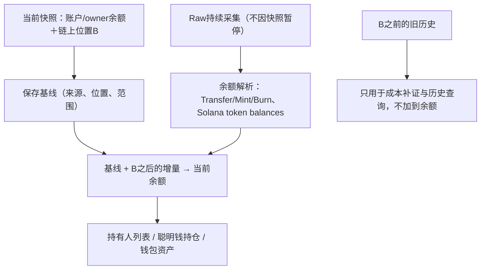
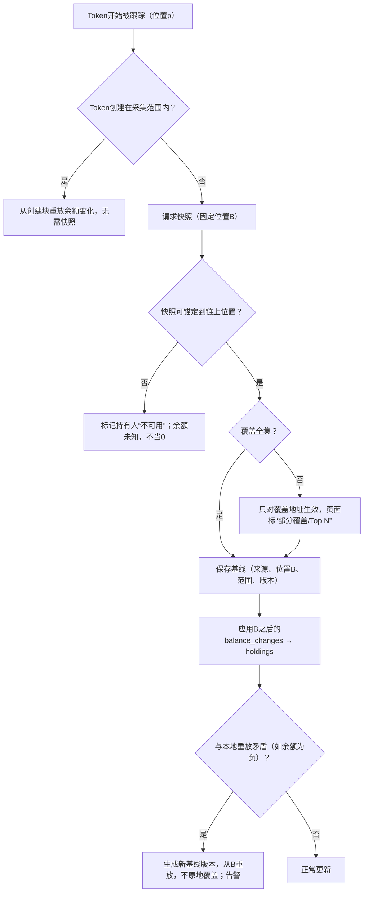

# 持仓、余额与持有人

> 决策D28、D42–D46、D73、D79。
>
> 演示（真实链上样本＋异常兜底）：[Demo 04 持仓](../demos/04-holdings.md)。

## 1. 为什么需要快照

采集只覆盖A之前30天（D73）及之后；更早买入的Token，单靠Raw无法得到当前余额。因此先取一份**可核验的当前快照**作基线，再叠加之后的链上变化（D46）。

余额变化只记“跟踪中的Token”（D79），所以持仓、持有人也只覆盖跟踪中的Token；Token开始被跟踪时取基线，见[数据模型§4.5](06-data-model.md)。

## 2. 流程

规则：

1. 快照必须带链上位置B（EVM块号与hash；Solana slot与上下文），只应用B之后的Raw变化。
2. 只覆盖部分地址的快照，未覆盖地址余额为未知，不当0。
3. 余额事实与买卖事实分开：一次Swap的Token转账只计一次余额变化。
4. B之前补到的成交只补FIFO成本，不再改当前余额。例：B时余额100，B后转入20、转出5，当前115；后来补到B前买入60，当前仍是115。
5. 快照与本地结果矛盾时生成新基线版本并重放B之后Raw，不原地覆盖。

## 3. 持有人页

- 完整优先；无法证明全集时标注“部分覆盖/Top N样本”及快照时间（D42）。
- 首版只展示最新快照，不提供历史日期回看（D43）。
- Solana按owner合并Token Account；池、销毁、锁仓地址单独标注、不计入前10持有者。

## 4. 快照来源

M1按D107：只对创建位置落在采集范围（L及之后）的Token从创建块重放，不请求第三方快照；更早的Token余额为未知，持有人页标“部分覆盖”。下表仍是M2前要选的来源，未选定前不接入。

| 链 | 候选 |
| --- | --- |
| Solana | RPC `getProgramAccounts`（按mint过滤，需固定slot上下文）、Helius DAS、Birdeye |
| Base / BSC | 自建：从Token创建块起重放Transfer（新币适用）；老币用Moralis/Etherscan holders等，需核验固定块一致性 |

新发行的Token若创建在采集范围内，可直接从创建块重放，无需快照。

## 5. 异常兜底

| 异常 | 处理 |
| --- | --- |
| 快照来源限流/超预算 | 排队，不阻塞成交与行情；持有人页显示“计算中” |
| 快照分页期间链上继续变化 | 必须固定slot/块号上下文；做不到就不作为基线 |
| 余额算出负数 | 视为基线或解析错误：告警、生成新基线版本，不截断为0 |
| `tracked_since`被历史解析改小 | 在新位置取新基线，旧基线作废，重放（[数据模型§4.5](06-data-model.md)） |
| 重组 | 随事实删除重算，从共同祖先起重放持仓 |

## 6. 验收要点

- 上述100→115算例；快照期间产生的区块不漏不重。
- 同owner多个Token Account合并；未知余额不当0。
- 当前余额可先展示，成本未补齐时收益显示“--”。
