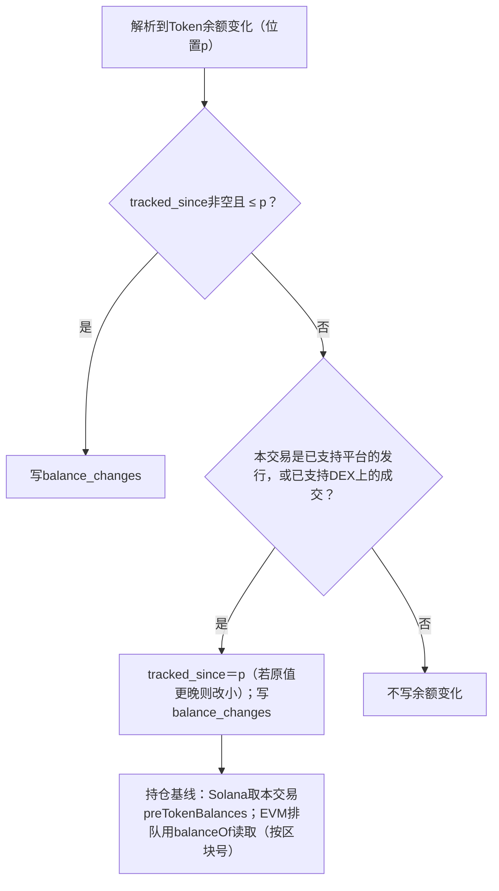

# 数据模型

> 决策D66、D73、D77–D105。权威DDL在`backend/migrations/`（`00001`–`00008`）；本文是说明与草案对照。按链分区的 RANGE 子分区由 ingest 按配置提前创建，迁移里先挂 DEFAULT 承接。

## 1. 通用约定

| 项 | 约定 |
| --- | --- |
| 链标识 | PostgreSQL枚举`chain_id`：`solana`、`base`、`bsc`（4字节，SQL中可读）。只有主网，不设`network`列 |
| 地址 | `BYTEA`原始字节：Solana 32字节、EVM 20字节（D77）。API、日志、管理后台转为base58或小写0x十六进制；EVM展示时用校验和格式 |
| 交易hash | `BYTEA`：Solana签名64字节、EVM 32字节；只在`chain_txs`存一次（D78） |
| 区块hash | `BYTEA` 32字节 |
| 链上位置 | `block_num BIGINT`（Solana为slot，EVM为区块号）＋`tx_index INT`（区块内交易序号）＋`item_index INT`（交易内序号，见§3.1） |
| 链上原子数量 | `NUMERIC(78,0)`（可容纳uint256，只允许整数，D82），配合decimals；API中用十进制字符串 |
| 状态字段 | `TEXT`＋`CHECK`（D82）；链标识例外，用枚举 |
| 美元金额 | `NUMERIC`；API中用十进制字符串，前端只做展示格式化 |
| 时间 | `timestamptz`，UTC；链上时间与采集时间分开存。BSC区块另存毫秒时间 |
| 未知 | `NULL`，不使用0或空串代替 |
| 版本 | 规则/解析/名单/重算结果带`version`，新版本生效后旧版本保留 |

## 2. 规模估算（2026-10-16/17实测样本外推）

| 链 | 每块Token余额变化 | 每天余额变化（全部Token） | 每天DEX成交（全部协议，估计） |
| --- | --- | --- | --- |
| Solana | 约484条/slot（6个样本slot） | 约1.05亿 | 约1,000万（仅Pump约280万） |
| Base | 约316个Transfer/块 | 约1,360万 | 约290万 |
| BSC | 约202个Transfer/块 | 约3,890万 | 约540万 |

全部Token的余额变化30天约47亿行，超出单机预算，因此只存跟踪中的Token（D79）。成交只存已支持协议，30天预计1–3亿行。M0接入后用真实写入量替换本表。

## 3. 采集层

```sql
CREATE TYPE chain_id AS ENUM ('solana', 'base', 'bsc');

-- 启动锚点A（D47、D74）与历史下界L（A之前30天，D73）
CREATE TABLE chain_anchors (
    chain             chain_id    PRIMARY KEY,
    anchor_position   BIGINT      NOT NULL,
    anchor_hash       BYTEA       NOT NULL,
    anchor_time       TIMESTAMPTZ NOT NULL,
    history_start_position BIGINT NOT NULL,
    history_start_time     TIMESTAMPTZ NOT NULL,
    created_at        TIMESTAMPTZ NOT NULL DEFAULT now()
);

-- 区块元数据；载荷在对象存储/本地目录（D66、D75）
-- 分区：LIST(chain) → RANGE(position)，区间同事实表（D83）；分区键必须进主键，所以主键带position
CREATE TABLE raw_blocks (
    chain            chain_id    NOT NULL,
    position         BIGINT      NOT NULL,          -- Solana slot / EVM区块号
    block_hash       BYTEA       NOT NULL,
    block_height     BIGINT,                        -- Solana blockHeight（与slot不同，可缺失）；EVM同position
    parent_hash      BYTEA       NOT NULL,
    block_time       TIMESTAMPTZ,
    block_time_ms    BIGINT,                        -- BSC milliTimestamp
    tx_count         INT         NOT NULL,
    object_key       TEXT        NOT NULL,
    compressed_bytes BIGINT      NOT NULL,
    confirmation     TEXT        NOT NULL CHECK (confirmation IN ('pending', 'confirmed')),           -- D71
    branch           TEXT        NOT NULL DEFAULT 'canonical' CHECK (branch IN ('canonical', 'orphaned')),
    completeness     TEXT        NOT NULL DEFAULT 'complete' CHECK (completeness IN ('complete', 'partial')),
    fetched_at       TIMESTAMPTZ NOT NULL DEFAULT now(),
    PRIMARY KEY (chain, position, block_hash)
) PARTITION BY LIST (chain);
-- 子分区：UNIQUE (position) WHERE branch = 'canonical'；(block_time) 用于时间→位置换算

-- 采集任务：每个区间一行（D81）；只放采集，解析进度在parse_progress
CREATE TABLE block_jobs (
    chain            chain_id    NOT NULL,
    task_kind        TEXT        NOT NULL CHECK (task_kind IN ('forward', 'history')),
    range_start      BIGINT      NOT NULL,          -- 含
    range_end        BIGINT      NOT NULL,          -- 不含；默认range_start + 1000
    status           TEXT        NOT NULL DEFAULT 'pending'
                     CHECK (status IN ('pending', 'running', 'done', 'failed')),
    done_count       INT         NOT NULL DEFAULT 0, -- 已写入raw_blocks的块数
    skipped_count    INT         NOT NULL DEFAULT 0, -- Solana确认跳过的slot数（-32007/-32009）
    gap_count        INT         NOT NULL DEFAULT 0, -- 重试耗尽、已转入collection_gaps的块数
    attempts         INT         NOT NULL DEFAULT 0,
    next_attempt_at  TIMESTAMPTZ NOT NULL DEFAULT now(),
    lease_until      TIMESTAMPTZ,                   -- running任务的租约，过期可被重新领取
    worker_id        TEXT,
    last_error_class TEXT CHECK (last_error_class IN ('retryable', 'config', 'not_found', 'history_unavailable', 'incomplete')),
    last_error       TEXT,
    updated_at       TIMESTAMPTZ NOT NULL DEFAULT now(),
    PRIMARY KEY (chain, task_kind, range_start),
    CHECK (range_end > range_start)
);
CREATE INDEX block_jobs_ready ON block_jobs (chain, task_kind, next_attempt_at) WHERE status = 'pending';
-- 区间完成条件：done_count + skipped_count + gap_count = range_end - range_start
-- forward任务追链头：链头所在区间在到达range_end前保持running，按租约续期

CREATE TABLE collection_progress (
    chain               chain_id NOT NULL,
    task_kind           TEXT     NOT NULL,
    run_id              BIGINT   NOT NULL,
    range_start         BIGINT   NOT NULL,
    range_end           BIGINT,                     -- forward为NULL（追链头）
    continuous_position BIGINT   NOT NULL,          -- 连续完成位置
    continuous_hash     BYTEA,
    generation          BIGINT   NOT NULL DEFAULT 0, -- 防止过期worker覆盖
    status              TEXT     NOT NULL CHECK (status IN ('running', 'paused', 'done')),
    last_error          TEXT,
    updated_at          TIMESTAMPTZ NOT NULL DEFAULT now(),
    PRIMARY KEY (chain, task_kind, run_id)
);

CREATE TABLE collection_gaps (
    chain        chain_id NOT NULL,
    position     BIGINT   NOT NULL,
    reason       TEXT     NOT NULL,                 -- retry_exhausted | history_unavailable | budget_paused
    first_seen   TIMESTAMPTZ NOT NULL DEFAULT now(),
    resolved_at  TIMESTAMPTZ,
    PRIMARY KEY (chain, position)
);

CREATE TABLE reorg_events (
    id               BIGINT GENERATED ALWAYS AS IDENTITY PRIMARY KEY,
    chain            chain_id NOT NULL,
    common_ancestor  BIGINT   NOT NULL,
    old_tip          BIGINT   NOT NULL,
    new_tip          BIGINT   NOT NULL,
    detected_at      TIMESTAMPTZ NOT NULL DEFAULT now()
);
```

## 4. 事实层

### 4.1 位置键（D78）

| 字段 | Solana | EVM |
| --- | --- | --- |
| `block_num` | slot | 区块号 |
| `tx_index` | 交易在区块中的下标 | `transactionIndex` |
| `item_index` | 交易内事件序号：按指令执行顺序给解析出的事件编号（从0开始） | `logIndex`（区块内唯一） |

- 主键即链上顺序，FIFO账本直接按主键排序。
- 只保存主链（canonical）上的事实。未确认块的事实也直接写入，确认状态查`raw_blocks.confirmation`（D87）。重组时：删除`block_num > 共同祖先`的事实 → 重新解析新分支 → 派生结果从该位置重算。
- `item_index`由解析器确定性生成：同一Raw、同一解析器版本，结果完全相同。
- 事实表只存原子数量，不存美元值（D85）；事实写入后只会因重组或解析器升级整段替换，不做行级更新。
- 解析器升级（D86）：新版本解析到影子分区（`<表>_shadow_<chain>_p<起点>`，结构与正式子分区相同）→ 与正式分区逐行比对、守恒校验 → 通过后在一个事务里`DETACH`旧子分区、`ATTACH`影子分区 → 派生结果从该区间重算。`parser_version`列只用于审计。

### 4.2 分区（D80）

PostgreSQL要求分区表的主键包含分区键，所以不能直接按`block_time`分区。采用：

```text
pool_trades                     PARTITION BY LIST (chain)
 ├─ pool_trades_solana          PARTITION BY RANGE (block_num)
 │   ├─ pool_trades_solana_p457600000   [457,600,000, 457,816,000)   约1天（21.6万slot）
 │   └─ …
 ├─ pool_trades_base            PARTITION BY RANGE (block_num)   每区间43,200块
 └─ pool_trades_bsc             PARTITION BY RANGE (block_num)   每区间192,000块
```

- 分区由ingest提前创建（领先链头至少2个区间）；区间大小写在配置里，BSC出块时间变化时只影响新区间。
- 按时间查询时，先用`raw_blocks`把时间换算成`block_num`范围，再命中分区。
- 暂不删除；将来删除时按整个分区`DETACH`＋`DROP`。

### 4.3 表

```sql
-- 产生过事实的交易，以及调用了已支持协议的失败交易（D84），每笔一行
CREATE TABLE chain_txs (
    chain       chain_id    NOT NULL,
    block_num   BIGINT      NOT NULL,
    tx_index    INT         NOT NULL,
    tx_hash     BYTEA       NOT NULL,
    signer      BYTEA       NOT NULL,              -- Solana首个签名者 / EVM tx.from；手续费计入此钱包
    success     BOOLEAN     NOT NULL,              -- false时本交易没有其他事实，只用于手续费成本
    fee_native  NUMERIC(78,0) NOT NULL,            -- 网络费原子数量（lamports/wei，Base另含L1费）
    tip_native  NUMERIC(78,0),                     -- 路由/Jito小费原子数量，无则NULL
    block_time  TIMESTAMPTZ NOT NULL,
    PRIMARY KEY (chain, block_num, tx_index)
) PARTITION BY LIST (chain);
-- 按hash查交易：每个子分区建 (tx_hash) 索引

-- 池级成交：每个池子每一跳一行
CREATE TABLE pool_trades (
    chain         chain_id    NOT NULL,
    block_num     BIGINT      NOT NULL,
    tx_index      INT         NOT NULL,
    item_index    INT         NOT NULL,
    block_time    TIMESTAMPTZ NOT NULL,
    protocol      TEXT        NOT NULL,            -- pump_curve | pumpswap | fourmeme | uniswap_v4 | pancake_v2 …
    pool          BYTEA       NOT NULL,            -- Solana池账户 / v4 poolId / v2/v3池地址
    token         BYTEA       NOT NULL,
    quote_asset   BYTEA       NOT NULL,
    side          TEXT        NOT NULL CHECK (side IN ('buy', 'sell')),  -- 从Token角度
    token_amount  NUMERIC(78,0) NOT NULL,
    quote_amount  NUMERIC(78,0) NOT NULL,
    trader        BYTEA,                           -- 池子看到的交易方（可能是路由）
    parser_version INT        NOT NULL,
    PRIMARY KEY (chain, block_num, tx_index, item_index)
) PARTITION BY LIST (chain);

-- 交易内各项费用（协议费、创建者费、聚合器费、分成）
CREATE TABLE trade_fees (
    chain       chain_id NOT NULL,
    block_num   BIGINT   NOT NULL,
    tx_index    INT      NOT NULL,
    item_index  INT      NOT NULL,                 -- 对应pool_trades.item_index；聚合器费用为交易级，取-1
    seq         SMALLINT NOT NULL,
    kind        TEXT     NOT NULL CHECK (kind IN ('protocol', 'creator', 'lp', 'aggregator', 'unknown')),
    recipient   BYTEA,
    asset       BYTEA    NOT NULL,
    amount      NUMERIC(78,0) NOT NULL,
    PRIMARY KEY (chain, block_num, tx_index, item_index, seq)
) PARTITION BY LIST (chain);

-- 钱包级经济动作：多跳归并后每个钱包×Token一行
CREATE TABLE economic_actions (
    chain          chain_id    NOT NULL,
    block_num      BIGINT      NOT NULL,
    tx_index       INT         NOT NULL,
    item_index     INT         NOT NULL,           -- 取归并后最后一跳的item_index
    block_time     TIMESTAMPTZ NOT NULL,
    wallet         BYTEA       NOT NULL,
    token          BYTEA       NOT NULL,
    side           TEXT        NOT NULL CHECK (side IN ('buy', 'sell')),
    token_amount   NUMERIC(78,0) NOT NULL,
    quote_asset    BYTEA       NOT NULL,
    quote_amount   NUMERIC(78,0) NOT NULL,         -- 买入为实际花费（含协议费），卖出为实际到账；网络费与小费在chain_txs
    attribution    TEXT        NOT NULL CHECK (attribution IN ('confirmed', 'inferred', 'ambiguous')),
    hops           SMALLINT    NOT NULL DEFAULT 1,
    parser_version INT         NOT NULL,
    PRIMARY KEY (chain, block_num, tx_index, item_index)
) PARTITION BY LIST (chain);
-- 子分区索引：(wallet, block_num DESC)、(token, block_num DESC)

-- Token余额变化：只记跟踪中的Token（D79）
CREATE TABLE balance_changes (
    chain        chain_id NOT NULL,
    block_num    BIGINT   NOT NULL,
    tx_index     INT      NOT NULL,
    item_index   INT      NOT NULL,                -- Solana按账户下标；EVM为Transfer的logIndex
    owner        BYTEA    NOT NULL,
    token        BYTEA    NOT NULL,
    delta        NUMERIC(78,0) NOT NULL,           -- 有符号
    post_balance NUMERIC(78,0),                    -- Solana来自postTokenBalances；EVM为NULL
    kind         TEXT     NOT NULL CHECK (kind IN ('trade', 'transfer', 'mint', 'burn')),
    PRIMARY KEY (chain, block_num, tx_index, item_index)
) PARTITION BY LIST (chain);

-- 原生币转账（标签的注资关系用），≥0.01且接收方非程序/合约；保留30天，过期整分区删除（D80例外）
CREATE TABLE native_transfers (
    chain      chain_id NOT NULL,
    block_num  BIGINT   NOT NULL,
    tx_index   INT      NOT NULL,
    item_index INT      NOT NULL,
    sender     BYTEA    NOT NULL,
    receiver   BYTEA    NOT NULL,
    amount     NUMERIC(78,0) NOT NULL,
    PRIMARY KEY (chain, block_num, tx_index, item_index)
) PARTITION BY LIST (chain);
-- 子分区索引：(receiver, block_num DESC)
```

`liquidity_events`结构同`pool_trades`（两侧原子数量、方向add/remove）。

美元值的计算（D85）：派生作业按`(chain, quote_asset, date_trunc('minute', block_time))`关联`quote_asset_prices`，`quote_amount`按报价资产decimals换算后乘以美元价；该分钟无价格时结果为NULL，等价格补齐后由`recompute_jobs`重算对应区间。

`native_transfers`在EVM上只能从区块数据得到顶层`tx.value`（`item_index`取-1）；合约内部转出的原生币需要trace，公共RPC不提供（D75），开发阶段缺失这部分，注资判定以Solana为主。

### 4.4 实体表（不分区）

| 表 | 主键 | 字段 |
| --- | --- | --- |
| `tokens` | (chain, address) | symbol（清洗后≤32字符）、name（清洗后≤128字符）、raw_metadata（JSONB原样，D103）、decimals、total_supply、creator、launch_platform、launch_position(block_num, tx_index)、**tracked_since**（开始跟踪的位置）、metadata_uri、social（JSONB）、first_seen_at |
| `pools` | (chain, pool) | protocol、token、quote_asset、hooks、created_position、status（active/graduated/closed）、migrated_from |
| `pool_migrations` | (chain, from_pool) | to_pool、迁移交易位置、证据 |
| `parse_progress` | (chain, module, parser_version, task_kind) | 连续解析位置；task_kind为forward/history |
| `parse_failures` | (chain, module, block_num, tx_index) | 错误、重试次数、状态 |
| `parse_quarantine` | (chain, block_num, tx_index) | 守恒校验失败的交易、原因、解析器版本 |
| `token_metadata_jobs` | (chain, token) | URI拉取状态、重试次数 |
| `attribution_tasks` / `attribution_revisions` | id | 补证任务与归因修订 |

### 4.5 “跟踪中的Token”（D79）



- 前向解析从A起先运行，历史解析（从L起旧→新，D49）晚于前向开始，所以一个Token可能先在A之后被跟踪，历史解析时又在更早位置出现。此时把`tracked_since`改为更早的位置，并从该位置起补写余额变化；同时在新位置取一份新持仓基线，旧基线作废，持仓按“新基线＋之后的变化”重放（[持仓§5](05-holdings.md)），避免基线与补写的变化重复计算。L之前的部分由持仓基线覆盖，不回扫Raw。
- 报价资产（WSOL、WETH、WBNB、USDC、USDT等白名单）永不跟踪。

## 5. 派生层

| 表 | 说明 |
| --- | --- |
| `quote_asset_prices` | (chain, asset, minute)：报价资产美元价 |
| `token_main_pool` | 当前主池与切换历史 |
| `candles` | (chain, token, candle_interval, bucket_start)：OHLCV＋全池成交量；1m/5m/1h/1d长期保存（D89）；列名避开保留字`interval` |
| `candles_hf` | (chain, token, candle_interval, bucket_start)：1s/30s，按天分区，只留24小时；更早的从`pool_trades`现算（D89、D91） |
| `compute_progress` | (job, chain)：派生作业水位与输入版本 |
| `token_minute_stats` | (chain, token, minute)：成交笔数、买卖笔数、成交额、全体买卖额、交易人数草图；按天分区，保留30天（D91） |
| `sm_minute_stats` | (list_version, chain, token, minute)：聪明钱买卖额与笔数、参与钱包；按天分区，保留30天（D91）；名单切换后旧版本的行30分钟后删除（D92） |
| `token_window_current` | (chain, time_window, token)：资金流入列表全部列的当前值，每5秒增量更新；列名避开保留字`window` |
| `wallet_token_daily` | (chain, wallet, token, day)：买卖笔数与额、已实现收益、本日是否完成一次完整闭仓（从零到零，可跨天）、成本是否完整、是否全部为confirmed归因（attribution_ok，自动识别用） |
| `token_info_cache` | (chain, token)：代币信息卡字段与计算时间 |
| `holding_baselines` | 快照来源、链上位置、覆盖范围、版本 |
| `holdings` | (chain, wallet, token)：当前余额、更新位置 |
| `fifo_lots` | (chain, wallet, token, opened_at位置)：剩余数量、剩余成本、是否成本完整 |
| `realized_pnl` | (chain, wallet, token, 卖出位置)：释放成本与利润 |
| `recompute_jobs` | 范围、原因、输入版本、状态 |

派生表中的钱包、Token同样用`BYTEA`。

- 收益相关表（`wallet_token_daily`、`holdings`、`fifo_lots`、`realized_pnl`）覆盖所有交易过跟踪中Token的钱包（D88）。
- 美元值不设中间表：作业按`(chain, quote_asset, minute)`关联`quote_asset_prices`现算后写入上表（D90）。价格补齐或修订时，经`recompute_jobs`重算受影响分钟。

## 6. 名单、标签、信号

| 表 | 说明 |
| --- | --- |
| `smart_money_lists` | 名单版本：来源（import/auto）、规则版本、生成时间、状态 |
| `smart_money_members` | (list_version, chain, address)：每个版本完整成员，永久保留（D92）；名称、X链接、来源集合（import/auto） |
| `smart_money_exclusions` | 管理员排除的地址与原因 |
| `token_wallet_labels` | (chain, token, address, label)：dev/sniper/bundle/insider/whale；rule_version、命中时间、证据`JSONB`（交易位置与证据类型），D93 |
| `wallet_labels` | (chain, address, label)：pro_trader/kol；rule_version或导入批次、命中时间、证据`JSONB`，D93 |
| `signals` | id；列：chain、token、side、time_window、rule_version、list_version、triggered_at、触发位置(block_num, tx_index, item_index)、首次推送市值、钱包数、净买入额、当日序号、状态（active/reverted）；完整快照`JSONB`（参与钱包与各自金额、价格等），D94 |
| `signal_state` | (chain, token, side, day)：最近触发时间（冷却）、当日序号 |
| `leaderboard_snapshots` | (chain, period, scope, computed_at, rank)：钱包、盈亏、胜率等列；按computed_at保留48小时（D95） |

## 7. 用户层（M4起）

| 表 | 说明 |
| --- | --- |
| `users` | id `UUID`（Go生成UUIDv7，D96）；chain、address（`UNIQUE (chain, address)`，一个钱包一个用户，D97）、创建时间、最近登录时间 |
| `auth_nonces` | nonce、chain、address、过期时间、是否已消费 |
| `follows` | (user, chain, target_kind, address)：target_kind为wallet/token；备注 |
| `collections` / `collection_members` | 合集与地址 |
| `blacklist` | 用户屏蔽的Token或地址 |
| `alert_rules` / `alert_events` | 提醒规则与触发记录；`alert_events`永久保留（D99） |

会话（D98）：

```sql
-- 每次登录一行；多端各自一行，互不影响
CREATE TABLE auth_sessions (
    id          UUID        PRIMARY KEY,        -- Go生成UUIDv7，用于日志与管理
    token_hash  BYTEA       NOT NULL UNIQUE,    -- SHA-256(32字节随机token)；Cookie只存token原文
    user_id     UUID        NOT NULL REFERENCES users (id),
    created_at  TIMESTAMPTZ NOT NULL DEFAULT now(),
    expires_at  TIMESTAMPTZ NOT NULL,
    revoked_at  TIMESTAMPTZ,                    -- 非NULL即失效
    revoke_reason TEXT CHECK (revoke_reason IN ('logout', 'account_changed', 'relogin', 'admin')),
    user_agent  TEXT
);
CREATE INDEX auth_sessions_user ON auth_sessions (user_id) WHERE revoked_at IS NULL;
-- 每天删除expires_at早于7天前的行
```
| `event_stream` | 全部实时事件，outbox与已发布流合一（`seq`为空即待发布）；按小时分区保留24小时（D100–D102），DDL见[实时推送](08-realtime.md) |
| `trade_intents` | M5：报价、路由、签名后tx hash、链上状态 |

## 8. 索引与保存

- 分区表的索引建在每个子分区上：`economic_actions(wallet, block_num DESC)`、`economic_actions(token, block_num DESC)`、`pool_trades(token, block_num DESC)`、`balance_changes(owner, token)`、`native_transfers(receiver, block_num DESC)`、`chain_txs(tx_hash)`。
- 非分区：`token_minute_stats(chain, minute)`、`token_window_current(chain, time_window, <每个可排序列>)`、`tokens`名称与符号的`pg_trgm`索引（名称、符号为文本）。
- 保存期限：事实表暂不删除（D80），例外是`native_transfers`保留30天；Raw按D24另行决定。派生数据按D91删除：`token_minute_stats`、`sm_minute_stats`超过30天的分区，`sm_minute_stats`旧名单版本切换30分钟后，`candles_hf`超过24小时；`event_stream`超过24小时（D102）；`leaderboard_snapshots`超过48小时（D95）。
