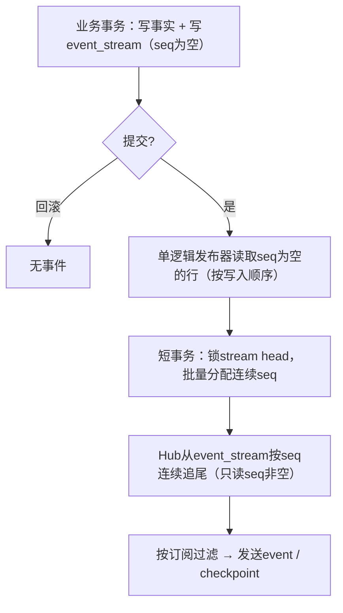
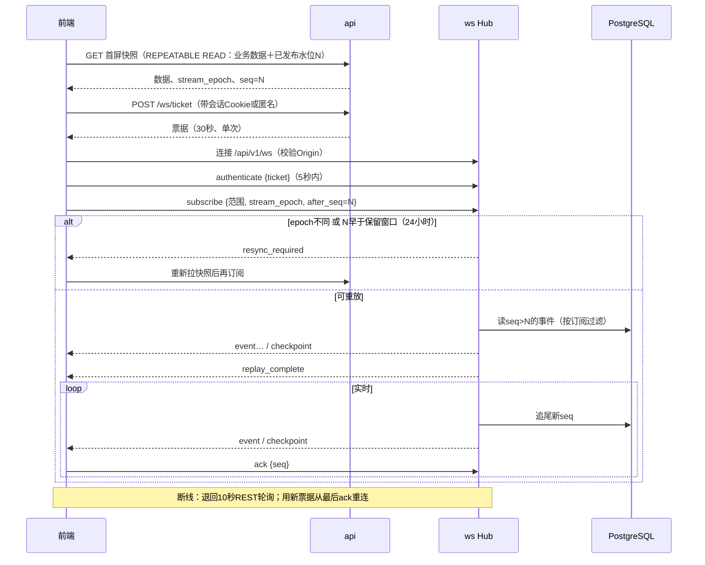

# 实时推送（WebSocket）

> 决策D62：M4随监控/提醒上线；M1–M3用REST每10秒刷新。D12的100k在线目标需实压证明。
>
> 演示（真实链上样本＋异常兜底）：[Demo 09 实时推送](../demos/09-realtime.md)。

## 1. 事件类型

| 类型 | 触发 | 前端行为 |
| --- | --- | --- |
| `token.updated` | Token价格、市值、窗口指标有新版本（合并节流，每Token≤1次/秒） | 更新列表行与详情头部 |
| `token.trade` | 订阅Token出现新成交 | 详情页活动流插入 |
| `wallet.action` | 被关注/监控/聪明钱钱包产生已归因买卖 | 监控浮层、钱包活动插入 |
| `signal.created` | 新信号触发 | 信号流插入卡片 |
| `alert.fired` | 用户提醒规则命中 | 提醒弹出（声音需用户先交互授权） |
| `event.corrected` / `event.reverted` | 原事件被补证改判或重组撤销 | 按原事件id替换或删除，不再弹提醒 |

历史回填和重算产生的修订标`is_backfill=true`，不触发提醒。同一钱包同时被关注和监控只推一次。

## 2. 消息封装

```json
{
  "schema_version": "1",
  "event_id": "evt_...",
  "type": "wallet.action",
  "stream_epoch": "ep_...",
  "seq": "42",
  "chain": "solana",
  "entity_id": "...",
  "entity_revision": "7",
  "occurred_at": "2026-10-16T10:00:00Z",
  "is_backfill": false,
  "payload": { "wallet": "...", "token": "...", "side": "buy", "amount_usd": "1520.4" }
}
```

`seq`以字符串传输；金额同REST，用十进制字符串。

## 3. 发布：事务内写事件流（D100、D101）

全部事件类型都进`event_stream`，outbox与事件流是同一张表：



```sql
CREATE TABLE event_stream (
    id            BIGINT GENERATED ALWAYS AS IDENTITY,
    created_at    TIMESTAMPTZ NOT NULL DEFAULT now(),   -- 分区键：按小时分区，保留24小时（D102）
    seq           BIGINT,                               -- 发布器分配；NULL＝未发布
    stream_epoch  TEXT        NOT NULL,
    event_type    TEXT        NOT NULL,
    chain         chain_id,
    entity_id     TEXT        NOT NULL,
    entity_revision BIGINT    NOT NULL,
    is_backfill   BOOLEAN     NOT NULL DEFAULT false,
    payload       JSONB       NOT NULL,
    PRIMARY KEY (created_at, id)
) PARTITION BY RANGE (created_at);
-- 子分区索引：(seq) WHERE seq IS NOT NULL；(id) WHERE seq IS NULL（发布器待处理队列）
```

- 业务提交前不推送；`seq`在加锁的发布事务里分配，不直接用自增ID当水位（晚提交的小ID会被跳过）。
- 规模（D100）：成交事件估计每天约2,000万（Solana约1,000万、BSC约540万、Base约290万），平均约230条/秒；`token.updated`按每Token≤1次/秒节流。发布器按批（如每批1,000条）分配`seq`。M4压测时验证发布延迟、写放大与Hub追尾速度，不达标再讨论把`token.trade`改为直接按位置读`pool_trades`。
- `LISTEN/NOTIFY`只用于唤醒，Hub仍定时追尾持久表。
- 重放与实时共用同一读取路径，读到流尾后不切换到纯内存广播。

## 4. 连接、订阅与补发

1. 客户端调用`POST /api/v1/ws/ticket`获取短时单次票据（30秒），不放URL、不入日志。
2. 连接`/api/v1/ws`，校验Origin/Host；首帧`authenticate`提交票据，超时5秒未鉴权即断开。
3. `subscribe`携带范围（链、Token、钱包、事件类型）、`stream_epoch`、最后ack的`seq`。
4. 服务端先补发游标之后事件，发`replay_complete`，再持续推送；被过滤的区段用`checkpoint`推进扫描位置。
5. 客户端处理完后`ack`；断线后用新票据从最后ack重连。
6. 游标过期、epoch变化（备份恢复后）、订阅范围扩大时返回`resync_required`，客户端重新拉REST快照（含水位）后再订阅。

匿名用户可订阅公开数据（Token、信号）；关注、监控、提醒需登录。



| 异常 | 处理 |
| --- | --- |
| 发布器崩溃 | 已提交但`seq`为空的事件在重启后补分配，不丢不重 |
| Hub追尾落后 | 发布滞后指标告警；客户端照常收到，只是延迟 |
| 客户端发送队列溢出（慢客户端） | 断开连接，客户端从最后ack重连 |
| 会话被撤销（D98） | 用户订阅范围的连接收到`auth_revoked`后断开；公开订阅需重新取匿名票据 |
| 备份恢复 | 新`stream_epoch`，全部客户端resync |
| 重组/改判 | 推送`event.reverted`/`event.corrected`，前端按原事件id替换或删除 |

## 5. 首屏快照与订阅衔接

REST快照在一个`REPEATABLE READ`只读事务中同时读取业务数据和已发布的事件流水位N；客户端从N订阅。快照里已包含、之后又重放的事件按`event_id`与`entity_revision`幂等去重。

## 6. 背压与限额

| 项 | 初始值（待压测调整） |
| --- | --- |
| 单连接发送队列 | 256条，溢出即断开并让客户端从ack重连 |
| 单帧大小 | 64KB |
| 单连接订阅数 | 200；超出时拒绝该次subscribe并返回错误码，不断开连接 |
| 心跳 | 服务端每20秒ping，40秒无pong断开 |
| 重连 | 客户端指数退避1s→30s加抖动 |
| 事件流保留 | 24小时（按小时分区，每小时删最旧分区，D102），超出要求resync |

## 7. 验收要点

- 业务回滚不推；发布前崩溃重启后补发；晚提交的事件（seq为空的行）不被跳过。
- 快照→订阅期间持续写入不漏不重；过滤流的checkpoint不越过未处理事件。
- 票据重放/过期、恶意Origin、未鉴权帧、超大消息、慢客户端都被拒绝或断开且资源有界。
- 备份恢复产生新epoch，旧客户端必须resync。
- 改判事件替换原事件，不产生第二次提醒。

## 前端对接约定（2026-10-19 补充，M4 实现）

目标：WS 事件**复用 REST 契约里的同一形状**，前端用现有的合并路径消费，不再写第二套渲染逻辑；断线时退回现有的 10 秒轮询（[前端架构§3](14-frontend.md)）。

| 事件 | `payload` 形状 | 前端写入位置 |
| --- | --- | --- |
| `token.updated` | `{ "window": Window, "currency": "USD", "list_version": string, "row": InflowRow }` | 资金流入可见行的 `latest` 映射（与 `POST /tokens/batch` 同一入口，按 Token 合并、不重排）；详情头部按 `row` 刷新 |
| `token.trade` | `{ "activity": Activity, "entity_revision": int, "removed": boolean }` | 活动页签 Query 缓存：按 `activity.id`（链上位置）插入/替换；`removed=true`（重组或改判撤销）时删除 |
| `wallet.action`、`signal.created`、`alert.fired` | M2–M4 定义时先进 `api/openapi.yaml` 的 schema，再在此引用 | 对应页面缓存 |

- **订阅参数**带 `window`、`currency`（`usd|native`）与 `list_version`：服务端按订阅推送已换算好的值，前端仍不做金额运算（D109）。`list_version` 与当前快照不同时，客户端丢弃该事件并在下次刷新时重查。
- **快照水位**：M4 起，`InflowPage`、`TokenDetail`、`ActivitiesResponse` 增加可选字段 `stream: { epoch: string, seq: string }`（对已有客户端向后兼容），客户端从该 `seq` 之后订阅。
- **去重**：事件按 `event_id` 去重；同一实体按 `entity_revision` 只接受更大的版本。
- **trace**：每条事件带产生它的业务 `trace_id`（[可观测性](18-observability.md)），客户端日志与后端日志可以对上。
- **错误码**：WS 错误帧 `{ "type": "error", "code": ErrorCode | "resync_required" | "subscription_limit", "trace_id" }`；`resync_required` 与 `subscription_limit` 在 M4 加入 `ErrorCode` 目录。
