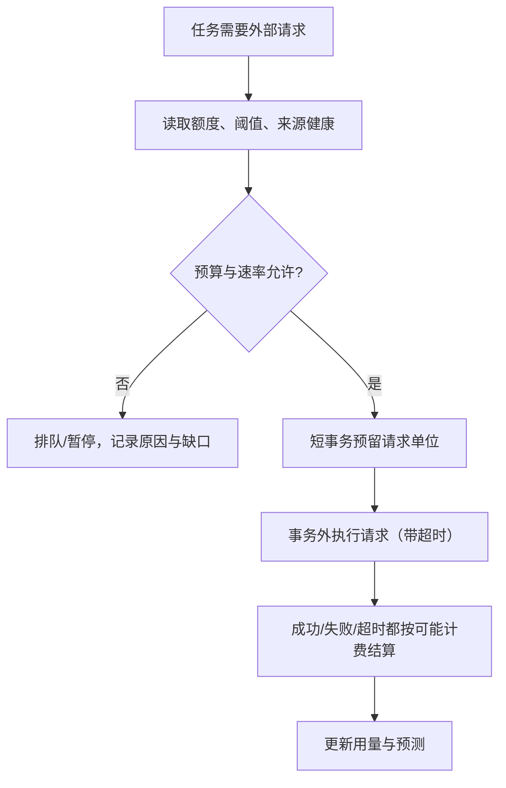

# 运维：预算、限流、安全与可观测

## 1. 预算与限流

| 规则 | 说明 |
| --- | --- |
| 预算阈值 | 验证期月预算USD100：70美元提醒、80美元暂停历史回溯与补证、100美元暂停前向采集与全部新增付费请求并告警，由你手动恢复（D104）；暂停期间的位置登记缺口`budget_paused`，恢复后补齐 |
| 计数 | 固定套餐费、套餐内额度、超额费分开记录；软件估算不等于账单，供应商有硬限额时同时配置 |
| 限流 | 按供应商隔离令牌桶；指数退避加抖动；所有请求带context超时 |
| 资源配额 | 前向采集优先；历史回溯、补证、快照各自独立配额，不能挤占前向 |
| 背压 | 队列满即暂停领取并登记缺口，不开无界goroutine |
| 用户请求 | 页面访问不直接触发上游请求；所有上游调用经服务端调度与缓存 |

## 2. 安全

| 项 | 要求 |
| --- | --- |
| 秘密 | RPC Key、数据库凭证只在后端秘密配置；不进日志、前端、`NEXT_PUBLIC_`变量 |
| 上游透传 | 不提供任意RPC透传接口 |
| 管理后台 | 独立管理员身份（钱包签名＋白名单地址）；所有写操作留审计 |
| 用户会话 | HttpOnly、Secure、SameSite=Lax Cookie；写接口校验Origin |
| 导入 | 限行数/大小；拒收疑似私钥/助记词字段；外部链接与元数据视为不可信输入，前端不直接渲染HTML |
| 交易 | 后端不接触私钥；报价有效期与滑点上限由用户确认 |
| 数据库 | 应用账号最小权限；迁移用独立角色；连接池与语句超时 |
| 诊断 | pprof默认关闭，开启时只监听回环地址 |

## 3. 可观测

| 环节 | 指标 |
| --- | --- |
| 来源 | 每供应商请求单位、费用、成功/失败/限流、延迟 |
| 采集 | 各链链头、forward/history连续完成位置、缺口数、队列深度与最老任务年龄、每日Raw字节 |
| 解析 | 各模块进度与落后区块数、失败任务、待补证数、未知成本占比 |
| 计价/统计 | 主池切换次数、价格与第三方偏差告警、重算积压 |
| 数据库 | 连接、锁等待、慢查询、磁盘剩余 |
| API/WS | 请求延迟分位、错误率；WS连接数、发布滞后、重放与resync次数 |
| 前端 | 接口错误、渲染错误；数据新鲜度（`as_of`距当前时间） |

- 错误码、日志字段、trace-id、panic 兜底与 Grafana 查看方式见[可观测性](18-observability.md)（D112）；日志关联链为`trace_id → job_id → 区块 → 事实 → 重算版本`、`trace_id → query_id → 名单版本`。
- 指标标签只用链、来源、结果类型等低基数维度；钱包与Token地址只进日志。
- 管理后台“运行质量”页读取以上指标，见[管理后台](../product/08-admin.md)。

## 4. 故障与恢复

| 故障 | 处理 |
| --- | --- |
| 上游限流/无历史 | 退避或熔断，保留缺口；恢复后从断点补采 |
| 积压/资源高 | 降低历史与补证并发，保护前向采集，页面显示数据延迟 |
| 数据库故障 | 停止写入与发布；页面保留最后数据并标“过期” |
| 磁盘接近上限 | 暂停历史回溯并提醒；不自动删除Raw |
| 服务重启 | 过期任务重新领取，幂等恢复 |
| 备份恢复 | 在独立库恢复并核对后切换；WS换新epoch |

备份初始目标：RPO ≤ 24小时、RTO ≤ 30分钟，M1演练后确定。

## 5. 部署（初始）

单区域：1台应用服务器（Go服务全部角色＋Next.js）＋托管PostgreSQL＋对象存储（Raw）；前端可放CDN。容量证据出来前不拆服务；拆分时按[技术方案§3.1](../TECHNICAL_PLAN.md)的角色划分。公网TLS、域名与云厂商在M1末确定。

预算统计除RPC外还要包含对象存储容量与流量费用。
