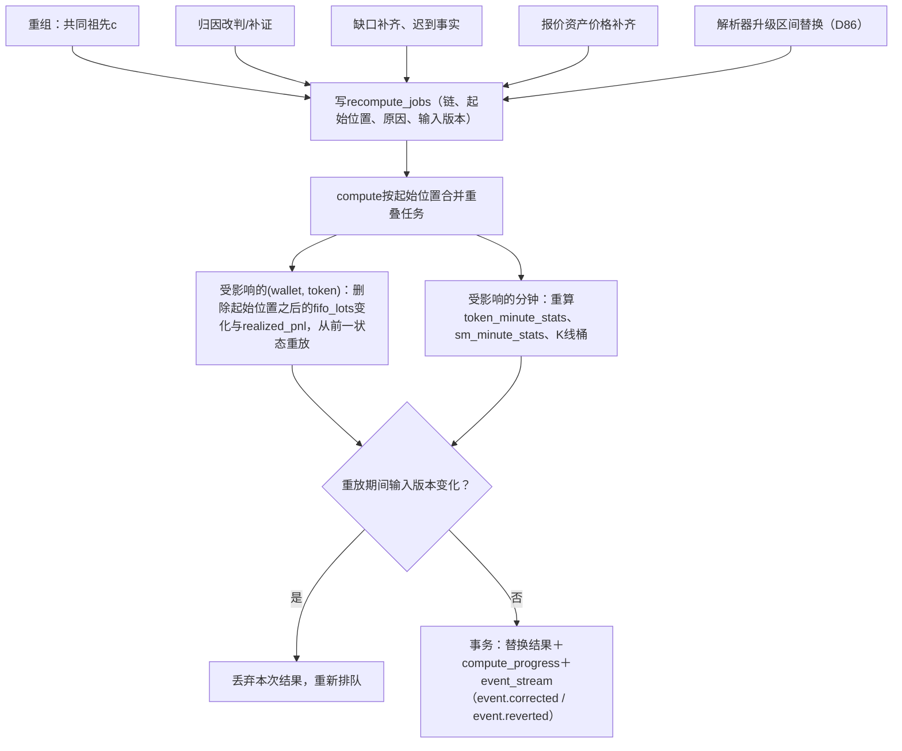
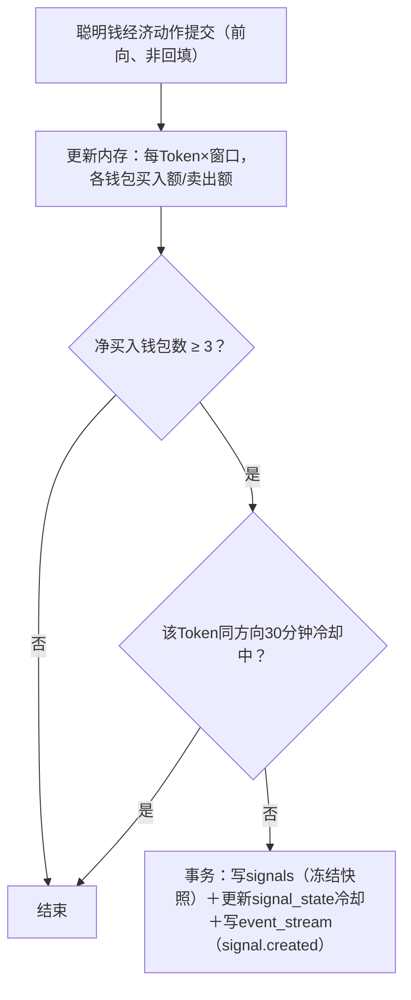

# 派生计算

> `compute`角色的实现。字段口径见[Token指标](../metrics/token-metrics.md)、[钱包指标](../metrics/wallet-metrics.md)、[聪明钱](../metrics/smart-money.md)、[标签](../metrics/labels.md)。水位规则见[技术方案§3.3](../TECHNICAL_PLAN.md)（D68）。
>
> 演示（真实链上样本＋异常兜底）：[Demo 05 FIFO账本](../demos/05-ledger.md)、[Demo 06 聪明钱与信号](../demos/06-smart-money-signals.md)、[Demo 07 地址标签](../demos/07-labels.md)。

## 1. 计算作业总览

| 作业 | 触发 | 输入 | 输出 | 里程碑 |
| --- | --- | --- | --- | --- |
| 价格与K线 | 新池级成交提交（按模块进度） | `pool_trades`、`quote_asset_prices` | `candles`、`candles_hf`、`token_main_pool` | M1 |
| 窗口统计 | 新成交提交；每5秒汇总 | `pool_trades`、`economic_actions` | `token_minute_stats`、`token_window_current` | M1 |
| 聪明钱分钟统计 | 新经济动作提交；名单版本切换 | `economic_actions`、名单 | `sm_minute_stats` | M1 |
| 持仓投影 | 余额变化提交 | `balance_changes`、基线 | `holdings` | M1 |
| FIFO账本 | 事实水位推进 | `economic_actions`、`balance_changes` | `fifo_lots`、`realized_pnl` | M2 |
| 钱包日汇总 | 账本更新 | `realized_pnl`、动作 | `wallet_token_daily` | M2 |
| 牛人榜 | 每小时 | `wallet_token_daily`、`holdings`、价格 | `leaderboard_snapshots` | M2 |
| 聪明钱自动识别 | 每天UTC+8 00:00 | `wallet_token_daily` | 新名单版本 | M2 |
| 地址标签 | Launch后前N块解析完成；持仓变化；每天 | 动作、原生币转账、持仓 | `token_wallet_labels`、`wallet_labels` | M3 |
| 代币信息卡 | 持仓或标签变化，30秒合并 | `holdings`、`token_wallet_labels` | `token_info_cache` | M3 |
| 信号引擎 | 聪明钱经济动作提交（仅前向、非回填） | 动作、名单 | `signals`＋`event_stream` | M3 |

作业状态与水位存`compute_progress`（作业名、链、已处理位置、输入版本）。所有作业可从水位重启，按事实主键幂等写入。

## 2. 窗口统计

**分钟桶**：`token_minute_stats(chain, token, minute)`，字段为成交笔数、买入笔数、卖出笔数、成交额、全体买入额、全体卖出额、去重交易人数（HyperLogLog草图，`bytea`）。

**窗口值**：1m直接读当前分钟与上一分钟按秒比例折算会不准，因此1m与5m用**秒级环形缓冲**（compute内存，每Token 300个桶），1h/4h/24h用分钟桶求和。

**当前表**：`token_window_current(chain, time_window, token)`保存列表需要的全部列（价格、市值、涨跌、流动性、交易数/额、聪明钱持仓/交易/净流入、持币地址数、币龄、DEX集合、发射平台、社交标记）。compute每5秒只对**发生变化的Token**执行upsert；窗口内已无成交的Token删除。

**涨跌幅起点价**：窗口起点前最后一笔主池成交价；从`candles`的1m桶取起点所在分钟的开盘价近似，误差在1分钟以内。

**走势图**：窗口等分20桶，取每桶最后成交价；缓存在`token_window_current.sparkline`（20个数值的数组）。

## 3. 聪明钱分钟统计与名单切换

`sm_minute_stats(list_version, chain, token, minute)`：聪明钱买入额、卖出额、买入笔数、卖出笔数、参与钱包位图/集合。

名单变化（导入、排除、每日自动识别）时：

1. 生成新`list_version`，状态`building`。
2. 用新成员从`economic_actions`重建最近24小时的`sm_minute_stats`；同时重算`聪明钱持仓`（成员×`holdings`）。
3. 构建完成后，在一个事务里把新版本标记`active`、旧版本标记`retired`；`token_window_current`的聪明钱列切换到新版本。
4. 旧版本数据保留30分钟，供已打开的分页（D30）读取，之后删除。

成员集合放在compute内存（每链一个哈希集合），经济动作提交时O(1)判断是否聪明钱。

## 4. FIFO账本

处理顺序：每链按事实水位推进，按(区块位置, 交易序号, 指令/日志序号)排序。

```text
买入：新增批次(lot)：数量q、成本c（花费美元＋手续费美元）、cost_known=true
转入/空投/期初：新增批次，cost_known=false，成本为空
卖出数量s，到账r（扣除手续费后）：
  从最早批次开始消耗：
    取 take = min(s, lot.q)
    released = lot.c × take / lot.q   （四舍五入到1e-18；最后一次消耗取剩余成本，保证总和守恒）
    lot.q -= take；lot.c -= released
  任一被消耗批次cost_known=false → 本次卖出与该钱包×Token标记成本不完整
  realized = r − Σreleased（仅成本完整时写入）
转出：按同样顺序消耗批次，释放成本不计收益（转给他人不是卖出）
```

- 原子数量用`math/big.Int`，美元用`decimal`，持久化为`NUMERIC`。
- 账本状态按(wallet, token)存`fifo_lots`；一次处理一批区块，同一事务内写入批次变化、`realized_pnl`与水位。
- 重算：补证改判或较早成交补入时，删除该(wallet, token)从受影响位置之后的结果，从前一状态重放；输入版本不一致时放弃本次结果。
- 美元成本按成交所在分钟关联`quote_asset_prices`现算（D85、D90）；该分钟价格缺失时批次暂记`cost_known=false`，价格补齐后经`recompute_jobs`重放。
- 失败交易的手续费（D84）计入钱包级其他成本，不进入某个Token的批次。

### 4.1 重算入口



重算期间页面继续显示旧结果并标“统计更新中”；替换在一个事务里完成，不出现新旧混合。

## 5. 钱包统计

`wallet_token_daily(chain, wallet, token, day)`：买入笔数/额、卖出笔数/额、已实现收益、本日是否完成一次完整闭仓（从零持仓到再次零持仓，周期可跨天，在归零那天记为true；灰尘<$0.01视为零）、成本是否完整、`attribution_ok`（该钱包×Token的动作是否全部为confirmed归因）。日界按UTC+8。

| 指标 | 计算 |
| --- | --- |
| 7天/30天已实现盈亏 | 对`wallet_token_daily`求和，仅成本完整的Token |
| 未实现盈亏 | 查询时：`fifo_lots`剩余数量×当前价 − 剩余成本 |
| 胜率、盈利分布 | 窗口内有卖出的成本完整Token，按单Token累计收益分组 |
| 活跃热力图 | 按天汇总买卖笔数 |
| 总价值 | `holdings`×当前价；原生币余额来自快照＋增量 |

钱包分析页的这些值由API即时计算并缓存30秒（按钱包键）；单个钱包涉及的Token通常在数百以内。

## 6. 聪明钱自动识别（D58）

每天一次SQL批处理：

```sql
-- 示意：近30天、单链；成本不完整的Token先剔除，不淘汰整个钱包（D3）
SELECT wallet
FROM wallet_token_daily
WHERE chain = $1 AND day >= $2
  AND cost_complete                                  -- 只用成本完整的Token
  AND attribution_ok                                 -- 排除含inferred/ambiguous动作的钱包×Token
GROUP BY wallet
HAVING sum(realized_usd) >= 5000
   AND count(DISTINCT token) FILTER (WHERE closed) >= 10
   AND (count(DISTINCT token) FILTER (WHERE token_pnl > 0))::numeric
       / nullif(count(DISTINCT token) FILTER (WHERE has_sell), 0) >= 0.6;
```

实际实现先按(wallet, token)聚合出单Token收益再汇总，上面只表达条件。之后剔除合约地址、池地址、已知路由、排除名单、单笔中位交易额<$50的钱包，生成新名单版本（§3）。

## 7. 地址标签（D59）

| 标签 | 计算方式 |
| --- | --- |
| 开发者 | 解析Token创建时写入`tokens.creator`，同时写标签 |
| 狙击手 | Launch后第3个区块（Solana第10个slot）解析完成且窗口内无采集缺口时，扫描该区间买入动作；排除开发者与捆绑钱包。窗口内有缺口则等待补齐，超过24小时仍不完整则按已有数据计算并标记`labels_partial` |
| 捆绑交易 | 同上区间，按D72三条证据判定：创建交易内的买入；与创建交易连续且含Jito小费的同slot交易组（EVM为同区块紧邻创建交易、且发送方由开发者注资的交易）；用`native_transfers`查找24小时内由开发者或同一地址注资的买入者（排除交易所热钱包列表）。每个标签记录命中的证据交易 |
| 老鼠仓 | 查Launch前及同区块：从开发者收到Token的地址；`native_transfers`中由开发者注资后买入的地址 |
| 鲸鱼 | 持仓变化时：余额 ≥ 流通量1%；池地址、销毁地址除外 |
| 专业交易员 | 每天：近7天经济动作 ≥ 500笔 |
| KOL | 导入名单 |

**原生币转账事实**：为注资关系单独解析`native_transfers`（发送方、接收方、数量、位置），只保留≥0.01 SOL/ETH/BNB且接收方不是程序/合约的转账，保存30天（事实表中的例外，过期整分区删除，可从Raw重建；D80）。

## 8. 信号引擎（D60）



- 内存结构：每(token, window)一个按时间排序的动作队列，过期出队；维护每钱包净额与“净买入钱包数”计数。
- 冷却与“今日第N次”存`signal_state(token, side, day)`，重启后从这里恢复。
- 重启时用最近24小时的聪明钱动作重建内存窗口，**重建期间不触发**，只恢复状态。
- 只消费前向解析（`block_num ≥ A`）的首次写入；历史解析与重算产生的动作不进入信号引擎（这类事件推送时标`is_backfill=true`）。
- 参与成交被重组撤销时，信号标记`reverted`，推送`event.reverted`。

## 9. 牛人榜

每小时，对每(chain, period ∈ {7d, 30d}, scope ∈ {all, smart, kol})：

1. 候选：窗口内在已支持协议上有成交的钱包；scope=smart/kol时再按当前名单过滤。
2. 每个钱包只用成本完整的Token计算：盈亏＝窗口已实现＋当前未实现，胜率、盈利分布同口径；成本不完整的Token剔除，钱包本身不排除（D3）。
3. 资格：窗口内交易Token数<3的钱包不上榜；合约地址、池地址、已知路由与机器人地址排除（[牛人榜§4](../product/03-leaderboard.md)）。
4. 排序取前1,000，写入`leaderboard_snapshots`（含计算时间，保留48小时，D95）；API读最新快照。

候选规模过大时（Solana可能数十万钱包），先用`wallet_token_daily`按已实现收益预筛前2万，再计算未实现部分。

## 10. 代币信息卡

持仓或标签变化时把Token放入待更新集合，每30秒批量计算：前10持有者占比、开发者持有、老鼠仓/捆绑/狙击合计占比、持有者数、专业交易员数、LP销毁比例，写`token_info_cache`。

## 11. 搜索

- 地址：精确匹配`tokens.address`与已知钱包（出现过经济动作的地址）。
- 名称/符号：`pg_trgm`索引的相似度搜索，按24小时交易额排序，最多返回20条；同名不同地址分别列出。

## 12. 验收要点

- FIFO两组算例；成本不完整传播；转出不产生收益。
- 某解析模块停滞时行情继续更新、账本停在最小水位。
- 名单切换期间资金流入列表不出现新旧版本混合数值。
- 信号恰好在第3个钱包触发；重启后不重复触发、冷却仍生效。
- 榜单结果与逐笔手工核对的5个钱包一致。
