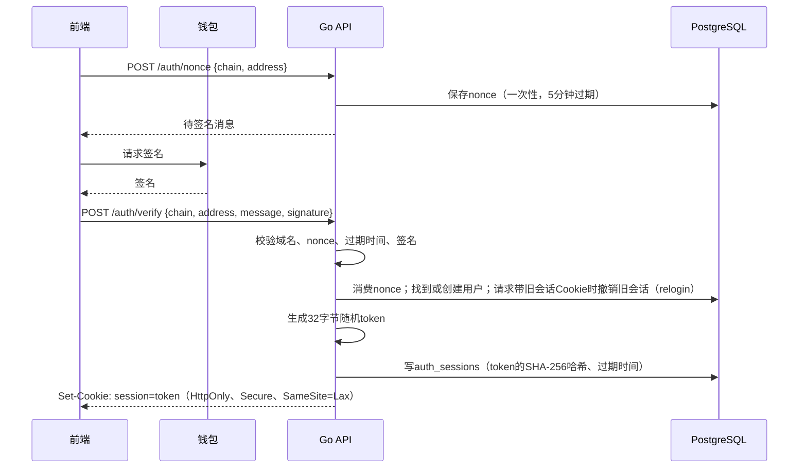
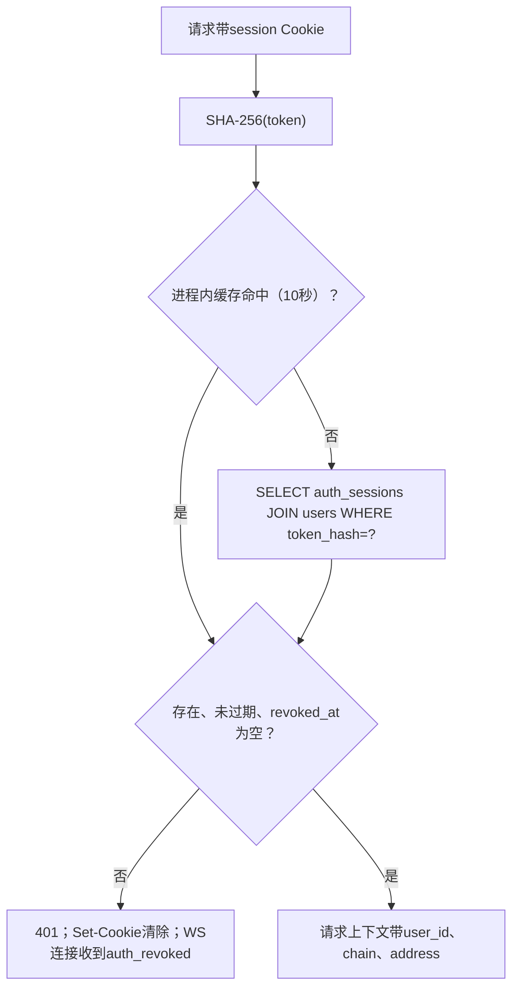
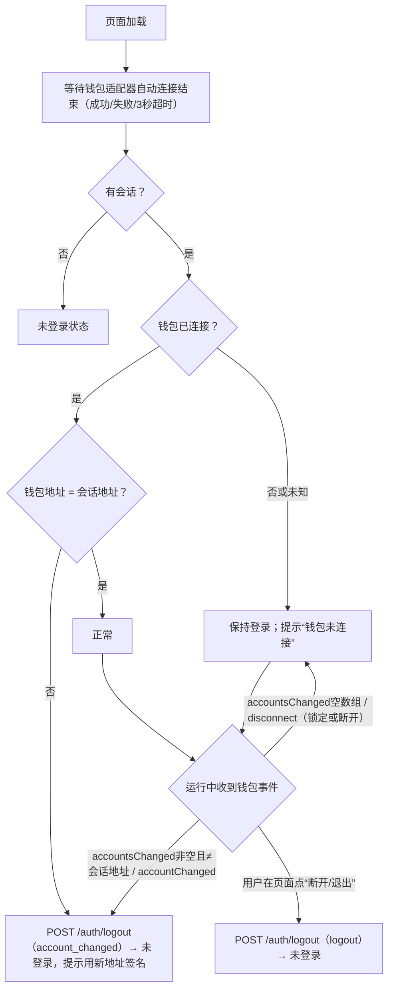
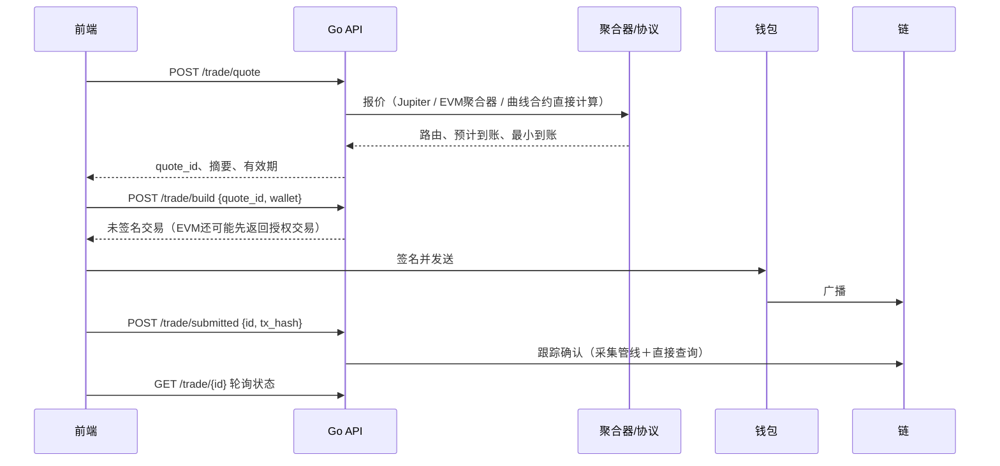
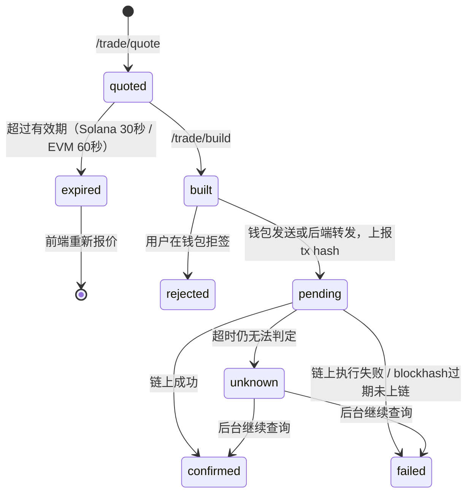

# 登录与交易实现

> 决策D61（钱包签名登录）、D63（非托管交易）、D70（交易广播）、D96–D99（用户id、单钱包用户、会话、提醒保留）。产品规格见[监控](../product/06-tracker.md)、[快捷交易](../product/07-trading.md)。
>
> 演示（真实链上样本＋异常兜底）：[Demo 10 登录与交易](../demos/10-auth-trading.md)。

## 1. 钱包签名登录（M4）

| 链 | 消息格式 | 校验 |
| --- | --- | --- |
| Base / BSC | EIP-4361（SIWE），含domain、address、chainId、nonce、issuedAt、expirationTime | EIP-191恢复签名地址；合约钱包用EIP-1271（`eth_call`调用`isValidSignature`） |
| Solana | Sign In With Solana消息格式（同样含domain、address、nonce、时间） | ed25519验签（标准库`crypto/ed25519`） |

- 会话（D98）：32字节随机token（`crypto/rand`），Cookie只存token原文，`auth_sessions`存SHA-256哈希；不用JWT，没有签名密钥要管理。有效期默认7天。每次登录一行，允许多端同时在线。
- 每次请求：对Cookie中token取哈希 → 按`token_hash`关联`users`一次查出会话与用户（进程内缓存10秒；撤销时同进程立即清缓存，其他实例最多延迟10秒）→ 不存在、已过期或已撤销返回401并清Cookie。
- 失效时机（只撤销本端会话，其他设备不受影响）：

| 触发 | 谁发现 | 处理 |
| --- | --- | --- |
| 用户在页面上点“断开”或“退出” | 前端 | `POST /auth/logout`，`revoke_reason=logout` |
| 钱包切换到另一个地址 | 前端监听：EVM `accountsChanged`（非空且≠会话地址）；Solana `accountChanged` | 调用登出，`account_changed`；新地址需重新签名 |
| 页面关闭期间在钱包里切换了地址 | 前端打开页面、等钱包自动连接结束后比对：已连接且地址≠会话地址 | 调用登出，`account_changed` |
| 本端重新连接钱包登录 | 后端：`/auth/verify`请求带着旧会话Cookie | 撤销旧会话（`relogin`）后签发新token |
| 管理员封禁 | 后端 | 撤销该用户全部未失效会话（`admin`） |

服务端每次请求：

前端钱包事件处理：

- 只监听**登录所用的那条链的钱包**；另一条链的钱包（见[前端§6](14-frontend.md)）只用于交易签名，切换或断开不影响会话。
- 钱包锁定不撤销：MetaMask自动上锁会发`accountsChanged([])`，部分Solana钱包上锁会发`disconnect`，与真正断开无法区分。此时只提示“钱包未连接”，登录保持；需要签名的操作（交易）先要求解锁。
- 页面打开时钱包自动连接是异步的：在适配器结束连接（成功、失败或超时3秒）之前不做地址比对；状态未知时不登出。
- 多标签页：一个标签页登出后经`BroadcastChannel`通知其他标签页切到未登录状态。
- 一个钱包就是一个用户（D97）：不支持绑定多个钱包；换钱包登录即另一个账户，关注、合集等数据不共享。
- 管理员：配置文件中的地址白名单；管理接口每次检查会话用户的地址是否在白名单内。
- 写接口校验`Origin`与站点一致；SameSite=Lax防跨站提交。
- 限流：`/auth/*`按IP每分钟10次；其他用户接口按用户每分钟120次。

## 2. 关注、合集、提醒（M4）

- 数据全部按`user_id`隔离；每个查询都带用户条件，测试覆盖越权访问。
- 上限（初始）：关注500个钱包、合集20个、每合集500个地址（D105）、提醒规则50条。
- 提醒规则：钱包买/卖（可设最小金额）、Token价格涨跌幅、Token出现信号。规则匹配在compute中执行：经济动作提交时按钱包索引查找规则；命中在同一事务写`alert_events`与`event_stream`（`alert.fired`）；`alert_events`永久保留（D99）。
- 关注的钱包不在聪明钱名单中也照常推送其动作（钱包动作对所有已解析地址都有）。

## 3. 快捷交易（M5）

### 3.1 流程

### 3.2 各链实现

| 链 | 曲线阶段 | 毕业后 | 卖出前授权 |
| --- | --- | --- | --- |
| Solana | Jupiter有路由则用Jupiter；否则后端按Pump IDL构造buy/sell指令 | Jupiter Swap API（`/quote`＋`/swap`返回序列化交易） | 不需要 |
| Base | Clanker无曲线，直接走聚合器或Uniswap v4路由 | 聚合器（待选） | 需要ERC20 approve或Permit2 |
| BSC | Four.meme TokenManager2的买卖方法，后端构造calldata | 聚合器（待选）或PancakeSwap路由 | 需要approve |

- 预计到账、最小到账（按滑点）、价格影响、网络费在报价时计算并展示。
- 报价有效期：Solana 30秒（受blockhash有效期限制）、EVM 60秒；过期必须重新报价。
- 优先费/Gas：P1/P2/P3预设保存`priority_fee`或`max_priority_fee`，Solana可选Jito小费（防MEV开关）。BSC防MEV私有RPC待定。

### 3.3 广播（D70）

- 默认由钱包签名并发送（Solana `signAndSendTransaction`、EVM `eth_sendTransaction`），交易走钱包自己的RPC。
- 钱包只支持签名不支持发送时，前端把**已签名交易**提交到`POST /trade/{id}/broadcast`，后端转发到RPC。已签名交易不含私钥，后端也无法修改它。
- 后端从不接收私钥、助记词，也不发起签名请求。

### 3.4 状态跟踪

| 状态 | 判定 |
| --- | --- |
| `pending` | 已提交hash，尚未上链 |
| `confirmed` | 采集管线或直接查询确认成功 |
| `failed` | 链上执行失败；或Solana blockhash已过期且未上链 |
| `unknown` | 90秒仍无法判定；前端提示“请勿重复提交”，后台继续查询 |

本应用发起的交易与采集到的经济动作通过tx hash关联，不重复计入统计。

| 异常 | 判定 | 提示与处理 |
| --- | --- | --- |
| 报价过期 | 超过有效期 | 不允许构造，提示重新报价 |
| 用户拒签 | 钱包返回拒绝 | 结束，不重试 |
| 余额不足 / 授权不足 | 构造前检查余额与allowance | EVM先返回授权交易；余额不足直接提示 |
| 滑点超限 | 链上失败（Solana自定义错误 / EVM revert） | `failed`，提示调高滑点或重新报价 |
| 广播失败 | 钱包或RPC返回错误 | `failed`，可重新报价后再发 |
| 长时间无法判定 | 每2秒查询，90秒仍无结果 | `unknown`，提示“请勿重复提交”，后台继续查询 |
| 重复点击 | 同一quote_id已构造 | 返回同一笔，不重复构造或广播 |

### 3.5 安全

- 报价与构造均校验：Token地址在已支持列表、数量>0、滑点≤50%、接收地址＝当前钱包。
- 前端展示的交易摘要以后端报价为准，签名前钱包会再显示一次。
- 交易接口按钱包与IP限流；所有请求与结果写审计日志（不含签名内容）。
- 第一版不收取平台交易费（D69待定）。

## 4. 验收要点

- 篡改签名、重放nonce、过期消息、错误domain均登录失败。
- 用户A无法读写用户B的关注、合集、提醒。
- 每链小额买入与卖出成功；拒签、滑点超限、余额不足、超时各有明确提示。
- 重复点击不重复构造/广播；`unknown`状态不会引导用户再次提交。
