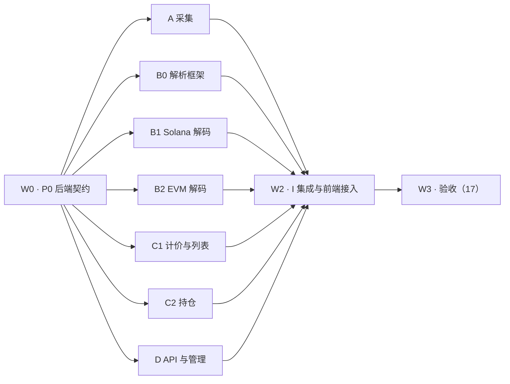

# M1 多 agent 任务卡

> v2（2026-10-19）。范围：[里程碑](11-milestones.md) M1-2 ～ M1-7 后端，以及前端接入真实 API。验收见 [17](17-m1-acceptance.md)。
> 用法：每个 agent 只拿 **§2 公约 + 自己的一张卡**。卡里已经写好接口、表、命令和完成标准，不需要通读文档；“只读”以外的文档和别人的目录不要打开。

## 1. 基线与依赖

**已完成（不要重做）**

| 项 | 位置 | 状态 |
| --- | --- | --- |
| 迁移 `00001`–`00008`（全部 M1 表） | `backend/migrations/` | 已落地，已在本地 Postgres 校验 |
| 后端骨架：config / store（goose 自动迁移）/ httpapi（仅 `/healthz`） | `backend/internal/` | `fmt-check vet build test` 通过 |
| **API 契约**（M1 全部端点） | `api/openapi.yaml` v1.0.0-m1 | Redocly lint 通过，**已冻结** |
| **契约的可执行参考实现**（排序、null、410、限流语义、导入校验） | `frontend/src/mock/`（`handlers.ts`、`inflow.ts`、`csv.ts`） | 11 个契约测试通过 |
| 前端 M1-8 ～ M1-11（资金流入、Token 详情、全局、中英文、管理后台） | `frontend/` | `npm run check` 通过，当前连内置 mock |
| **可观测性基线**：错误码目录、slog JSON、trace-id、`obs.Go/Loop/Supervise`、HTTP 中间件（trace→recover→访问日志）、`writeError`、`lint-go` 守卫、Grafana＋Loki | `backend/internal/obs/`、`internal/httpapi/middleware.go`、`ops/` | 单测覆盖 panic 存活、脱敏、trace 传递、错误码与 openapi 一致；见 [18](18-observability.md) |

**依赖与波次**



W1 的 7 张卡互不依赖代码：都只依赖 P0 冻结的接口、已有迁移和 `testdata`。运行时链路（采集→解析→派生→接口）只在 I 卡接通。

**按人手合并**（同一 agent 按顺序做，卡不变）

| agent 数 | 分配 |
| --- | --- |
| 3 | ① P0 → A → I ② B0 → B1 → B2 ③ C1 → C2 → D |
| 5 | ① P0 → A → I ② B0 → B1 ③ B2 ④ C1 → C2 ⑤ D |
| 8 | 每卡一个；P0 完成后再并行发 W1 |

## 2. 公约（所有 agent 必读，其他通用文档不必读）

1. **分支**：从 P0 合并后的 `main` 拉 `m1/<卡号>-<简述>`，用独立 worktree。
2. **只改自己的目录与迁移号段**（每卡写明）。需要改冻结契约（已有迁移、`internal/domain`、`api/openapi.yaml`）时**停下**，在交接里写“契约变更请求”，不要自己改。
3. **新表/新列只加新迁移**，不改 `00001`–`00009`。
4. **测试先行**：期望值来自卡里给的样本、文档算例或 `backend/testdata/`，不能用实现算出的数当期望。单测不连网；真实 RPC 只在标注的冒烟里跑，每链并发 ≤2。
5. **日志、错误、协程一律走 `internal/obs`**（[18](18-observability.md)，只读 §1–4）：
   - 返回 `obs.New/Field/Wrap(code, …)`，`code` 只能用目录里的；需要新码时写“契约变更请求”。HTTP 处理器用 `server.Handle(pattern, func(w, r) error)`，不要手写错误 JSON。
   - 日志只用 `slog.*Context(ctx, …)`，字段名用 `obs.Key*`；处理具体对象时 `ctx = obs.WithAttrs(ctx, …)`。
   - 不写裸 `go`：一次性用 `obs.Go`，周期任务 `obs.Loop`，常驻 worker `obs.Supervise`（`make -C backend lint-go` 会拦）。
   - 每个错误路径的测试断言 `code`，不断言 message 文案。
6. **未知是 `NULL` / `null`**，不写 0、不写空串。事实表不存美元（D85）；数量用 `NUMERIC(78,0)` 原子单位。
7. **秘密**：RPC Key、admin token 只走环境变量；不进代码、日志、夹具、交接文本。
8. **自检命令**（交接前全部跑过）：

   ```sh
   docker compose up -d postgres
   make -C backend fmt-check vet lint-go build test   # 单测＋裸 go 守卫
   make -C backend test-integration                # 集成测试（P0 提供；必须看到执行条数，不能全 skip）
   make -C backend test-race                        # 有 goroutine 的卡
   git diff --stat main...                          # 只出现自己的目录
   ```

9. **省 token**：先读卡内“只读”章节，再读与本卡直接相关的现有代码；不要通读 `docs/`、`frontend/`、别的卡的目录；不要整文件打印大样本 JSON（用 `jq` 取字段）。发现文档矛盾时写进交接，不要自己改文档。
10. **交接模板**（PR 描述 / 最终回复，照抄填空）：

   ```markdown
   ## 卡号与分支
   ## 完成（对照本卡“完成标准”逐条打勾）
   ## 新增迁移 / 契约变更请求（无则写“无”）
   ## 实际命令与结果（每条命令最后 5 行）
   ## 对账表（卡里要求的）
   ## 未完成 / 未验证 / 文档不一致
   ```

## 3. W0 · P0 后端契约（先做，约半天）

- **只读**：[数据模型 §1、§4.1–4.2](06-data-model.md)、`backend/migrations/00001_*.sql`、`00003_facts.sql`、`docs/demos/samples/` 目录结构。
- **所有权**：`backend/internal/domain/`、`backend/internal/rawview/`、`backend/internal/store/partition/`、`backend/internal/config/`、`backend/Makefile`、`backend/testdata/`、迁移 `00009`。
- **产出**（签名即契约，W1 照此编码）：

  ```go
  // internal/domain
  type Chain string // "solana" | "base" | "bsc"；与库内枚举 chain_id 一致
  type Position struct{ Block int64; Tx int32; Item int32 } // D78，Less() 排序
  func EncodeAddress(c Chain, b []byte) (string, error)   // Solana base58(32B)；EVM EIP-55(20B)
  func DecodeAddress(c Chain, s string) ([]byte, error)    // 非法输入返回 error
  type RawBlock struct{ Chain Chain; Number int64; Hash, ParentHash []byte; Time time.Time; Skipped bool; Payload []byte /* RPC 原始 JSON */ }
  type BlockSource interface { Head(ctx context.Context) (int64, error); Block(ctx context.Context, n int64) (RawBlock, error) }
  type RawStore interface { Put(ctx context.Context, b RawBlock) (objectKey string, err error); Get(ctx context.Context, objectKey string) (RawBlock, error) } // zstd 在实现内部
  // 解码器：纯函数，不碰数据库
  type Decoder interface { Module() string; Version() string; Decode(tx TxView) (Facts, error) }
  type Facts struct{ Trades []Trade; Liquidity []LiquidityEvent; Launches []Launch; Pools []Pool; Migrations []Migration; Fees []Fee }
  ```

  `Trade/LiquidityEvent/Launch/Pool/Migration/Fee` 字段与 `00003_facts.sql`、`00004_entities.sql` 列一一对应（原子数量用 `*big.Int`，地址 `[]byte`，位置 `Position`）。
- **`internal/rawview`**：把 Raw Payload 转成 `domain.TxView`（Solana：签名、位置、成功、手续费、账户表、外层+内层指令、pre/post token 余额、pre/post lamports、logs；EVM：hash、位置、from/to/value、status、gas、logs）。用 `docs/demos/samples/` 每链至少 1 块做表驱动测试。
- **分区工具**：按配置为 LIST(chain)→RANGE(block_num) 的表建子分区（领先链头 2 个区间，D83）；DEFAULT 分区有数据时返回错误。
- **已有、不要重做**：`internal/obs`（错误码、日志、trace、安全协程）、HTTP 中间件、`log.file`/`log.role` 配置、`lint-go`（见 [18](18-observability.md)）。
- **配置**：`config.example.yaml` 增加每链 `rpc_url`（公共端点，D75）、`concurrency`、`rate_limit_rps`、`job_range`(1000)、`partition_size`；秘密只走环境变量；`config_test` 覆盖缺失/非法值。
- **Makefile**：新增 `test-integration`（在 compose 的 Postgres 上建 `radar_test` 库，导出 `RADAR_TEST_DB_URL` 跑 `go test -tags integration ./...`）。无库时 `make test` 打印跳过原因。
- **常量表（07 §4 G10）**：`domain.QuoteAssets`（每链报价资产地址→符号、小数位：SOL/WSOL、USDC、USDT、WETH、WBNB 等）与 `domain.ProtocolNames`（protocol→DEX 显示名）。
- **testdata**：把 `docs/demos/samples/{solana,base,bsc}` 和 `decoded.json` 复制到 `backend/testdata/samples/`，加一个 `README.md` 说明每个文件对应的 Demo 段落。
- **完成标准**：编解码表驱动测试含 32B/20B/非法输入；rawview 每链样本测试通过；分区集成测试证明行落到正确子分区；`make -C backend check` 通过；`git status` 干净后合并 `main`。

## 4. W1 卡（并行）

### A · 三链采集（M1-2）

- **只读**：[采集](02-ingestion.md) 全文、[Demo 01](../demos/01-ingestion.md) §3–5、DECISIONS D21/D47/D71/D73/D74/D81/D83/D87/D104。
- **所有权**：`internal/chain/`（BlockSource 实现）、`internal/rawstore/`（RawStore 本地目录实现）、`internal/ingest/`、迁移 `0010–0019`。
- **表**：`chain_anchors`、`block_jobs`、`raw_blocks`、`collection_progress`、`collection_gaps`、`reorg_events`（已存在，见 `00002_collection.sql`）。
- **做**：Solana `getBlock`（full、`maxSupportedTransactionVersion` 最高）与 EVM 区块＋`eth_getBlockReceipts`；错误分类 retryable / config / not_found / history_unavailable / incomplete；锚点 A（D74 数值）与下界 L 只写一次；`block_jobs` 每 1,000 位置一行、`FOR UPDATE SKIP LOCKED`＋租约；forward 追链头、history 从 A 往 L；连续位置推进 `collection_progress`；重试耗尽写 `collection_gaps`；parentHash 不连续时回溯 ≤64 块找共同祖先、旧块标 orphaned、写 `reorg_events`，并通过 `ingest.OnReorg(func(chain, fromBlock))` 回调通知解析（只定义回调，不实现解析）；预算开关（D104）只做开关与 `budget_paused` 缺口。
- **补表（07 §4 G7）**：`chain_heads`、`rpc_usage`（预算估算按请求数，D104）。
- **不做**：解析、派生、HTTP。
- **完成标准**：`httptest` 回放覆盖 Demo 01 的 5 个错误码、跳过 slot、重组（含共同祖先与 orphaned）、租约过期被他人领取；区间完成条件 `done+skipped+gap = 1000`；真实公共 RPC 冒烟每链 ≤20 块，日志摘要贴交接。

### B0 · 解析框架与归因（M1-3 框架、M1-4）

- **只读**：[解析](03-parsing.md) §2–5、[数据模型 §4](06-data-model.md)、DECISIONS D23/D25/D26/D49/D78/D79/D84/D86/D87。
- **所有权**：`internal/parse/`、迁移 `0020–0024`。
- **做**：按 03 §3.1 流程实现单块循环：读 Raw（只经 `domain.RawStore`）→ `rawview` → 依次调用注册的 `domain.Decoder` → 多跳归并为 `economic_actions` → 归因 confirmed / inferred / ambiguous（需要 trace 的记 inferred 并入 `attribution_tasks`）→ 守恒校验（失败整笔进 `parse_quarantine`）→ 每模块一个事务写事实＋`chain_txs`＋`parse_progress`＋`event_stream`（seq 为空）；失败交易只写 `chain_txs`（D84）；跟踪中 Token 才写 `balance_changes`（D79）；`native_transfers` ≥0.01；按位置区间删除并重解析（供 `ingest.OnReorg` 与解析器升级）。
- **补列（07 §4 G8）**：未知判别码计数持久化（`parse_progress.unknown_discriminators`）。
- **测试方式**：用假 Decoder（返回固定 Facts）＋ `testdata` 里的 Raw，不依赖 B1/B2。
- **完成标准**：同一 Raw 解析两次逐字节一致、重放幂等；守恒失败进隔离表；一个模块失败不阻塞其他模块；重解析区间后行数不翻倍。

### B1 · Solana 解码器（M1-3）

- **只读**：[Demo 02](../demos/02-parsing.md) Solana 段、[解析 §1](03-parsing.md)、`backend/testdata/samples/solana/`、`decoded.json` 的 `solana`。
- **所有权**：`internal/protocol/pump/`、`pumpswap/`、`launchlab/`、`jupiter/`、迁移 `0025–0026`（通常不需要）。
- **做**：实现 `domain.Decoder`（纯函数，不碰数据库）：Pump 曲线买卖与创建、PumpSwap 成交与流动性（**按余额流向判方向**：PumpSwap `Sell` 指令在反向池实为买入）、Raydium LaunchLab 曲线与毕业池迁移、Jupiter 只识别路由并让多跳交给 B0 归并；费用拆分写 `Fee`。
- **完成标准**：`decoded.json` 中 Solana 样本逐字段相等（数量、方向、费用、报价资产），对账表贴交接；未知判别码返回计数不报错；PumpSwap 反向池有专门测试。

### B2 · Base / BSC 解码器（M1-3）

- **只读**：[Demo 02](../demos/02-parsing.md) Base/BSC 段、`backend/testdata/samples/{base,bsc}/`、`decoded.json` 的 `base`、`bsc`。
- **所有权**：`internal/protocol/clanker/`、`uniswapv4/`、`fourmeme/`、`pancake/`、迁移 `0027–0029`。
- **做**：Clanker 发行；Uniswap v4 PoolManager `Swap`/`ModifyLiquidity`（原生 ETH 腿日志不可见时标 inferred，交给 B0 补证）；Four.meme 曲线（含 USDT 报价）与迁移；PancakeSwap v2/v3 成交与多跳。
- **完成标准**：`decoded.json` 中 Base/BSC 样本逐字段相等；Base 聚合器两跳、Four.meme USDT 报价各有专门测试。

### C1 · 计价、K 线与列表投影（M1-5）

- **只读**：[计价](04-pricing.md)、[派生计算 §1–3](13-analytics.md)、[Token 指标](../metrics/token-metrics.md)、[Demo 03](../demos/03-pricing.md)、DECISIONS D53–D56/D85/D89–D91/D105。
- **所有权**：`internal/pricing/`、`internal/compute/`、迁移 `0030–0035`。
- **输入**：用 SQL 夹具直接写 `pool_trades`、`liquidity_events`、`pools`、`tokens`（不依赖 B）。
- **做**：`quote_asset_prices` 每分钟成交量加权（D54：>5 分钟 stale、>30 分钟不输出）；主池（D55：1 小时平均流动性领先 20% 持续 10 分钟才切，毕业立即切，写 `token_main_pool_history`）；K 线 6 周期（1m/5m/1h/1d → `candles`，1s/30s → `candles_hf` 24 小时）；`token_minute_stats`、`sm_minute_stats`（按名单版本）、`token_window_current`（5 个窗口，含 20 点 sparkline）每 5 秒增量；`compute_progress` 取事实模块水位最小值；`recompute_jobs` 替换不叠加。
- **补表（07 §4 G1–G4）**：`pool_minute_stats`、`pool_state`、ATH 两列、`sm_chain_minute_stats`；D55 主池用 `pool_minute_stats.liquidity_usd` 的 1 小时均值。
- **列表口径**：`token_window_current` 的列必须足够 D 卡直接出 `InflowRow`（见 `api/openapi.yaml` 的 `InflowRow`、`OverviewResponse`、`WindowSummary`）；缺列加新迁移。
- **完成标准**：Demo 03 的 SOL 105.247 / ETH 2,454.07 / BNB 729.40 与 Pump、Four.meme 市值复算一致（贴对账表）；主池切换三情形测试；多池 Token 合计（D56）；窗口统计与独立 SQL 一致；重算后行数不翻倍。

### C2 · 持仓与持有人（M1-6）

- **只读**：[持仓](05-holdings.md)、[Demo 04](../demos/04-holdings.md)、DECISIONS D42/D43/D46/D79/D107。
- **所有权**：`internal/holding/`、迁移 `0036–0039`。
- **输入**：SQL 夹具写 `balance_changes`、`tokens`。
- **做**：采集范围内创建的 Token 从创建块重放余额（D107）；更早的 Token 余额为未知并标 partial；`holdings`、`holding_baselines`、持有者数；未知不当 0；重组重算。
- **完成标准**：Demo 04 样本余额对上；partial / full 两种覆盖各有测试；持有者数与独立 SQL 一致。

### D · API 与管理后端（M1-7 后端、M1-8/9 接口）

- **只读**：`api/openapi.yaml`（**唯一契约**）、[API](07-api.md)、`frontend/src/mock/handlers.ts`、`inflow.ts`、`csv.ts`（行为参考：排序 null 最后、相同值按 Token ID、min/max 排除 null、410、导入校验与拒收密钥）、DECISIONS D28–D30/D57/D92/D106。
- **所有权**：`internal/httpapi/`、`internal/smartmoney/`（仅导入与名单版本）、迁移 `0040–0049`。
- **输入**：SQL 夹具写派生表与名单表（不依赖 C）。
- **补表（07 §4 G5/G6/G9）**：`smart_money_imports`；`smart_money_members.added_at`；导入 tags 写 `wallet_labels`；1m/5m 概览柱图直接聚合 `economic_actions`；`label_counts` 按 07 §4 的定义。
- **做**：路由一律 `server.Handle(pattern, func(w, r) error)`，错误返回 `obs.Error`（trace、recover、访问日志、错误 JSON 已由中间件提供，`/` 兜底 404 已注册）；契约内全部 M1 端点；资金流入快照（前 2,000 ID 进程内 LRU、TTL 10 分钟、`query_id`+`offset`、410、查询 >2 秒 503+`Retry-After`、单 IP 每分钟 60 次新查询 429）；`/tokens/batch` 可见行刷新；K 线 1s/30s 超 24 小时从 `pool_trades` 现算；搜索 pg_trgm；管理端 `RADAR_ADMIN_TOKEN`（Bearer、常量时间比较、未配置也 403）；导入生成新名单版本、合并不翻倍；地址 base58 / EIP-55；金额十进制字符串；响应头不加 `x-radar-mock`。
- **完成标准**：契约测试——每个端点的响应用 `kin-openapi` 按 `api/openapi.yaml` 校验通过；翻页期间数据变化不重不漏；410/503/429 用例；导入两次＋自动识别不翻倍；`/healthz` 不受影响；`curl` 示例贴交接。

## 5. W2 · I 集成与前端接入

- **只读**：各卡交接、[架构 §2](01-architecture.md)、`frontend/README.md`。
- **所有权**：`backend/cmd/radar/`、根 `Makefile`、`docker-compose.yml`、`frontend/next.config.ts` 与 `frontend/e2e/`（不改页面组件；页面问题记交接退回）。
- **做**：`cmd/radar` 按角色启动 ingest / parse / compute / api（可同进程）；接 `ingest.OnReorg` → B0 重解析；空库从近期链头采每链约 30 块跑通；前端以 `RADAR_API_ORIGIN=http://localhost:8080 npm run build` 连真实 API，`npm run test:smoke` 通过（依赖 mock 数据的断言改为结构断言）。
- **完成标准**：三链各有 Token 在资金流入与详情页可见（截图）；`make check` 全绿；记录实测积压与缺口。

## 6. 退回规则

验收（17）发现问题时只退回对应卡；修复仍在原分支、原目录内完成，交接里标“返工第 N 次”。
