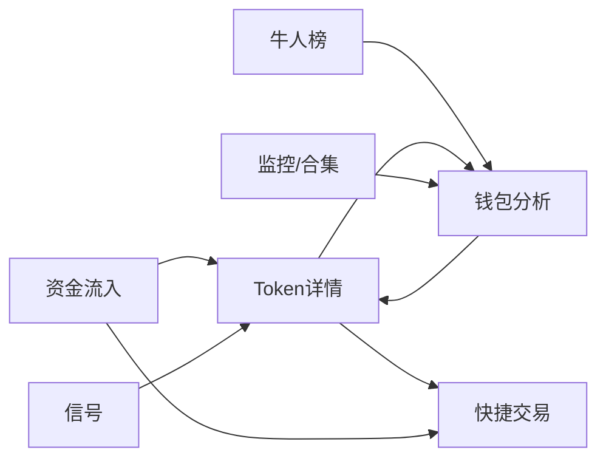

# 产品总览：页面地图与全局规则

> 决策见[DECISIONS](../DECISIONS.md)。页面结构与交互见各页规格（D11），视觉为像素风终端（D108）。

## 1. 页面地图

| 页面 | 路由 | 里程碑 | 规格 |
| --- | --- | --- | --- |
| 资金流入 | `/smart-money/inflow` | M1 | [01](01-inflow.md) |
| 信号 | `/smart-money/signals` | M3 | [02](02-signals.md) |
| 牛人榜 | `/smart-money/leaderboard` | M2 | [03](03-leaderboard.md) |
| Token详情 | `/token/{chain}/{address}` | M1基础、M3标签 | [04](04-token-detail.md) |
| 钱包分析 | 弹窗＋`/wallet/{chain}/{address}` | M2 | [05](05-wallet-analysis.md) |
| 钱包监控/合集/关注 | 浮层＋`/trackers` | M4 | [06](06-tracker.md) |
| 快捷交易 | 列表“操作”列、详情右侧面板 | M5 | [07](07-trading.md) |
| 管理后台 | `/admin/*` | M1 | [08](08-admin.md) |

页面关系：

## 2. 全局布局

- **顶部导航**：Logo、搜索框（代币/钱包地址）、连接钱包按钮、语言切换（简体中文 / English，B11）、设置。
- **二级导航**：资金流入 / 信号 / 牛人榜 三个页签共享链选择。
- **链选择**：全部 / Solana / Base / BSC，写入URL；切链重置筛选与分页。
- **底部栏**：SOL、BNB、ETH主流币实时价格；钱包监控、观察列表入口（M4）。
- **全局搜索**：输入合约或钱包地址，返回Token与钱包候选，显示链与地址；输入名称返回同名候选列表，名称相同不合并。

## 3. 全局展示规则

| 规则 | 说明 |
| --- | --- |
| 语言 | 简体中文与英文；文案全部来自翻译文件，不在组件里写死（B11） |
| 计价 | 默认美元；设置里可切换原生币（D53）。中文界面≥1万显示“万”、≥1亿显示“亿”；英文界面用K/M/B |
| 涨跌颜色 | 涨绿跌红；同时用+/-号，不只靠颜色 |
| 时间 | 币龄用相对时间（12d、3mo、23h39m）；悬停显示UTC与本地时间 |
| 地址 | 前4后4缩写，带复制按钮和区块浏览器外链 |
| 数据状态 | 加载中、已知为0、未知（显示“--”）、过期（灰色＋提示）分开；未知不显示为0 |
| 刷新 | M1–M3列表每10秒REST刷新当前页（不打乱当前排序，只更新数值）；M4起改为WS推送（D62） |

## 4. 第一版不做的部分

交易所类功能（现货/合约、充值、活动、新人奖励、地区横幅）。气泡图、AI洞察、安全检测按D65放在M5之后单独评估来源。
