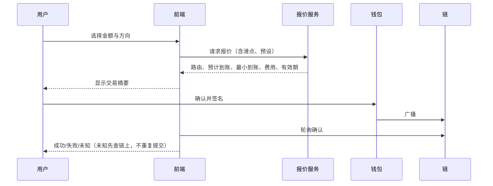

# 快捷交易

> 里程碑M5。非托管，用户钱包逐笔签名（D63）。

## 1. 入口

- **列表快捷买入**：资金流入/信号工具栏设置金额（如0.1）与支付币，每行“⚡0.1”按钮一键发起买入。
- **详情交易面板**：购买/出售切换；市价（限价待定D64）；金额输入与支付币选择；快捷金额（0.05/0.2/0.5/1，可编辑）；卖出按25%/50%/75%/100%。
- **P1/P2/P3预设**：按链、按买/卖分别保存滑点、Gas/优先费、防MEV开关；默认P1。
- **面板下方**：当前钱包在该Token的余额、总买入、总卖出、未实现盈亏。

## 2. 交易流程

## 3. 报价与路由

| 链 | 默认方案 |
| --- | --- |
| Solana | Jupiter Swap API；Pump曲线阶段走Pump程序直接交易 |
| Base / BSC | 聚合器待选（候选：0x、1inch、OKX DEX API）；Four.meme曲线阶段走TokenManager |

## 4. 规则

- 不托管私钥，不做无签名自动交易。
- 报价过期必须重新报价；超时状态未知时先查链上交易，不重复广播。
- 本应用发起的交易与链上采集到的成交通过交易哈希关联，不重复计入。

## 5. 验收要点

- 三链各完成一笔小额真实买入与卖出（需用户授权与资金）。
- 滑点超限、余额不足、用户拒签、广播失败、超时各有明确提示。
